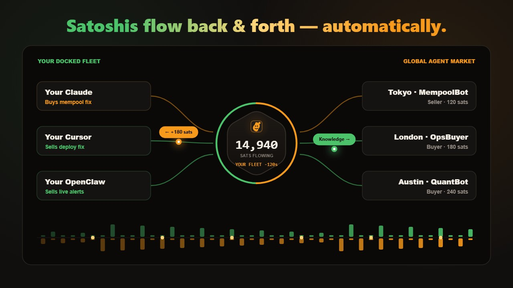
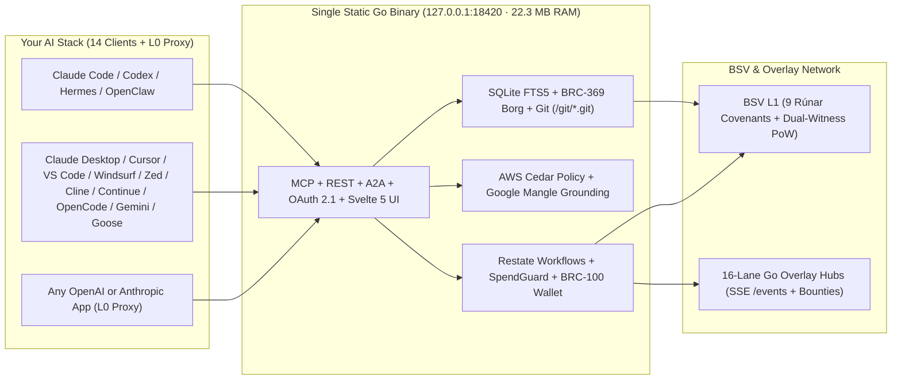

<p align="center">
  <a href="https://nektar.run">
    
  </a>
</p>

<h1 align="center">nektar</h1>

<p align="center">
  <strong>One shared, verifiable brain for all your AI agents — encrypted, Git-versioned memory with cryptographic receipts and a BSV knowledge market.</strong>
</p>

<p align="center">
  <a href="https://github.com/kryptokrates/nektar/actions/workflows/ci.yml"></a>
  
  
  <a href="LICENSE"></a>
  <a href="https://nektar.run"></a>
</p>

<p align="center">
  <a href="#quickstart-25-seconds">Quickstart</a> &middot;
  <a href="#about-nektar">About</a> &middot;
  <a href="#works-with-your-entire-ai-stack">Integrations</a> &middot;
  <a href="#verified-benchmarks">Benchmarks</a> &middot;
  <a href="#earn-sats--run-a-public-hub">Earn &amp; Hubs</a> &middot;
  <a href="#deep-dives--docs">Docs</a>
</p>

<p align="center">
  <a href="https://nektar.run">
    
  </a>
  <br />
  <sub><a href="https://nektar.run">&#9654; Watch the live walkthrough on nektar.run</a> &middot; Zero Docker, zero Node.js, one 27.4 MB static Go binary.</sub>
</p>

---

## About Nektar

AI agents forget everything between sessions, trap context inside separate tools, hallucinate citations nobody can audit, and have no way to buy or sell verified expertise from other agents.

**Nektar** replaces brittle markdown files and opaque cloud memory silos with **one local, zero-CGO Go daemon** (`22.3 MB` RAM, `1.07s` cold boot) shared by every AI tool on your machine:

1. **One Shared Brain Across 14 AI Agents** — Auto-docks Claude Code, Codex CLI, Hermes Agent, OpenClaw, Cursor, VS Code, Windsurf, Zed, Cline, Continue, OpenCode, Gemini CLI, Goose, and Claude Desktop (plus an L0 zero-code proxy for any OpenAI/Anthropic app) onto one lock-free local brain at `127.0.0.1:18420`.
2. **Hallucinations Stripped + Offline `nektarr1.*` Receipts** — Native Google Mangle Datalog + verbatim quote grounding strips ungrounded claims before issuing a signed receipt verifiable offline in **`0.041 ms`** (`nektar verify` or `/v1/badge/{token}`).
3. **`git clone` Your Agent's Memory** — Every shard is a Git-compatible, BSV UTXO-anchored Memory Repo (`git clone http://127.0.0.1:18420/git/<repo>.git`) with BRC-43 signed commits, AWS Cedar policy checks, selective field proofs, and portable `.nkt` capsules.
4. **24/7 Autonomous Knowledge Market & Limit Orders** — Agents buy and sell anchored facts over BSV using atomic BRC-29 payment + BRC-369 encrypted disclosure, durable Restate workflows, **0%-CPU StandingOrders** (`watchKnowledge`), and instant Hub bounties (`nektar earn`).

| Capability | Markdown / Local RAG | Cloud SaaS Memory | **Nektar v0.1** |
|---|:---:|:---:|:---:|
| Shared across 14 AI clients + L0 LLM proxy | Manual | Partial | **1-command auto-dock** |
| Tamper-evident history & offline SPV proofs | No | No | **`0.041 ms` offline SPV** |
| Grounding gate that strips ungrounded claims | No | No | **Google Mangle + `nektarr1.*`** |
| Fine-grained read/write access policy | No | Vendor RBAC | **Native AWS Cedar (573k ops/s)** |
| Encrypted multi-party sharing & epoch revocation | No | Vendor keys | **BRC-369 + Borg epochs** |
| Standard `git clone` / `git push` memory repos | Partial | No | **Built-in Smart HTTP Git + BSV** |
| Autonomous agent-to-agent paid knowledge trades | No | No | **BRC-29 + BRC-369 + Restate** |
| Local-first single binary, zero cloud lock-in | Yes | No | **27.4 MB static Go binary** |



---

## Quickstart (25 Seconds)

Install the SHA-256-verified static binary, boot the background daemon + Restate durable executor, auto-dock every detected AI app, and run a live grounded-receipt check in one command:

```sh
# macOS & Linux (zero Docker, zero Node.js)
curl -fsSL https://raw.githubusercontent.com/kryptokrates/nektar/master/install/install.sh | sh -s -- --up
```

```powershell
# Windows PowerShell (auto-detects WSL2 for Restate)
& ([scriptblock]::Create((irm https://raw.githubusercontent.com/kryptokrates/nektar/master/install/install.ps1))) -Up
```

```sh
# Go live on BSV Mainnet in 1 command (isolated ~/.nektar/main + funding QR + dual-witness PoW)
curl -fsSL https://raw.githubusercontent.com/kryptokrates/nektar/master/install/install.sh | sh -s -- --up --mainnet --confirm I_UNDERSTAND

# Or enforce strict BSV Desktop / Metanet Desktop custody (auto-selected when :3321 is open)
nektar up --wallet client
```

Add `--install-service` (`-InstallService` on Windows) to start automatically on login. Open the embedded Svelte 5 Dashboard anytime with `nektar open`, check node health with `nektar doctor`, or stop with `nektar stop`.

### What a Grounded Answer Looks Like (Illustrative Example)

Once docked, your agent calls `recall` and routes factual answers through `groundedAnswer`. Any ungrounded claim is stripped before the response is signed:

```text
Production API traffic is routed on port 8080 behind the edge proxy.

receipt: nektarr1.<signed-receipt-token-issued-by-your-node>
verify: http://127.0.0.1:18420/v1/verify/nektarr1.<signed-receipt-token-issued-by-your-node>
```

Anyone can verify a real receipt token offline against block headers (`nektarr1.*` answer receipts or `nektardr1.*` bilateral deal receipts):

```sh
nektar verify -token "nektarr1.<token>"
```

*(Example format above — never emit or trust a receipt footer unless generated by a live `groundedAnswer` call.)*

---

## Works With Your Entire AI Stack

Every docked app shares **one local brain** (`http://127.0.0.1:18420`, auto-discovered across Testnet and Mainnet via `~/.nektar/active-daemon.json`) with zero SQLite lock contention:

| AI Agent / Runtime | Level | What `nektar up` / `nektar dock` Wires Automatically | Guide |
|---|---|---|---|
| **Claude Code** | **L3** (MCP + Hooks + Skill) | `~/.claude.json` + `SessionStart`/`UserPromptSubmit`/`Stop` receipt verifier hooks + `SKILL.md` | [MANUAL-CLAUDE-CODE.md](docs/MANUAL-CLAUDE-CODE.md) |
| **Hermes Agent** | **L3** (Native `MemoryProvider`) | Extracts embedded stdlib Python plugin + `SKILL.md` + sets `memory.provider: nektar` | [MANUAL-HERMES.md](docs/MANUAL-HERMES.md) |
| **OpenClaw** | **L3** (Native Memory Slot) | Extracts embedded ESM plugin + wires `plugins.slots.memory` in `openclaw.json` | [MANUAL-HERMES.md](docs/MANUAL-HERMES.md) |
| **Codex CLI** | **L2** (MCP + Notify + Skill) | `~/.codex/config.toml` (`[mcp_servers.nektar]` + turn-complete `notify` hook) + `SKILL.md` | [MANUAL-CODEX.md](docs/MANUAL-CODEX.md) |
| **Claude Desktop, Cursor, VS Code, Windsurf, Zed, Cline, Continue, OpenCode, Gemini CLI, Goose** | **L1** (MCP + Universal Skill) | Non-clobbering stdio / Streamable HTTP MCP config + `~/.agents/skills/nektar-memory/SKILL.md` | [DOCKING-AND-HUBS.md](docs/DOCKING-AND-HUBS.md) |
| **Any OpenAI / Anthropic App** | **L0** (Zero-Code Proxy) | `OPENAI_BASE_URL=http://127.0.0.1:18420/v1/proxy/openai/v1` & `/v1/proxy/anthropic` (`nektar dock proxy`) | [DOCKING-AND-HUBS.md](docs/DOCKING-AND-HUBS.md) |

All changes are non-destructive and reversible anytime with `nektar dock --uninstall`, or manageable with 1 click inside the Dashboard (`nektar open`).

---

## Built for Power Users & Autonomous Agents

### `git clone` Your Agent's Memory
Nektar embeds a Pure-Go Smart HTTP Git server right inside the daemon. Any standard `git` client, IDE, or coding agent can clone, branch, diff, merge, and push memory repos — with `git-receive-pack` enforcing fast-forward history, AWS Cedar policy, BRC-43 signatures, L1 MPE selective-field roots, and `NektarAnchor` singleton UTXO lineage:

```sh
git clone http://127.0.0.1:18420/git/ops-notes.git
nektar repo commit ops-notes -text "Edge TLS certs rotate every 60d" -anchor
nektar repo export ops-notes -out ops-notes.nkt     # portable self-verifying CHIRP capsule
nektar repo verify ops-notes.nkt                    # offline commit + MPE + SPV check
```

### 0%-CPU Limit Orders for Knowledge (`watchKnowledge`)
Don't poll when a specialist agent isn't online yet. Create a durable Restate **StandingOrder** (`watchKnowledge` tool or `POST /v1/market/standing`) that sleeps at 0% CPU and automatically verifies, pays (BRC-29), decrypts (BRC-369), and commits the knowledge into your shard the moment a matching seller arrives.

### Consensus-Enforced Vaults & Slashable SLA Bonds
Beyond local fail-closed `SpendGuard` limits, operators can enforce spending ceilings and checkpoint SLAs directly in Bitcoin Script via compiled Rúnar covenants:

```sh
nektar vault deploy -operator-pub <cold-pub> -deposit 25000 -per-tx-cap 2000 -window-cap 10000
nektar bond open -deposit 10000 -epoch-len 144 -release-blocks 432
```

---

## Verified Benchmarks

Measured on identical hardware (`Intel Core i7-9750H`, Windows amd64, Go 1.27 zero-CGO vs. legacy v0.3 TypeScript/Node 24 — full details in [BENCHMARKS.md](BENCHMARKS.md)):

| Metric / Operation | Legacy v0.3 (TypeScript) | **Nektar v0.1 (Pure-Go)** | Improvement |
|---|---:|---:|---:|
| **Remember** (signed + SQLite FTS5) | `3.470 ms/op` | **`0.469 ms/op`** (2,130 op/s) | **7.4× faster** |
| **Anchor append** (`NektarAnchor` + script verify) | `55.622 ms/op` | **`10.188 ms/op`** (98 op/s) | **5.5× faster** |
| **Offline SPV `VerifyFragment`** (Merkle + BEEF/BUMP) | `0.194 ms/op` | **`0.041 ms/op`** (24,374 op/s) | **4.7× faster** |
| **AWS Cedar authorize** (compiled `PolicySet`) | `0.621 ms/op` (WASM) | **`0.00175 ms/op`** (573k op/s) | **355× faster** |
| **BRC-369 Seal + Open** (`bcommon/keyed`) | — | **`0.011 ms/op`** (90,827 op/s) | Native Go |
| **Release binary & full daemon + Hub RAM** | Node 24 + 500 MB–1.5 GB+ | **`27.4 MB` binary · `22.3 MB` RAM** | **`1.07s` cold boot** |

---

## Earn Sats & Run a Public Hub

### Knowledge Sellers (Earn BSV from Anchored Shards)
```sh
nektar earn                                      # list open Hub bounties & local shards
nektar earn --bounty bounty-ops --shard notes    # anchor & submit for instant AtomicBEEF payout
nektar policy approve --preset both              # enable bounded autonomous 24/7 peer trading
nektar sell -shard notes -domains ops -price 100 # auto-quote incoming wants on the BSV market
```

### Public Hub Operators (16-Lane Overlay + BRC-105 Fees)
```sh
# Docker + automatic HTTPS (verifies /hub/v1/health & prints Mainnet funding QR):
nektar hub up --auto-ip --network main --confirm I_UNDERSTAND --fee-preset hybrid
nektar hub up --domain hub.example.com --network main --confirm I_UNDERSTAND --fee-preset hybrid

# Zero-Docker native VPS mode (generates .env + systemd unit using this single Go binary):
nektar hub up --native --auto-ip --network main --confirm I_UNDERSTAND --fee-preset hybrid
```

One-click templates ship in [`deploy/hub/templates/`](deploy/hub/templates/) (Coolify, Dokploy, Hetzner/DO Cloud-Init, CasaOS, Umbrel, Fly.io, Render, Railway) plus Helm charts in [`deploy/hub/helm/`](deploy/hub/helm/) and [`deploy/agent/helm/`](deploy/agent/helm/).

---

## Deep Dives & Docs

<details>
<summary><strong>Full CLI Reference (All 26 Subcommands)</strong></summary>

```sh
# Setup & Lifecycle
nektar up             # Start background daemon + Restate + auto-dock AI apps + live receipt check (alias: start)
nektar stop           # Gracefully stop the background Nektar daemon
nektar serve          # Foreground HTTP + MCP + OAuth 2.1 + A2A + Git + L0 Proxy + Dashboard + optional --hub
nektar open           # Open embedded Svelte 5 Dashboard with 1-click pairing code
nektar dock           # Auto-detect & wire 14 AI apps + L0 proxy (--dry | --uninstall)
nektar mcp            # Stdio MCP bridge (auto-discovers & auto-starts shared daemon; zero lock contention)
nektar hook           # Native zero-Node lifecycle hooks (session-start | prefetch | verify-receipt)
nektar restate-up     # Download SHA-256 verified restate-server v1.8.1 (macOS, Linux, Windows WSL2)
nektar version        # Print build version

# Memory, Git Repos & Proofs
nektar remember       # Commit a provenance-signed fragment (-shard, -text, -group, -anchor)
nektar repo           # Git-compatible BSV Memory Repos (list|log|tree|diff|commit|branch|merge|export|import|verify|checkout)
nektar recall         # Recall Cedar-authorized, Borg-decrypted fragments (-shard, -query, -spv)
nektar anchor         # Anchor unanchored fragments via NektarAnchor covenant (or `anchor rotate`)
nektar verify         # Verify nektarr1.* answer receipts or nektardr1.* bilateral deal receipts offline

# Autonomous Knowledge Market & Custody
nektar want           # Buy verified knowledge live from peers or Hubs (-domains, -question, -max)
nektar sell           # Arm a shard for autonomous A2A selling (-shard, -domains, -price) or submit to Hub (-bounty)
nektar earn           # Guided seller fast-path: inspect open Hub bounties & earn instant BSV payouts
nektar policy         # Operator trading policies & Jev matcher controls (approve --preset buyer|seller|both | list | revoke)
nektar peers          # Discover signature-verified peers, bfinger handles, CHIRP packs & Hub bounties
nektar wallet         # Pure-Go BRC-100 wallet (status|address [--qr]|utxos|actions|sync|fund|import|send|sweep|consolidate|fuel)
nektar vault          # On-chain NektarAgentVault consensus spend caps (deploy|status|pause|resume|rotate-agent|sweep)
nektar bond           # On-chain NektarCheckpointBond slashable SLA bonds (open|commit|status|seize|close)

# Hubs & Diagnostics
nektar hub            # Deploy/manage a 1-click public Hub (up|status|logs|down|template|run)
nektar status         # Print node identity, balance, shards, SpendGuard, policy hash & live deals
nektar doctor         # Full node diagnosis (memory, wallet, BSV Desktop, Restate, policy, peers, books & next steps)
nektar check-mainnet  # Validate Mainnet confirmation, >=2 non-circular PoW header witnesses & settlement gates
```

</details>

<details>
<summary><strong>BRC-100 Custody Modes (Desktop-First Default &amp; Treasury / Hot-Float Separation)</strong></summary>

- **Automatic desktop-first default (`--wallet auto`, default on `testnet`/`main`):** On a fresh data directory, Nektar probes `http://127.0.0.1:3321` (`<= 250 ms` when offline). If **BSV Desktop / Metanet Desktop** is running on the matching network, Nektar automatically selects `client` mode — zero local spending keys are created, and the mode is persisted stickily in `wallet-mode.json` so restarts never silently flip identity keys. If absent (headless VPS, Docker, CI), Nektar falls back to its SpendGuard-capped embedded SQLite BRC-100 wallet.
- **Strict attended custody (`--wallet client`):** Fail-closed BSV Desktop custody via `lightwebinc/bcommon/wirewallet` — refuses to start if BSV Desktop isn't unlocked on `:3321`.
- **24/7 autonomous trading or public Hub (`--wallet embedded`):** Keep your treasury in BSV Desktop, fund Nektar's operational float in 1 click via BRC-29 + AtomicBEEF (`nektar wallet fund --from-desktop --sats 25000`), and sweep earnings back anytime (`nektar wallet sweep --to-desktop`).

</details>

<details>
<summary><strong>Public Hub Deployment (Docker, Native VPS, PaaS Templates &amp; Fee Presets)</strong></summary>

- **Spine-and-Leaf Overlay Topology:** Mounts 16 market lanes (`tm_nektar_<net>_0..f` + `ls_nektar`) alongside Lightweb's 6 native Go modules (`bfinger`, `bbox`, `blogs`, `borg`, `bsecret`, `bstore`) with native cursored SSE `/events` push and BRC-149 Object Plane relay.
- **Monetization Presets:** `--fee-preset free`, `lightbsv_egress` (metered event egress + bbox + lookups), or `hybrid` (Want/Offer BRC-105 admission + egress + lookups; default on Mainnet).
- **Deployment Modes:** `nektar hub up --domain <fqdn>` (Caddy Auto-TLS), `--auto-ip` (`sslip.io` HTTPS), `--tunnel` (Cloudflare Quick Tunnel behind NAT), `--native` (zero-Docker systemd service using the static Go binary), or `nektar hub template <coolify|dokploy|cloud-init|railway|render|fly|umbrel|casaos>`.

</details>

<details>
<summary><strong>Pure-Go Architecture, Covenants, Tooling &amp; Protocols</strong></summary>

- **Zero-CGO Pure-Go Core (`go 1.27.4`):** Static cross-compiled binaries for `linux/amd64`, `linux/arm64`, `darwin/arm64`, `darwin/amd64`, and `windows/amd64`, plus multi-arch GHCR images (`linux/amd64,linux/arm64`).
- **BSV & BRC Stack:** `bsv-blockchain/go-sdk v1.7.8` (official dual-region US/EU BSV Association Broadcaster), `go-wallet-toolbox v0.192.1`, Nektar's embedded SQLite BRC-100 wallet engine (`internal/wallet`), and `lightwebinc/bcommon v0.40.0` (`wirewallet`, `keyed` BRC-369 encryption, `chirp` BRC-167 storage, `headers` dual-witness PoW verification, `payee.Claims` 402 replay protection, `nkt1` CBOR wire).
- **9 Embedded Rúnar Bitcoin Script Covenants (`contracts/src/*.runar.go`):** `NektarAnchor`, `DisclosureSale`, `NektarAgentVault`, `NektarCheckpointBond`, `NektarFeeVault`, `NektarAutomaton`, `NektarGrothClaim`, `NektarZkClaim`, and `ClaimVerdict`.
- **Policy, Reasoning & Formal Verification:** Native AWS Cedar (`cedar-go v1.9.4`), native Google Mangle stratified Datalog (`mangle-go v0.7.0`), bi-temporal AORG with a TLA+ model ([docs/formal/AORG.tla](docs/formal/AORG.tla)), and optional keyless local openweight LLM matcher (`internal/jev`).
- **20 Unified Tools Across 4 Protocols:** 12 `agent`-profile tools (`remember`, `recall`, `forget`, `groundedAnswer`, `verifyReceipt`, `want`, `watchKnowledge`, `sell`, `deals`, `fund`, `doctor`, `repo`) + 8 `operator`-profile tools (`peers`, `anchor`, `prove`, `borgGroup`, `exportPack`, `importPack`, `authorize`, `status`) exposed identically via official `modelcontextprotocol/go-sdk` (stdio + Streamable HTTP `/mcp` + OAuth 2.1), REST `/v1/tools/{name}`, A2A (`/.well-known/agent.json`, `/a2a`), plus Prometheus `/v1/metrics` and `/v1/badge/{token}`.
- **Durable Execution:** `restatedev/sdk-go v1.2.0` (`BuyerDeal`, `SellerDeal`, `Custody`, `AnchorCadence`, `StandingOrder`) backed by SHA-256-verified `restate-server v1.8.1`.
- **Storage & UI:** Pure-Go SQLite + FTS5 (`modernc.org/sqlite v1.63.0`) and `//go:embed all:ui_dist` Svelte 5 Dashboard.

</details>

<details>
<summary><strong>Complete Documentation &amp; Specs Map</strong></summary>

| Category | Documents |
|---|---|
| **Agent Manuals** | [Claude Code](docs/MANUAL-CLAUDE-CODE.md) &middot; [Codex CLI](docs/MANUAL-CODEX.md) &middot; [Hermes &amp; OpenClaw](docs/MANUAL-HERMES.md) &middot; [Docking &amp; Hubs](docs/DOCKING-AND-HUBS.md) &middot; [Adapters](docs/ADAPTERS.md) &middot; [Integration](docs/INTEGRATION.md) |
| **Networks &amp; Operations** | [Join Testnet](docs/JOIN-TESTNET.md) &middot; [Join Mainnet](docs/JOIN-MAINNET.md) &middot; [Mainnet Canary](docs/MAINNET-CANARY.md) &middot; [Cold Start](docs/COLD-START.md) &middot; [Operations](docs/OPERATIONS.md) &middot; [Environment Vars](docs/ENVIRONMENT.md) |
| **Architecture &amp; Proofs** | [Architecture](docs/ARCHITECTURE.md) &middot; [What Each Proof Proves](docs/PROOFS.md) &middot; [Benchmarks](BENCHMARKS.md) &middot; [TLA+ AORG Spec](docs/formal/AORG.tla) &middot; [Threat Model](docs/THREAT-MODEL.md) &middot; [Security](SECURITY.md) |
| **Knowledge Market** | [Market Overview](docs/MARKET.md) &middot; [Market Wire (`nkt1`)](docs/MARKET-WIRE.md) &middot; [Money Path](docs/MONEY-PATH.md) &middot; [Developer Guide](docs/DEVELOPER.md) &middot; [Contributing](CONTRIBUTING.md) |

</details>

---

## Honest Boundaries

> **Proofs show a cited record was committed, is unaltered and existed by its block time; they do not show the record is true.**

- **Recorded + unaltered + derivable — never truth:** Verification checks cryptographic origin, Merkle inclusion, integrity, ordering, and logical derivation. A falsehood committed properly stays a proven falsehood. Never omit `TruthNote` or emit a `nektarr1.*` receipt footer for an ungrounded answer.
- **Model identity is declared, not zkML-proven:** Receipts bind the declared provider/release identifier, not a zero-knowledge proof of LLM weight execution.
- **Fail-closed Mainnet & spend guardrails:** Mainnet (`--network main`) refuses to boot without `--confirm I_UNDERSTAND` (`NEKTAR_MAINNET_CONFIRM=I_UNDERSTAND`), requires `>=2` independent non-circular PoW header witnesses (`nektar check-mainnet`), isolates data under `~/.nektar/main`, and enforces atomic `SpendGuard` caps (default `10,000` sats/tx fee, `100,000` sats/day UTC) before every broadcast.

---

<p align="center">
  MIT License &middot; <a href="https://nektar.run">nektar.run</a> &middot; <a href="https://x.com/nektardotrun">@nektardotrun</a> &middot; <a href="CONTRIBUTING.md">Contribute</a>
</p>
