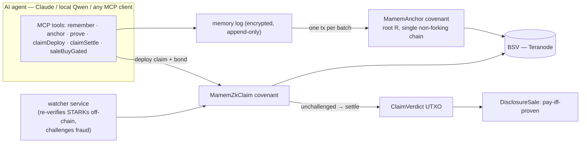

# mamem — an AI memory it can't silently rewrite

**One sentence:** gives an AI agent a memory whose history is sealed on the BSV
blockchain — so anyone can later check *what the AI knew, when it knew it, and
who was allowed to see it* — without trusting whoever ran the machine.

License: [Apache-2.0](LICENSE) · [](https://github.com/nedzof/merkle-automaton/actions/workflows/ci.yml)

---

## The two-minute version

Think of the AI's memory as a lab notebook:

- **Every page is encrypted** and appended to a local log. Writing is cheap —
  no chain involved.
- **Every so often we stamp the notebook**: hash the whole batch and put the
  stamp (a Merkle root) into one transaction on BSV. From then on, pages can't
  be torn out or swapped — the stamp wouldn't match. Each anchor also *spends*
  the previous anchor, so the history is a single chain that can't fork.
- **When the AI answers, it hands over a receipt**: "this came from record 47,
  here's the path from it to the stamped root, the root is inside block X (check
  the real headers yourself), and here's proof I was allowed to tell you."
  You can verify all of that offline. No API key, no permission, no trust.

On top of that sits the **claim layer** — the part that's actually new:

- The AI can prove, mathematically, that a memory really is inside a stamped
  notebook (a RISC Zero STARK — a zero-knowledge proof).
- Verifying a whole STARK inside Bitcoin Script would cost **$40–150 per
  check**. Nobody pays that. So we do the optimistic version instead:

  1. The prover posts a claim on-chain: *"my proof verifies"* — plus a bond.
     Cost: fractions of a cent, one transaction.
  2. A **watcher** bot re-checks the proof off-chain (free, milliseconds).
     If the claim is a lie, the watcher posts a counter-bond and *challenges*.
  3. A dispute narrows "your 14-million-step proof is wrong" down to **one
     single step** in ~5 rounds. That step is judged by a small on-chain
     contract. Loser pays. ~10 cents, only ever paid by a liar.
  4. Because lying always loses the bond, rational provers don't lie — the
     expensive check exists only as a threat and almost never runs.
  5. An unchallenged claim **settles** and mints a tiny on-chain "verdict"
     token. A sale contract can require that verdict: **pay-iff-proven**.

That's it. A bail-bond system for proofs: cheap because honesty is
incentivized, safe because the blockchain is the referee when it matters.

## The one assumption (read this)

> **A false claim is caught only if at least one honest watcher challenges it
> within the window.** We run one as a docker service; anyone can run another.
> Everything else — sealing, ordering, access, the dispute outcome — is pure
> math and consensus, no trust needed.

If you can't accept *any* liveness assumption, the full-verify-on-chain mode
(Stage 2) was deliberately skipped: it works in principle but costs $40–150
per use. For high-stakes one-off finality it can be revisited.

## What this is NOT

- **Not a coin, not a token.** It's plumbing: sealed memory + receipts.
- **Not "the chain verifies every proof."** The chain verifies *claims*, and
  only judges one tiny step when a dispute happens.
- **Not truth.** Proofs guarantee *inclusion, integrity, ordering,
  authorization, existence-by-time* — never that a memory's content is true.
  Garbage in, cryptographically-sealed garbage out.
- **Not mainnet-ready.** Everything below is proven on a local Teranode
  regtest network with real transactions. Mainnet pilot is the next milestone.

## Architecture in one picture



## Run the whole thing

Prereqs: Docker Desktop running the local Teranode regtest stack
(`infra/teranode-quickstart`), `pnpm`, Node ≥ 22.

```sh
pnpm install && pnpm -r build

# the full stranger-reproducible story through the real MCP server —
# remember → anchor → STARK prove → claimDeploy → watcher → claimSettle →
# verdict → gated sale — all on live regtest (~3 min, prints E2E MCP PASS):
node packages/mcp/demo/e2e-mcp-regtest.mjs

# the honest challenger, as a service (watches the shared /data volume):
docker compose up -d watcher

# fraud demo: deploy a lying claim, let the daemon catch it (host-side):
node packages/e2e/src/e2e-watcher-regtest.mjs
```

### Use it from an actual AI

```sh
pnpm mcp:install claude-desktop cursor   # Docker MCP Toolkit → any client
pnpm chat "what torque does drain port 4 need?"   # local model, Docker Model Runner
```

Install without cloning (Docker MCP Toolkit):

```sh
mkdir -p ~/.docker/mcp/catalogs/mamem
curl -fsSL https://raw.githubusercontent.com/nedzof/merkle-automaton/master/docker-mcp/mamem.ghcr.yaml -o ~/.docker/mcp/catalogs/mamem/mamem.ghcr.yaml
docker mcp profile create --name mamem
docker mcp profile server add mamem --server file://$HOME/.docker/mcp/catalogs/mamem/mamem.ghcr.yaml
docker mcp client connect claude-desktop --profile mamem
```

The image is `ghcr.io/nedzof/mamem` (`latest` = release, `edge` = master).
See **[docs/INTEGRATION.md](docs/INTEGRATION.md)** for every client option
and the persistent backend modes.

### The wallet question (operator-only — AI users never touch this)

The AI client pays nothing and holds no keys. Whoever runs the MCP server
is the wallet holder; anchoring costs fractions of a cent per write-batch.
One command sets it up:

```sh
node packages/mcp/dist/src/init.js                  # → new key in gitignored .env,
                                                    #   only the ADDRESS is printed
node packages/mcp/dist/src/init.js --network=regtest
                                                    # → also checks reserve funding;
                                                    #   if empty, prints the exact
                                                    #   generatetoaddress command to run
```

Then serve — stdio for local clients, HTTP for remote ones:

```sh
MAMEM_NETWORK=regtest node packages/mcp/dist/src/bin.js   # stdio MCP
MAMEM_HTTP_PORT=8080  node packages/mcp/dist/src/bin.js   # + REST /v1, MCP /mcp, OpenAPI
```

Rotation is `init.js --force` — destructive: UTXOs of the old key do **not**
follow to the new one, so rotate only on a quiet chain. Set `MAMEM_ENV_FILE`
to target a different env file. `--network` rejects everything that isn't
`regtest` — mainnet is not wired.

---

## For the pedants — the precise version

Everything above, stated exactly.

### Sealing (writes)

- Records are appended to a local encrypted log (`BatchLog`); a batch's
  SHA-256 Merkle root `R` is committed in one spend of the **`MamemAnchor`
  Rúnar covenant**. The anchor UTXO must spend its own previous head —
  a single non-forking UTXO chain per shard. One anchor tx per batch,
  independent of batch size.
- Anchors carry `n` (sequence) and `size`; the head is pinned by covenant
  introspection (`OP_PUSH_TX` + `hashPrevouts`/`hashOutputs`), not by the
  backend being honest.

### Receipts (reads)

A recall returns the payload plus: Merkle path leaf→`R`, the anchor UTXO
chain, and an SPV check against real Teranode block headers. Access is
gated by *all* of: identity, ZK clearance (Bulletproof: level ≥ threshold
without revealing the level), Cedar policy, policy-DAG (Datalog)
authorization. Derived content inherits the max clearance of its premises.

### Zero knowledge

`@mamem/zk` wraps a RISC Zero STARK (BabyBear field, Poseidon2 sponge) that
proves *leaf ∈ R* plus a committed `queryId` — verifying a ~224 KB receipt
takes milliseconds, off-chain, via a wasm-bindgen Rust verifier
(`verifyZkm2`). The guest program is pinned by `image-id.json` and built
reproducibly inside the Docker image (build fails on mismatch).

### The claim layer (optimistic on-chain verification)

| Contract | Role |
|---|---|
| `MamemZkClaim` | 18-field state covenant: `status, receiptHash, journalRoot, journalSize, queryId, bondSats, deadline, responseDeadline, challengerPkh, bisectLo/Hi, midCommit, proverPkh, maxFee, window, stages, verdictCode, anchorOutpoint`. Methods: `challenge → reveal → bisect → proveStage → settle/claimTimeout/slashTimeout` (8 public). |
| `Poseidon2Stage` | the on-chain judge: ONE risc0-zkp 3.0.5 poseidon2 round (24-cell state, x⁷ sbox, M_ext/M_int) executed as a stateful covenant step — a dispute resolves to a single verified round. |
| `ClaimVerdict` | minted by `settle`; `authorize` enforces payment to `payeePkh` in the same tx. |
| `DisclosureSale` | `buyGated` pins `hash256(prevouts)` to the exact [sale, verdict] pair — the buy is consensus-impossible without spending the verdict atomically. |
| `MamemAnchor.witnessSettle` | co-spent input of `settleAnchored`; re-emits its own continuation (anchor survives) + the identical 4-output list the claim enumerates → `journalRoot == anchor.R` is consensus-enforced. |

The bisection game: `stages` committed stage-hashes; `reveal`/`bisect` halve
the disputed range each round; the terminal step replays one Poseidon2 round
on-chain. Challenger bond + prover bond; loser forfeits.

### The watcher

`packages/watcher` — a daemon (also `docker compose up -d watcher`) that
polls a file-backed claims registry shared with the MCP server via a
volume. Per open claim it: pulls the proof bundle, re-verifies the STARK in
an **isolated worker process** (a wasm panic can't kill the daemon; a crash
is logged as *inconclusive*, never auto-challenged — inconclusive is not
fraud), cross-checks `journalRoot/journalSize/queryId` against the claim's
committed fields, self-funds its challenger bond, broadcasts `challenge`,
and marks outpoints `spent` so it never re-broadcasts a dead claim.

### What's verified vs. honest gaps

- ✅ Live on Teranode regtest, real transactions: anchor chain, STARK
  membership + replay/tamper rejection, clearance gates, restart
  persistence, claim deploy/status/settle, verdict mint, gated sale,
  watcher fraud-detection → challenge accepted, anchored settle
  (`journalRoot == anchor.R`), continuing anchor. `pnpm e2e` covers the
  offline equivalents.
- ✅ Interpreter-level: full claim lifecycle incl. bisection + stage proof
  (16/16 evals).
- ⚠️ Watcher tracks known registry outpoints only — following covenant
  continuations past the first spend needs a tx-index (documented).
- ⚠️ Stage 2 (full-receipt on-chain validity, ~$40–150/use) deliberately
  skipped — the optimistic system is complete without it.
- ⚠️ No security audit. Regtest economics measured; mainnet pilot pending.

### Design rules

- Contracts are **Rúnar only** — no hand-written Bitcoin Script anywhere
  (shared libs go through `runar-sdk` `buildUnlockingScript`/`buildP2PKHScript`).
- Secrets live in gitignored `.env` / `.state/`. Regtest keys only.
- Measured numbers only in docs — see [BENCHMARKS.md](BENCHMARKS.md).

## Documentation

| Doc | Contents |
|---|---|
| [docs/GOAL-v9.md](docs/GOAL-v9.md) | current goal state: the claim layer, watcher, anchored settle, honest deferrals |
| [docs/INTEGRATION.md](docs/INTEGRATION.md) | MCP for Claude/Cursor/VS Code/local models, Docker MCP Toolkit, runtime modes |
| [docs/ARCHITECTURE.md](docs/ARCHITECTURE.md) | layers, packages, sequence/state diagrams, ADRs |
| [docs/RESEARCH.md](docs/RESEARCH.md) | prior art: reused / adopted / rejected, per source |
| [docs/PROOFS.md](docs/PROOFS.md) | what each proof proves and does not prove |
| [docs/THREAT-MODEL.md](docs/THREAT-MODEL.md) | STRIDE per component, residual risks |
| [docs/OPERATIONS.md](docs/OPERATIONS.md) | stack, funding, gates, troubleshooting |
| [docs/DEVELOPER.md](docs/DEVELOPER.md) | hard rules, package map, test conventions |
| [docs/migration-log.md](docs/migration-log.md) | chronological engineering log, gotchas, live txids |
| [BENCHMARKS.md](BENCHMARKS.md) | measured performance |

## Packages

`core` · `chain` · `log` · `contracts` (Rúnar) · `anchor` · `overlay` ·
`verify` · `crypto` · `identity` · `zk` · `datalog` · `graph` · `policy` ·
`automaton` · `mcp` · `reasoning` · `watcher` · `fuzz` · `e2e`
