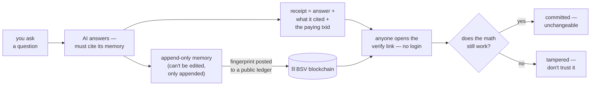

#  nektar — an AI memory it can't silently rewrite

An append-only memory for AI agents, sealed on the BSV blockchain. Anyone
can later check *what the AI knew, when it knew it, and who was allowed to
see it* — without trusting whoever ran the machine.

[](https://github.com/nedzof/nektar/actions/workflows/ci.yml)
[](https://github.com/nedzof/nektar/actions/workflows/release.yml)
License: [Apache-2.0](LICENSE)

## The whole idea in one picture



1. Facts go into a log that can only **grow** — nothing is ever edited.
2. A **fingerprint** (hash) of that log is posted on-chain — like
   notarizing a page. The chain only timestamps the fingerprint; it
   never sees your data.
3. When the AI answers, it must **cite notarized facts** — claims it
   can't derive get stripped, and the answer gets a receipt.
4. Anyone with the receipt **re-does the math**: hash matches? anchor
   on-chain? cites inside it? Faked anything → the math fails.

The blockchain is the notary — verification is the reader re-running
the checks, not trusting us.

## See a verified answer in 60 seconds

```sh
pnpm -r build && pnpm demo
```

Boots on the mock network — **offline, zero BSV, nothing spent** — seeds
memory, answers a grounded question, and prints a real receipt + badge.
Watch the ungrounded claim get stripped in front of you. Then:

- `pnpm setup:claude` / `pnpm setup:codex` — wire the receipt hooks into your agent
- `exportShard` hands any public shard to another operator as a `packUrl`;
  `importShard {from: "<their-url>", shard: "…"}` re-verifies every bundle on
  import — verified memory on day one. `/.well-known/nektar` lists what an
  operator offers; `NEKTAR_PACK_SHARE=0` opts out.
- `doctor` — one-call health check (funding, shards, anchors, prover)

## The walkthrough — one question, end to end

What actually happens when someone asks your agent
*"what torque does drain port 4 need?"* — and exactly which parts of the
answer are backed by cryptography versus by trust.

**1. Earlier — the AI learned something**

```sh
remember("drain port 4 torque 45Nm", shard="manual")
```

→ an encrypted record in the local log, provenance-signed by the log key.
**Backed:** the record exists, is signed, and is tamper-evident.

**2. The log got stamped**

```sh
anchor(shard)   # one BSV transaction commits the Merkle root R
```

→ and each anchor *spends the previous anchor* (a Rúnar covenant) — one
unforkable chain per shard, enforced by consensus, not by the backend.
**Backed:** the record can no longer be edited or deleted without the
on-chain stamp breaking.

**3. The AI recalls it**

```sh
recall("manual")   # → items + a signed AnswerReceipt
```

→ the record text **plus** a receipt binding
`answer ‖ refs ‖ check ‖ model ‖ time` under the log key's signature.
Access still goes through identity, ZK clearance, Cedar and the policy
DAG first. **Backed:** what the AI claims to have read is committed.

**4. You check the receipt yourself**

```sh
prove("manual", 0)   # → proof bundle → verifyFragment()
```

→ Merkle path leaf→`R`, the anchor chain, the BEEF — verified **offline
against public block headers**, no trust in the server that served it.
**Backed:** the record was recorded, unaltered, before its block time.

*(The STARK is a different tool, not an upgrade: it hides the leaf by
design — "some record is in the anchored tree" — so use it for privacy
proofs and dispute objects, not for "check my quote." Citations need the
leaf revealed.)*

**Which proof does it pick?** The *owner's declaration*, not the
caller's mood: `remember(…, private:true)` marks a shard private —
**monotone, it cannot be un-declared** and it persists across restarts.
Public shards keep the ordinary Merkle path (instant, free). A private
shard refuses plain citations outright; a bare `groundedAnswer` cite is
**auto-proved** — the service self-issues a `zkQuery`, proves and
verifies the membership STARK in one call (~50 s), and only then keeps
the claim (an explicit `zk:{queryId,proof}` still works). The committed
receipt
then redacts the cite to `{private:true, hdp, anchorTxid}` — the shard
name never reaches the chain. ZK proving is real compute (~50 s CPU per
proof), so the prover tools are priced above answers when payments are
on; the verify side stays free — a verifier never pays to check.

**5. The answer itself gets gated**

```sh
groundedAnswer(claims=[{text:"45Nm", cites:[{shard:"manual",seq:0}]}])
```

→ every claim must cite a **verified** fragment and be a literal quote or
Datalog-entailed. Whatever fails is **stripped** — an underivable answer
is refused, not published with a disclaimer. The surviving answer is
anchored as a receipt. **Backed:** per-claim derivation from sealed
memory — Wright's "no fragment may be hallucinated."

→ and it returns a **scannable receipt**: `receipt: nektarr1.…` plus a
`verify:` URL. Anyone hitting `/v1/verify` sees the checks run live
(exists → re-hash → provenance → anchored → cites anchored) — the page
carries a QR for a phone scan. A Claude Code Stop hook can verify every
answer on the fly (`integrations/claude-code`).

**Sharing + cold start.** `groundedAnswer`/`commitReceipt` also return a
`share` block — token, verify URL, `/v1/badge` URL, ready-made Markdown
`[](verify)` — so the agent can paste a badge into
a doc or PR. The HTML verify page unfurls (OG meta) and carries an install
CTA. `exportShard` packs a **public** shard — plaintext + provenance + every
anchor's proof bundle; `importShard` re-verifies each bundle on import
(zero trust in the exporter — a tampered record recomputes a different leaf
and lands in `unverifiable`) and logs the import on `__imports__`. Private
shards and level-gated records refuse export outright. `doctor` is the
one-call diagnostic: funding, shards, records, anchors, payments, prover.
`pnpm setup:claude` wires the Claude Code hooks + CLAUDE.md snippet without
clobbering existing settings.

**6. If someone disputes the proof** — two rails, both on-chain

**Optimistic rail (default, cheapest):** the prover posts a small
**bonded claim**; a watcher bot re-verifies the STARK off-chain for free
and challenges lies; any dispute bisects the fraud to one Poseidon2 step
judged by an on-chain contract (~10 cents, paid only by liars).

**Validity rail (regtest-proven):** a **Groth16 verifier lives inside a
locking script** — the claim's `settleValid` must co-spend that verifier
UTXO in the same transaction, so the verdict *can only exist* if the
SNARK verifies under consensus. No watcher, no window, no liveness
assumption — miners are the judge. Already run end-to-end on our own
sha256d-Merkle-membership circuit, root baked into the verifying key.

Both rails mint the same **verdict token** on settlement — a sale
contract can require it: **pay-iff-proven**.

## The honest cut — what's backed and what isn't

```
someone's question
    └─► the AI's answer
        ├─ cited claim "45Nm"        BACKED — derivable from a sealed record
        ├─ receipts, manifest, chain  BACKED — anchored, signed, verifiable
        ├─ the prose between cites    NOT — the gate checks claims, not style
        ├─ "the model produced this"  DECLARED by default; ATTESTED when the
        │                              receipt embeds a modelAttestation —
        │                              statement re-derives + sha256(proof) is
        │                              anchored; a verifierTxid names the
        │                              consensus-checked spend (demo MLP only)
        └─ truth of the record        NEVER — sealing proves recorded, not right
```

**One sentence:** everything the AI *quotes* can be proven to come from an
untamperable log; how it *phrases* it and whether the *record was true*
remain unproven — and the system says so explicitly rather than implying
otherwise.

**Still open, honestly:** proving the weights actually produced a token
needs zkML/TEE (`modelManifest` anchors the *declared* identity instead —
see Honest status for what already exists on BSV and the realistic path);
agents use the gate by
instruction, not by force; and a clever paraphrase can fail grounding and
get stripped — that's the safety feature, not a bug.

## What this enables that doesn't exist today

- **Auditable AI** — "what did it know, and when" checkable years later
  with no server access. Today's audit trail is a mutable database + a promise.
- **Agents trusting strangers** — two agents owned by *different people*
  share memory; each reader verifies inclusion + authorization itself.
- **Selling verified answers** — payment releases only if the math checks
  out. No escrow company, no disputes.
- **Zero-knowledge clearance** — prove "a record satisfying policy P
  exists" without revealing the record.
- **Court-grade evidence** — a sealed timestamped chain vs. screenshots
  of logs.
- **Model/data integrity** — anchor weights+dataset digests: "which model
  produced this answer" becomes provable.

## See it live

A demo instance runs on the public testnet (`167.233.174.91:8080`,
`NEKTAR_NETWORK=ttn`, payments on):

- `GET /.well-known/x402` — the priced-tool catalog, served unauthenticated
- [a real paid-answer receipt](http://167.233.174.91:8080/v1/verify?r=nektarr1.MExLewq-WdZeUIWDltJ80AasW29_SzHVq6yIpB35zGI) — human check page; the `paid` line names the settlement tx
- `docs/DEMO.md` — the five-minute show: 402 invoice → WIF-signed tx → receipt → phone verify

## Running it

Setup, wallet bootstrap, funding, and every client option (Claude Code,
Claude Desktop, Cursor, remote HTTP, Docker MCP Toolkit, local models,
regtest Docker stack) → **[docs/INTEGRATION.md](docs/INTEGRATION.md)**.

## Find each other — the rendezvous directory

Agents aren't findable on-chain by design; "finding" = knowing an
endpoint. A shared rendezvous (`tm_presence`/`ls_presence` overlay topic)
lets agents publish a signed "I'm here" ad `{pub, endpoint, shards}` —
the signature binds endpoint to the agent's key, so listings can't be
forged.

```sh
# host one (any always-on box):
NEKTAR_OVERLAY_HOST=0.0.0.0 NEKTAR_OVERLAY_PORT=8090 pnpm rendezvous

# announce your agent (free — no UTXO, the signature is the auth):
NEKTAR_AGENT_WIF=<key> NEKTAR_AGENT_ENDPOINT=http://<you>:8080/mcp \
  NEKTAR_AGENT_SHARDS=manual,tnet NEKTAR_OVERLAY_URL=http://<rendezvous>:8090 \
  pnpm rendezvous:announce

# discover peers:
curl http://<rendezvous>:8090/directory?shard=tnet
```

Announce → get a peer's endpoint+pubkey → connect via
`claude mcp add --transport http … --header "Authorization: Bearer …"` →
verify its receipts against that pubkey yourself. **The directory finds
peers; it never vouches for them** — trust comes from the receipts.

### Know what a shard is *about* — domain-tagged discovery

Shard labels alone can't answer "who knows about soccer". `describeShard`
commits a manifest to `__catalog__` — domain tags, a description, priced
offers, and the shard's on-chain `shardId` — anchored like any other memory,
so "I cover soccer" is a timestamped, attributable claim (false advertising
stays reputation damage, not a mutable directory field).

```sh
# describe what you serve (anchored on __catalog__):
describeShard { shard:"soccer", domains:["soccer","ligue-1"],
                desc:"French football results",
                offers:[{kind:"answer",priceSats:250}] }

# announce the signed catalog alongside your ad (announce.mjs does it
# automatically from /.well-known/nektar):
GET /directory?domain=soccer    # agents claiming that domain (signed catalogs)
GET /directory?q=transfer       # free-text over domains + descriptions
```

A buyer agent closes the loop from inside its own instance:
`discover {domain:"soccer"}` finds candidates → `peerCall {endpoint, tool:"recall", ...}`
reads what's offered (free) → `peerCall {tool:"groundedAnswer", maxSats:1000}`
handles the 402: it verifies the seller's **signed quote** (invoices now carry
`quoteSig`+`pub` — a doctored amount/payTo fails verification), pays the
invoice, and returns the answer + receipt + settlement txid. Live walkthrough:
`node packages/mcp/demo/discovery-smoke.mjs` (two agents + rendezvous on mock).

### Get notified — the event feed (JetStream-pull)

The rendezvous keeps a durable, sequenced log of every signed event —
`ad`, `catalog`, and `want` (a buyer's signed "I need domain X" — the
demand side). Consumers hold a cursor and pull; `wait` long-polls for
near-real-time delivery:

```sh
GET /events?since=<cursor>&domains=soccer,ligue-1&kind=catalog&wait=25000

# announce demand (sellers watching 'soccer' see it on their next pull):
NEKTAR_WANT_DOMAINS=soccer NEKTAR_WANT_MAX_SATS=1000 \
  NEKTAR_AGENT_WIF=<key> pnpm --filter @nektar/overlay exec node want.mjs

# or from inside an agent: watch {domains:["soccer"], since:<cursor>}
# reference consumer: node packages/mcp/demo/follow.mjs --domains soccer
```

Presence artifacts are also **submittable on-chain** — `tm_presence` admits
`nektar-agent`/`nektar-catalog`/`nektar-want` OP_RETURN outputs (signature-
verified at every host), so the same objects propagate via GASP today and
ride the 1BSV overlay object plane (BRC-148/149) when it ships — transport
is a seam, the signed artifacts don't change. The rendezvous exposes
`/requestSyncResponse` + `/requestForeignGASPNode` so a peer engine can
replicate `tm_nektar` directly.

## Honest status

- ✅ Live on regtest + public testnet with real transactions (anchor
  chains, STARK prove/verify, claims, verdicts, gated sales, rendezvous).
- ⚠️ One liveness assumption, on the *optimistic* rail only: a false
  claim stands only if **no honest watcher** challenges it in the window.
  The **validity rail** (`NektarGrothClaim` + in-script Groth16 verifier,
  our own circuit, regtest-proven) removes it — production use still
  needs a real trusted-setup ceremony. Everything else is math.
- ⚠️ Mainnet is gated (`NEKTAR_MAINNET_CONFIRM` + spend caps), not yet a
  pilot. No security audit.
- Proofs cover *inclusion, ordering, authorization, existence-by-time* —
  never that a memory's content is **true**.
- **Per-answer receipts**: `groundedAnswer` strips every claim that isn't
  entailed by a verified fragment and anchors an answer receipt (Wright
  §8). "Which model answered" has three states: **declared** (the
  `modelManifest`, unproven) → **statement-attested** (`attestInference`
  re-derives the Groth16 public statement
  `poseidon(input‖output‖poseidon(model))` off-chain — a ported toy-
  Poseidon over BLS12-381, bit-exact vs the circuit's public input) →
  **attested+anchored** (the default: `sha256(proof)` lands in a ~300 B
  OP_RETURN attestation tx; proof bytes served at `/v1/zkproof/<commit>`
  and re-checked by `verifyReceipt`) → **consensus-verified**
  (`onchain:true` deploys the in-script verifier and spends it — Wright
  §18's "executable on-chain if necessary", the dispute/showcase rail;
  regtest deploy `b6fe4727…`/spend `27712ae8…`, public testnet mined
  h1766667).
  Scope: only the canned 784×16×10 quantized demo MLP has a proof —
  LLM inference stays declared (zkML/TEE would be needed; zkLLM proves
  *which model ran*, grounding proves *what the answer derives from* —
  different questions). Dev trusted setup + nChain demo params —
  regtest-grade only.
- **Paid service (opt-in, `NEKTAR_PAYMENTS=1`)**: `anchor`,
  `groundedAnswer` and `commitReceipt` take a per-call atomic payment —
  BRC-166-style x402 `exact`: an unpaid call returns a `402` invoice
  (`payQuote` tool / `GET /v1/pay/quote`; priced catalog at
  `/.well-known/x402`), the caller signs a tx paying the operator
  address + carrying `OP_RETURN nektarpay:<invoiceId>` (one tx binds one
  call), retries with `payment:{invoiceId,transaction}` — we verify,
  broadcast, and the **receipt commits the settlement txid** (the
  "signed usage receipt" names what paid for it; `/v1/verify` gains a
  `paid` check). WIF-only — no wallet protocol; `payclient.ts` is the
  reference signer. Startup is fail-closed: no valid
  `NEKTAR_OPERATOR_WIF`, no boot. **Verified on real consensus** by
  `packages/e2e/src/e2e-pay.mjs` (regtest + ttn) and exercised live
  against the deployed demo box (`167.233.174.91:8080`, running
  `NEKTAR_NETWORK=ttn`) by `packages/e2e/src/e2e-pay-remote.mjs`:
  funding tx, settlement broadcast, receipt binding, replay rejected —
  all real public testnet transactions. See
  [docs/OPERATIONS.md](docs/OPERATIONS.md).

## Two ways an agent pays for memory — in plain words

**Rail A — pay-per-answer (the vending machine).** You don't buy the
memory, you buy a *question*. Another agent asks `groundedAnswer`,
the server replies "that'll be 250 sats" (an invoice). Their instance
signs a payment tx from its own funds (`payInvoice`), sends it back,
and gets the grounded answer plus a receipt that names the paying txid.
No escrow — the payment tx itself is the handshake. If the answer is
bad, the money is already gone; what's guaranteed is *that* an answer
was delivered for *that* tx — publicly auditable by anyone. Like buying
a newspaper: you pay at the till and take what you get.

**Rail B — buy the memory itself (the escrow).** This is for buying a
specific record, not an answer. The seller says "I have record #6 in
shard `default` — 500 sats" and sends a *commitment*: proof the record
really exists inside an anchored batch, so **the buyer verifies the
thing exists before paying** (you can't be sold a memory that isn't
there). The buyer funds an on-chain escrow — a locked box neither side
can open alone. One "buy" transaction does both halves atomically:
the seller gets the sats *and* the decryption material gets revealed
on-chain in the same tx — you literally cannot have one without the
other. If the seller ghosts, the buyer's `refund` recovers the escrow
after a locktime. Like buying a locked suitcase where paying and
getting the key happen in the same instant, and the clerk had already
shown you a certificate proving the suitcase exists.

**So:** Rail A = paying for a service (compute + access, instant, no
escrow, you get an answer). Rail B = buying an asset (the memory
itself, verify-before-pay, trustless escrow, atomic reveal). Both are
real testnet-verified — A on the deployed demo box, B in covenant
script-eval tests.

## Documentation

| Doc | Contents |
|---|---|
| [docs/MANUAL-CLAUDE-CODE.md](docs/MANUAL-CLAUDE-CODE.md) | the complete user manual for Claude Code — journeys, benefits, setup |
| [docs/MANUAL-CODEX.md](docs/MANUAL-CODEX.md) | same manual for Codex |
| [docs/DEMO.md](docs/DEMO.md) | the five-minute paid-answer demo on the live box |
| [docs/ARCHITECTURE.md](docs/ARCHITECTURE.md) | layers, packages, diagrams, ADRs |
| [docs/CLAIMS.md](docs/CLAIMS.md) | the claim layer in full — contracts, bisection, watcher |
| [docs/INTEGRATION.md](docs/INTEGRATION.md) | every MCP client option, transports, runtime modes |
| [docs/OPERATIONS.md](docs/OPERATIONS.md) | deployment, funding, gates, troubleshooting |
| [docs/PROOFS.md](docs/PROOFS.md) | what each proof does and doesn't prove |
| [docs/THREAT-MODEL.md](docs/THREAT-MODEL.md) | STRIDE per component, residual risks |
| [docs/GOAL-v9.md](docs/GOAL-v9.md) | current goal state + honest deferrals |
| [BENCHMARKS.md](BENCHMARKS.md) | measured performance |

Packages: `core` `chain` `log` `contracts` `anchor` `overlay` `verify`
`crypto` `identity` `zk` `datalog` `graph` `policy` `automaton` `mcp`
`reasoning` `watcher` `fuzz` `e2e` — each under `packages/`.
