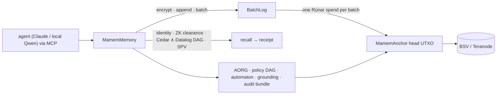

# mamem — Merkle Automaton on BSV

Verifiable, encrypted, provenance-bearing agent memory: a BSV-native implementation of Wright's *Merkle Automaton* (arXiv:2506.13246).

Writes are cheap off-chain appends. One Rúnar contract spend anchors a whole batch, and each shard's history is a single UTXO chain that cannot fork. Reads are released only after identity, ZK clearance, Cedar and policy-DAG checks *and* an SPV proof. Every answer carries a receipt. Every verification ends in the BSV header chain.

> **Proofs establish inclusion, integrity, ordering, authorization and existence by a time — never truth.** See [docs/PROOFS.md](docs/PROOFS.md).



## Use it from your AI (Claude, Cursor, VS Code, local models…)

```sh
pnpm install && pnpm -r build
pnpm mcp:install claude-desktop cursor   # Docker Desktop MCP Toolkit: one install, any client
pnpm chat "What torque does drain port 4 need?"   # local model via Docker Model Runner
```

See **[docs/INTEGRATION.md](docs/INTEGRATION.md)** for every client, the HTTP/Streamable-HTTP endpoint and the persistent regtest backend.

## Quick start

```sh
pnpm install && pnpm -r build
pnpm check:deps && pnpm -r test && pnpm reproduce
pnpm e2e                                  # offline, incl. the full-paper scenario (~11 s)
pnpm stack:up && MAMEM_NETWORK=regtest pnpm e2e   # live Teranode regtest (~2 min)
node packages/mcp/demo/client.mjs         # scripted MCP agent session
```

Additional gates: `pnpm formal` (TLA+/TLC), `pnpm cedar:symcc` (Cedar SymCC + cvc5), `pnpm smt:vectors` (Rust oracle), `pnpm bench` (→ [BENCHMARKS.md](BENCHMARKS.md)), `node tools/check-mermaid.mjs docs/*.md README.md`, `docker build .` (clean-checkout gate).

## Documentation

| Doc | Contents |
|---|---|
| [docs/INTEGRATION.md](docs/INTEGRATION.md) | MCP server for Claude/Cursor/VS Code/local models, Docker MCP Toolkit, HTTP, runtime modes |
| [docs/ARCHITECTURE.md](docs/ARCHITECTURE.md) | layers, packages, sequence and state diagrams (Mermaid), ADRs |
| [docs/RESEARCH.md](docs/RESEARCH.md) | research & inspirations: reused / adopted / rejected, per source |
| [docs/PROOFS.md](docs/PROOFS.md) | what each proof proves and does not prove |
| [docs/THREAT-MODEL.md](docs/THREAT-MODEL.md) | STRIDE per component, residual risks |
| [docs/OPERATIONS.md](docs/OPERATIONS.md) | stack, funding, gates, MCP server, troubleshooting, backups |
| [docs/DEVELOPER.md](docs/DEVELOPER.md) | hard rules, package map, how-tos, test conventions |
| [docs/migration-log.md](docs/migration-log.md) | chronological engineering log, gotchas, live txids |
| [../merkle-automaton-test-spec.md](../merkle-automaton-test-spec.md) | test cases + traceability for every requirement |
| [BENCHMARKS.md](BENCHMARKS.md) | measured performance |

## Packages

`core` · `chain` · `log` · `contracts` (Rúnar) · `anchor` · `overlay` · `verify` · `crypto` · `identity` · `zk` · `datalog` · `graph` · `policy` · `automaton` · `mcp` · `reasoning` · `fuzz` · `e2e` — see [DEVELOPER.md](docs/DEVELOPER.md#package-map).

## Rules

- No hand-written Bitcoin Script: contracts are Rúnar only.
- Regtest only. Secrets stay in gitignored `.env` / `.state/`.
- Measured numbers only.
