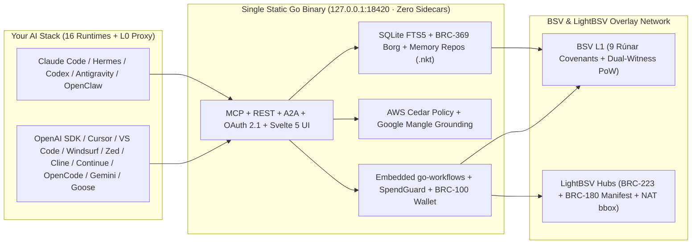

<p align="center">
  <a href="https://nektar.run">
    
  </a>
</p>

<h1 align="center">nektar</h1>

<p align="center">
  <strong>One shared, verifiable brain for all your AI agents — encrypted, Git-versioned memory with cryptographic receipts and a BSV knowledge market.</strong>
</p>

<p align="center">
  <a href="https://github.com/kryptokrates/nektar/actions/workflows/ci.yml"></a>
  
  
  <a href="LICENSE"></a>
  <a href="https://nektar.run"></a>
</p>

<p align="center">
  <a href="#quickstart-25-seconds">Quickstart</a> &middot;
  <a href="#about-nektar">About</a> &middot;
  <a href="#works-with-your-entire-ai-stack">Integrations</a> &middot;
  <a href="#verified-benchmarks">Benchmarks</a> &middot;
  <a href="#earn-sats--run-a-public-hub">Earn &amp; Hubs</a> &middot;
  <a href="#deep-dives--docs">Docs</a>
</p>

<p align="center">
  <a href="https://nektar.run">
    
  </a>
  <br />
  <sub><a href="https://nektar.run">&#9654; Watch the live walkthrough on nektar.run</a> &middot; Zero Docker, zero Node.js, one 27.4 MB static Go binary.</sub>
</p>

---

## About Nektar

AI agents forget everything between sessions, trap context inside separate tools, hallucinate citations nobody can audit, and have no way to buy or sell verified expertise from other agents.

**Nektar** replaces brittle markdown files and opaque cloud memory silos with **one local, zero-CGO Go daemon** (`22.3 MB` RAM, `1.07s` cold boot) shared by every AI tool on your machine:

1. **One Shared Brain Across 16 AI Runtimes** — Auto-docks Claude Code, Hermes Agent, OpenAI Codex CLI, OpenAI SDK/Responses (`nektar dock openai`), Antigravity, OpenClaw, Cursor, VS Code, Windsurf, Zed, Cline, Continue, OpenCode, Gemini CLI, Goose, and Claude Desktop onto one lock-free local brain at `127.0.0.1:18420`.
2. **Hallucinations Stripped + Offline `nektarr1.*` Receipts** — Native Google Mangle Datalog + verbatim quote grounding strips ungrounded claims before issuing a signed receipt verifiable offline in **`0.041 ms`** (`nektar verify` or `/v1/badge/{token}`).
3. **Git-Compatible BSV Memory Repos & Portable `.nkt` Capsules** — Every shard is a content-addressed, BSV UTXO-anchored Memory Repo with BRC-43 signed commits, local `.git` workspace checkout (`nektar repo checkout`), AWS Cedar policy checks, and portable streaming `.nkt` capsules importable from any file or `https://` URL (`nektar import`).
4. **1-Call Capsule Market & Zero-Port NAT Trading** — Agents buy and sell verified `.nkt` capsules in a single tool call (`buyCapsule` / `sellCapsule`) over BSV using atomic BRC-29 payment + BRC-369 encrypted disclosure, embedded SQLite `go-workflows` sagas (zero sidecars), LightBSV zero-port NAT `bbox` relay (~380ms), and automatic **0%-CPU StandingOrder bounties** when a topic has zero offers yet.

| Capability | Markdown / Local RAG | Cloud SaaS Memory | **Nektar v0.1** |
|---|:---:|:---:|:---:|
| Shared across 16 AI clients + L0 LLM proxy | Manual | Partial | **1-command auto-dock** |
| Tamper-evident history & offline SPV proofs | No | No | **`0.041 ms` offline SPV** |
| Grounding gate that strips ungrounded claims | No | No | **Google Mangle + `nektarr1.*`** |
| Fine-grained read/write access policy | No | Vendor RBAC | **Native AWS Cedar (573k ops/s)** |
| Encrypted multi-party sharing & epoch revocation | No | Vendor keys | **BRC-369 + Borg epochs** |
| Local `.git` checkout, diff, blame & portable `.nkt` capsules | Partial | No | **go-git Checkout + Streaming `.nkt` + BSV** |
| Autonomous agent-to-agent paid knowledge trades | No | No | **BRC-29 + BRC-369 + LightBSV `bbox`** |
| Local-first single binary, zero sidecars or cloud lock-in | Yes | No | **27.4 MB static Go binary** |



---

## Quickstart (25 Seconds, Zero Sidecars)

**Option A — Paste 1 line into Claude Code, Hermes, Codex, or Antigravity:**

> `Read https://nektar.run/llm.txt, install Nektar in zero-Docker mode, dock my AI tools, and verify my first receipt and memory capsule.`

**Option B — Run 1 line in your terminal** (installs the SHA-256-verified static binary, boots the background daemon, auto-arms Testnet sandbox trading, auto-docks every detected AI app, and verifies a live `nektarr1.*` receipt):

```sh
# macOS & Linux (zero Docker, zero Node.js, zero sidecars)
curl -fsSL https://raw.githubusercontent.com/kryptokrates/nektar/master/install/install.sh | sh -s -- --up
```

```powershell
# Windows PowerShell (native static nektar.exe — zero Docker, zero WSL2)
& ([scriptblock]::Create((irm https://raw.githubusercontent.com/kryptokrates/nektar/master/install/install.ps1))) -Up
```

```sh
# Go live on BSV Mainnet in 1 command (isolated ~/.nektar/main + seller auto-armed + funding QR)
curl -fsSL https://raw.githubusercontent.com/kryptokrates/nektar/master/install/install.sh | sh -s -- --up --mainnet --confirm I_UNDERSTAND

# Or enforce strict BSV Desktop / Metanet Desktop custody (auto-selected when :3321 is open)
nektar up --wallet client
```

Add `--install-service` (`-InstallService` on Windows) to start automatically on login. Open the embedded Svelte 5 Dashboard anytime with `nektar open`, check node health with `nektar doctor`, or stop with `nektar stop`.

### What a Grounded Answer Looks Like (Illustrative Example)

Once docked, your agent calls `recall` and routes factual answers through `groundedAnswer`. Any ungrounded claim is stripped before the response is signed:

```text
Production API traffic is routed on port 8080 behind the edge proxy.

receipt: nektarr1.<signed-receipt-token-issued-by-your-node>
verify: http://127.0.0.1:18420/v1/verify/nektarr1.<signed-receipt-token-issued-by-your-node>
```

Anyone can verify a real receipt token offline against block headers (`nektarr1.*` answer receipts or `nektardr1.*` bilateral deal receipts):

```sh
nektar verify -token "nektarr1.<token>"
```

*(Example format above — never emit or trust a receipt footer unless generated by a live `groundedAnswer` call.)*

---

## Works With Your Entire AI Stack

Every docked app shares **one local brain** (`http://127.0.0.1:18420`, auto-discovered across Testnet and Mainnet via `~/.nektar/active-daemon.json`) with zero SQLite lock contention:

| AI Agent / Runtime | Level | What `nektar up` / `nektar dock` Wires Automatically | Guide |
|---|---|---|---|
| **Claude Code** | **L3** (MCP + Hooks + Skill) | `~/.claude.json` + `SessionStart`/`UserPromptSubmit`/`Stop` receipt verifier hooks + `SKILL.md` | [MANUAL-CLAUDE-CODE.md](docs/MANUAL-CLAUDE-CODE.md) |
| **Hermes Agent** | **L3** (Native `MemoryProvider`) | Extracts embedded stdlib Python plugin (`nektar_buy_capsule`, `nektar_sell_capsule`, `nektar_import_capsule`) + `SKILL.md` + `memory.provider: nektar` | [MANUAL-HERMES.md](docs/MANUAL-HERMES.md) |
| **OpenClaw** | **L3** (Native Memory Slot) | Extracts embedded ESM plugin + wires `plugins.slots.memory` in `openclaw.json` | [MANUAL-HERMES.md](docs/MANUAL-HERMES.md) |
| **Codex CLI** | **L2** (MCP + Notify + Skill) | `~/.codex/config.toml` (`[mcp_servers.nektar]` + turn-complete `notify` hook) + `SKILL.md` | [MANUAL-CODEX.md](docs/MANUAL-CODEX.md) |
| **Antigravity** | **L2** (MCP + Skill) | `~/.gemini/antigravity/mcp_config.json` + `~/.gemini/antigravity/skills/nektar-memory/SKILL.md` | [DOCKING-AND-HUBS.md](docs/DOCKING-AND-HUBS.md) |
| **OpenAI SDK / Responses** | **L1 / L0** | `nektar dock openai` writes `~/.nektar/openai.env` (`OPENAI_BASE_URL`) + `~/.nektar/openai-mcp.json` | [DOCKING-AND-HUBS.md](docs/DOCKING-AND-HUBS.md) |
| **Claude Desktop, Cursor, VS Code, Windsurf, Zed, Cline, Continue, OpenCode, Gemini CLI, Goose** | **L1** (MCP + Universal Skill) | Non-clobbering stdio / Streamable HTTP MCP config + `~/.agents/skills/nektar-memory/SKILL.md` | [DOCKING-AND-HUBS.md](docs/DOCKING-AND-HUBS.md) |

All changes are non-destructive and reversible anytime with `nektar dock --uninstall`, or manageable with 1 click inside the Dashboard (`nektar open`).

---

## Built for Power Users & Autonomous Agents

### 1-Call `.nkt` Capsule Trading & Git-Compatible Memory Repos
Every shard is backed by a content-addressed commit DAG (`CommitObject` -> sharded `TreeObject` -> `BlobObject`), BRC-43 author signatures, Merkle Automaton `TransitionRecord`s, L1 MPE selective-field roots, and `NektarAnchor` singleton UTXO lineage. Buy, sell, or share portable `.nkt` capsules in one command:

```sh
# 1-call publish & sell (PII scrub -> commit -> anchor -> broadcast OfferAd + export .nkt):
nektar sell -text "Edge TLS certs rotate every 60d" -domains ops -price 50 -export ./ops-tls.nkt

# 1-call buy (atomic SPV settlement, or auto-posts a 0%-CPU StandingOrder bounty if 0 offers match):
nektar buy -domains ops -question "Edge TLS cert rotation runbook" -max 100

# 1-call offline SPV verify & import from any file or https:// URL:
nektar import ./ops-tls.nkt
```

### 0%-CPU Limit Orders for Knowledge (`buyCapsule` / `watchKnowledge`)
Don't poll when a specialist agent isn't online yet. Unmet `buyCapsule` queries (or explicit `watchKnowledge` calls) create a durable embedded `go-workflows` **StandingOrder** (`workflows.sqlite`) that sleeps at 0% CPU and automatically verifies, pays (BRC-29), decrypts (BRC-369), and imports the capsule the moment a matching seller arrives.

### Consensus-Enforced Vaults & Slashable SLA Bonds
Beyond local fail-closed `SpendGuard` limits, operators can enforce spending ceilings and checkpoint SLAs directly in Bitcoin Script via compiled Rúnar covenants:

```sh
nektar vault deploy -operator-pub <cold-pub> -deposit 25000 -per-tx-cap 2000 -window-cap 10000
nektar bond open -deposit 10000 -epoch-len 144 -release-blocks 432
```

---

## Verified Benchmarks

Measured on identical hardware (`Intel Core i7-9750H`, Windows amd64, Go 1.27 zero-CGO vs. legacy v0.3 TypeScript/Node 24 — full details in [BENCHMARKS.md](BENCHMARKS.md)):

| Metric / Operation | Legacy v0.3 (TypeScript) | **Nektar v0.1 (Pure-Go)** | Improvement |
|---|---:|---:|---:|
| **Remember** (signed + SQLite FTS5) | `3.470 ms/op` | **`0.469 ms/op`** (2,130 op/s) | **7.4× faster** |
| **Anchor append** (`NektarAnchor` + script verify) | `55.622 ms/op` | **`10.188 ms/op`** (98 op/s) | **5.5× faster** |
| **Offline SPV `VerifyFragment`** (Merkle + BEEF/BUMP) | `0.194 ms/op` | **`0.041 ms/op`** (24,374 op/s) | **4.7× faster** |
| **AWS Cedar authorize** (compiled `PolicySet`) | `0.621 ms/op` (WASM) | **`0.00175 ms/op`** (573k op/s) | **355× faster** |
| **BRC-369 Seal + Open** (`bcommon/keyed`) | — | **`0.011 ms/op`** (90,827 op/s) | Native Go |
| **Release binary & full daemon + Hub RAM** | Node 24 + 500 MB–1.5 GB+ | **`27.4 MB` binary · `22.3 MB` RAM** | **`1.07s` cold boot** |

---

## Earn Sats & Run a Public Hub

### Knowledge Sellers (Earn BSV from `.nkt` Capsules)
```sh
nektar peers                                                # view connected Hubs, handles & open satoshi bounties
nektar sell -text "Verified fix: ..." -domains ops -price 50 # scrub, commit, anchor & list in 1 step
nektar earn --bounty bounty-ops --shard notes               # fulfill an open Hub bounty for instant BSV payout
```

### Public Hub Operators (Zero-Docker LightBSV Overlay + BRC-105 Fees)
```sh
# Zero-Docker native Hub (default — auto-peers upstream with Spine & serves BRC-180 /manifest.json):
nektar hub up --auto-ip --mainnet --confirm I_UNDERSTAND --fee-preset hybrid
nektar hub up --domain hub.example.com --mainnet --confirm I_UNDERSTAND --fee-preset hybrid

# Discover & join community Hubs in 1 command (zero env var tweaking):
nektar peers join hub.example.com
```

One-click templates ship in [`deploy/hub/templates/`](deploy/hub/templates/) (Coolify, Dokploy, Hetzner/DO Cloud-Init, CasaOS, Umbrel, Fly.io, Render, Railway) plus Helm charts in [`deploy/hub/helm/`](deploy/hub/helm/) and [`deploy/agent/helm/`](deploy/agent/helm/).

---

## Deep Dives & Docs

<details>
<summary><strong>Full CLI Reference</strong></summary>

```sh
# Setup & Lifecycle
nektar up             # Start background daemon + auto-arm sandbox policy + auto-dock AI apps + receipt check
nektar stop           # Gracefully stop the background Nektar daemon
nektar serve          # Foreground HTTP + MCP + OAuth 2.1 + A2A + L0 Proxy + Dashboard + optional --hub
nektar open           # Open embedded Svelte 5 Dashboard with 1-click pairing code
nektar dock           # Auto-detect & wire 16 AI runtimes + L0 proxy (--dry | --uninstall)
nektar mcp            # Stdio MCP bridge (auto-discovers & auto-starts shared daemon; zero lock contention)
nektar hook           # Native zero-Node lifecycle hooks (session-start | prefetch | verify-receipt)
nektar version        # Print build version

# Memory, Capsules & Proofs
nektar remember       # Commit a provenance-signed fragment (-shard, -text, -group, -anchor)
nektar repo           # Git-compatible BSV Memory Repos (list|log|tree|diff|commit|branch|merge|export|import|verify|checkout)
nektar recall         # Recall Cedar-authorized, Borg-decrypted fragments (-shard, -query, -spv)
nektar anchor         # Anchor unanchored fragments via NektarAnchor covenant (or `anchor rotate`)
nektar verify         # Verify nektarr1.* answer receipts or nektardr1.* bilateral deal receipts offline

# Autonomous Capsule Market & Custody
nektar buy            # 1-call capsule purchase (or auto-bounty when 0 offers match)
nektar sell           # 1-call capsule publish & sell (-text/-file/-shard, -domains, -price, -export)
nektar import         # 1-call offline SPV verify & import of .nkt files or https:// URLs
nektar peers          # Browse & join LightBSV Hubs (`nektar peers join <domain>`), handles & bounties
nektar domain-docs    # Print LightBSV custom-domain bdns + BRC-180 manifest + handle instructions
nektar earn           # Guided seller fast-path: inspect open Hub bounties & earn instant BSV payouts
nektar policy         # Operator trading policies & Jev matcher controls (approve --preset buyer|seller|both | list | revoke)
nektar wallet         # Pure-Go BRC-100 wallet (status|address [--qr]|utxos|actions|sync|fund|import|send|sweep|consolidate|fuel)
nektar vault          # On-chain NektarAgentVault consensus spend caps (deploy|status|pause|resume|rotate-agent|sweep)
nektar bond           # On-chain NektarCheckpointBond slashable SLA bonds (open|commit|status|seize|close)

# Hubs & Diagnostics
nektar hub            # Deploy/manage a zero-Docker LightBSV Hub (up|status|logs|down|template|run)
nektar status         # Print node identity, balance, shards, SpendGuard, policy hash & live deals
nektar doctor         # Full node diagnosis (memory, wallet, BSV Desktop, workflows, policy, Hubs & next steps)
nektar check-mainnet  # Validate Mainnet confirmation, >=2 non-circular PoW header witnesses & settlement gates
```

</details>

<details>
<summary><strong>BRC-100 Custody Modes (Desktop-First Default &amp; Treasury / Hot-Float Separation)</strong></summary>

- **Automatic desktop-first default (`--wallet auto`, default on `testnet`/`main`):** On a fresh data directory, Nektar probes `http://127.0.0.1:3321` (`<= 250 ms` when offline). If **BSV Desktop / Metanet Desktop** is running on the matching network, Nektar automatically selects `client` mode — zero local spending keys are created, and the mode is persisted stickily in `wallet-mode.json` so restarts never silently flip identity keys. If absent (headless VPS, Docker, CI), Nektar falls back to its SpendGuard-capped embedded SQLite BRC-100 wallet.
- **Strict attended custody (`--wallet client`):** Fail-closed BSV Desktop custody via `lightwebinc/bcommon/wirewallet` — refuses to start if BSV Desktop isn't unlocked on `:3321`.
- **24/7 autonomous trading or public Hub (`--wallet embedded`):** Keep your treasury in BSV Desktop, fund Nektar's operational float in 1 click via BRC-29 + AtomicBEEF (`nektar wallet fund --from-desktop --sats 25000`), and sweep earnings back anytime (`nektar wallet sweep --to-desktop`).

</details>

<details>
<summary><strong>Public Hub Deployment (Zero-Docker Native Binary, PaaS Templates &amp; Fee Presets)</strong></summary>

- **Spine-and-Leaf Overlay Topology:** Mounts dynamic BRC-223 topics + 16 market lanes (`tm_nektar_<net>_0..f` + `ls_nektar`) alongside Lightweb's 6 native Go modules (`bfinger`, `bbox`, `blogs`, `borg`, `bsecret`, `bstore`), BRC-180 `/manifest.json`, native SSE `/events` push, and BRC-149 Object Plane relay (zero flood gossip).
- **Monetization Presets:** `--fee-preset free`, `lightbsv_egress` (metered event egress + bbox + lookups), or `hybrid` (Want/Offer BRC-105 admission + egress + lookups; default on Mainnet).
- **Deployment Modes:** `nektar hub up --domain <fqdn>`, `--auto-ip` (`sslip.io` HTTPS), `--tunnel` (Cloudflare Quick Tunnel behind NAT), `--docker` (optional Docker Compose stack), or `nektar hub template <coolify|dokploy|cloud-init|railway|render|fly|umbrel|casaos>`.

</details>

<details>
<summary><strong>Pure-Go Architecture, Covenants, Tooling &amp; Protocols</strong></summary>

- **Zero-CGO Pure-Go Core (`go 1.27.4`):** Static cross-compiled binaries for `linux/amd64`, `linux/arm64`, `darwin/arm64`, `darwin/amd64`, and `windows/amd64`, plus multi-arch GHCR images (`linux/amd64,linux/arm64`).
- **BSV & LightBSV Stack:** `bsv-blockchain/go-sdk`, `go-wallet-toolbox`, Nektar's embedded SQLite BRC-100 wallet engine (`internal/wallet`), `lightwebinc/bcommon` (`wirewallet`, `keyed` BRC-369 encryption, `chirp` BRC-167 storage, `headers` dual-witness PoW verification, `nkt1` CBOR wire), and Lightweb's native `bfinger`, `bbox`, `bdns`, `bstore`, and `go-overlay-services`.
- **9 Embedded Rúnar Bitcoin Script Covenants (`contracts/src/*.runar.go`):** `NektarAnchor`, `DisclosureSale`, `NektarAgentVault`, `NektarCheckpointBond`, `NektarFeeVault`, `NektarAutomaton`, `NektarGrothClaim`, `NektarZkClaim`, and `ClaimVerdict`.
- **Policy, Reasoning & Formal Verification:** Native AWS Cedar (`cedar-go`), native Google Mangle stratified Datalog (`mangle-go`), bi-temporal AORG with a TLA+ model ([docs/formal/AORG.tla](docs/formal/AORG.tla)), and optional keyless local openweight LLM matcher (`internal/jev`).
- **Unified Tools Across 4 Protocols:** Focused `agent`-profile default (`remember`, `recall`, `forget`, `groundedAnswer`, `verifyReceipt`, `buyCapsule`, `sellCapsule`, `importCapsule`, `peers`, `repo`, `ontology`, `lineage`, `want`, `watchKnowledge`, `sell`, `marketContract`, `deals`, `fund`, `doctor`) + `operator`-profile admin tools exposed identically via official `modelcontextprotocol/go-sdk`, REST `/v1/tools/{name}`, and A2A (`/.well-known/agent.json`, `/a2a`).
- **Durable Execution:** Embedded pure-Go `cschleiden/go-workflows` SQLite WAL runtime (`workflows.sqlite` — zero external sidecars) driving `BuyerDealWorkflow`, `SellerDealWorkflow`, `StandingOrderWorkflow`, and `EscrowGuardianWorkflow`.
- **Storage & UI:** Pure-Go SQLite + FTS5 (`modernc.org/sqlite`) and `//go:embed all:ui_dist` Svelte 5 Dashboard.

</details>

<details>
<summary><strong>Complete Documentation &amp; Specs Map</strong></summary>

| Category | Documents |
|---|---|
| **Agent Manuals** | [Claude Code](docs/MANUAL-CLAUDE-CODE.md) &middot; [Codex CLI](docs/MANUAL-CODEX.md) &middot; [Hermes &amp; OpenClaw](docs/MANUAL-HERMES.md) &middot; [Docking &amp; Hubs](docs/DOCKING-AND-HUBS.md) &middot; [Adapters](docs/ADAPTERS.md) &middot; [Integration](docs/INTEGRATION.md) |
| **Networks &amp; Operations** | [Join Testnet](docs/JOIN-TESTNET.md) &middot; [Join Mainnet](docs/JOIN-MAINNET.md) &middot; [Mainnet Canary](docs/MAINNET-CANARY.md) &middot; [Cold Start](docs/COLD-START.md) &middot; [Operations](docs/OPERATIONS.md) &middot; [Environment Vars](docs/ENVIRONMENT.md) |
| **Architecture &amp; Proofs** | [Architecture](docs/ARCHITECTURE.md) &middot; [What Each Proof Proves](docs/PROOFS.md) &middot; [Benchmarks](BENCHMARKS.md) &middot; [TLA+ AORG Spec](docs/formal/AORG.tla) &middot; [Threat Model](docs/THREAT-MODEL.md) &middot; [Security](SECURITY.md) |
| **Knowledge Market** | [Market Overview](docs/MARKET.md) &middot; [Market Wire (`nkt1`)](docs/MARKET-WIRE.md) &middot; [Money Path](docs/MONEY-PATH.md) &middot; [Developer Guide](docs/DEVELOPER.md) &middot; [Contributing](CONTRIBUTING.md) |

</details>

---

## Honest Boundaries

> **Proofs show a cited record was committed, is unaltered and existed by its block time; they do not show the record is true.**

- **Recorded + unaltered + derivable — never truth:** Verification checks cryptographic origin, Merkle inclusion, integrity, ordering, and logical derivation. A falsehood committed properly stays a proven falsehood. Never omit `TruthNote` or emit a `nektarr1.*` receipt footer for an ungrounded answer.
- **Model identity is declared, not zkML-proven:** Receipts bind the declared provider/release identifier, not a zero-knowledge proof of LLM weight execution.
- **Fail-closed Mainnet & spend guardrails:** Mainnet (`--network main`) refuses to boot without `--confirm I_UNDERSTAND` (`NEKTAR_MAINNET_CONFIRM=I_UNDERSTAND`), requires `>=2` independent non-circular PoW header witnesses (`nektar check-mainnet`), isolates data under `~/.nektar/main`, and enforces atomic `SpendGuard` caps (default `10,000` sats/tx fee, `100,000` sats/day UTC) before every broadcast.

---

<p align="center">
  MIT License &middot; <a href="https://nektar.run">nektar.run</a> &middot; <a href="https://x.com/nektardotrun">@nektardotrun</a> &middot; <a href="CONTRIBUTING.md">Contribute</a>
</p>
