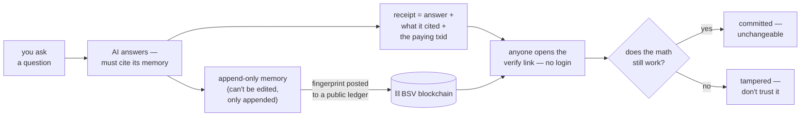

# mamem — an AI memory it can't silently rewrite

An append-only memory for AI agents, sealed on the BSV blockchain. Anyone
can later check *what the AI knew, when it knew it, and who was allowed to
see it* — without trusting whoever ran the machine.

[](https://github.com/nedzof/merkle-automaton/actions/workflows/ci.yml)
[](https://github.com/nedzof/merkle-automaton/actions/workflows/release.yml)
License: [Apache-2.0](LICENSE)

## The whole idea in one picture



1. Facts go into a log that can only **grow** — nothing is ever edited.
2. A **fingerprint** (hash) of that log is posted on-chain — like
   notarizing a page. The chain only timestamps the fingerprint; it
   never sees your data.
3. When the AI answers, it must **cite notarized facts** — claims it
   can't derive get stripped, and the answer gets a receipt.
4. Anyone with the receipt **re-does the math**: hash matches? anchor
   on-chain? cites inside it? Faked anything → the math fails.

The blockchain is the notary — verification is the reader re-running
the checks, not trusting us.

## The walkthrough — one question, end to end

What actually happens when someone asks your agent
*"what torque does drain port 4 need?"* — and exactly which parts of the
answer are backed by cryptography versus by trust.

**1. Earlier — the AI learned something**

```sh
remember("drain port 4 torque 45Nm", shard="manual")
```

→ an encrypted record in the local log, provenance-signed by the log key.
**Backed:** the record exists, is signed, and is tamper-evident.

**2. The log got stamped**

```sh
anchor(shard)   # one BSV transaction commits the Merkle root R
```

→ and each anchor *spends the previous anchor* (a Rúnar covenant) — one
unforkable chain per shard, enforced by consensus, not by the backend.
**Backed:** the record can no longer be edited or deleted without the
on-chain stamp breaking.

**3. The AI recalls it**

```sh
recall("manual")   # → items + a signed AnswerReceipt
```

→ the record text **plus** a receipt binding
`answer ‖ refs ‖ check ‖ model ‖ time` under the log key's signature.
Access still goes through identity, ZK clearance, Cedar and the policy
DAG first. **Backed:** what the AI claims to have read is committed.

**4. You check the receipt yourself**

```sh
prove("manual", 0)   # → proof bundle → verifyFragment()
```

→ Merkle path leaf→`R`, the anchor chain, the BEEF — verified **offline
against public block headers**, no trust in the server that served it.
**Backed:** the record was recorded, unaltered, before its block time.

*(The STARK is a different tool, not an upgrade: it hides the leaf by
design — "some record is in the anchored tree" — so use it for privacy
proofs and dispute objects, not for "check my quote." Citations need the
leaf revealed.)*

**Which proof does it pick?** The *owner's declaration*, not the
caller's mood: `remember(…, private:true)` marks a shard private —
**monotone, it cannot be un-declared** and it persists across restarts.
Public shards keep the ordinary Merkle path (instant, free). A private
shard refuses plain citations outright, and a `groundedAnswer` cite
survives only when it carries a ZK membership proof the service itself
verifies (one verifier-issued `zkQuery` per cite). The committed receipt
then redacts the cite to `{private:true, hdp, anchorTxid}` — the shard
name never reaches the chain. ZK proving is real compute (~50 s CPU per
proof), so the prover tools are priced above answers when payments are
on; the verify side stays free — a verifier never pays to check.

**5. The answer itself gets gated**

```sh
groundedAnswer(claims=[{text:"45Nm", cites:[{shard:"manual",seq:0}]}])
```

→ every claim must cite a **verified** fragment and be a literal quote or
Datalog-entailed. Whatever fails is **stripped** — an underivable answer
is refused, not published with a disclaimer. The surviving answer is
anchored as a receipt. **Backed:** per-claim derivation from sealed
memory — Wright's "no fragment may be hallucinated."

→ and it returns a **scannable receipt**: `receipt: mamemr1.…` plus a
`verify:` URL. Anyone hitting `/v1/verify` sees the checks run live
(exists → re-hash → provenance → anchored → cites anchored) — the page
carries a QR for a phone scan. A Claude Code Stop hook can verify every
answer on the fly (`integrations/claude-code`).

**6. If someone disputes the proof** — two rails, both on-chain

**Optimistic rail (default, cheapest):** the prover posts a small
**bonded claim**; a watcher bot re-verifies the STARK off-chain for free
and challenges lies; any dispute bisects the fraud to one Poseidon2 step
judged by an on-chain contract (~10 cents, paid only by liars).

**Validity rail (regtest-proven):** a **Groth16 verifier lives inside a
locking script** — the claim's `settleValid` must co-spend that verifier
UTXO in the same transaction, so the verdict *can only exist* if the
SNARK verifies under consensus. No watcher, no window, no liveness
assumption — miners are the judge. Already run end-to-end on our own
sha256d-Merkle-membership circuit, root baked into the verifying key.

Both rails mint the same **verdict token** on settlement — a sale
contract can require it: **pay-iff-proven**.

## The honest cut — what's backed and what isn't

```
someone's question
    └─► the AI's answer
        ├─ cited claim "45Nm"        BACKED — derivable from a sealed record
        ├─ receipts, manifest, chain  BACKED — anchored, signed, verifiable
        ├─ the prose between cites    NOT — the gate checks claims, not style
        ├─ "the model produced this"  DECLARED — manifest anchored; the
        │                                    inference itself is unproven
        └─ truth of the record        NEVER — sealing proves recorded, not right
```

**One sentence:** everything the AI *quotes* can be proven to come from an
untamperable log; how it *phrases* it and whether the *record was true*
remain unproven — and the system says so explicitly rather than implying
otherwise.

**Still open, honestly:** proving the weights actually produced a token
needs zkML/TEE (`modelManifest` anchors the *declared* identity instead —
see Honest status for what already exists on BSV and the realistic path);
agents use the gate by
instruction, not by force; and a clever paraphrase can fail grounding and
get stripped — that's the safety feature, not a bug.

## What this enables that doesn't exist today

- **Auditable AI** — "what did it know, and when" checkable years later
  with no server access. Today's audit trail is a mutable database + a promise.
- **Agents trusting strangers** — two agents owned by *different people*
  share memory; each reader verifies inclusion + authorization itself.
- **Selling verified answers** — payment releases only if the math checks
  out. No escrow company, no disputes.
- **Zero-knowledge clearance** — prove "a record satisfying policy P
  exists" without revealing the record.
- **Court-grade evidence** — a sealed timestamped chain vs. screenshots
  of logs.
- **Model/data integrity** — anchor weights+dataset digests: "which model
  produced this answer" becomes provable.

## See it live

A demo instance runs on the public testnet (`167.233.174.91:8080`,
`MAMEM_NETWORK=ttn`, payments on):

- `GET /.well-known/x402` — the priced-tool catalog, served unauthenticated
- [a real paid-answer receipt](http://167.233.174.91:8080/v1/verify?r=mamemr1.MExLewq-WdZeUIWDltJ80AasW29_SzHVq6yIpB35zGI) — human check page; the `paid` line names the settlement tx
- `docs/DEMO.md` — the five-minute show: 402 invoice → WIF-signed tx → receipt → phone verify

## Running it

Setup, wallet bootstrap, funding, and every client option (Claude Code,
Claude Desktop, Cursor, remote HTTP, Docker MCP Toolkit, local models,
regtest Docker stack) → **[docs/INTEGRATION.md](docs/INTEGRATION.md)**.

## Find each other — the rendezvous directory

Agents aren't findable on-chain by design; "finding" = knowing an
endpoint. A shared rendezvous (`tm_presence`/`ls_presence` overlay topic)
lets agents publish a signed "I'm here" ad `{pub, endpoint, shards}` —
the signature binds endpoint to the agent's key, so listings can't be
forged.

```sh
# host one (any always-on box):
MAMEM_OVERLAY_HOST=0.0.0.0 MAMEM_OVERLAY_PORT=8090 pnpm rendezvous

# announce your agent (free — no UTXO, the signature is the auth):
MAMEM_AGENT_WIF=<key> MAMEM_AGENT_ENDPOINT=http://<you>:8080/mcp \
  MAMEM_AGENT_SHARDS=manual,tnet MAMEM_OVERLAY_URL=http://<rendezvous>:8090 \
  pnpm rendezvous:announce

# discover peers:
curl http://<rendezvous>:8090/directory?shard=tnet
```

Announce → get a peer's endpoint+pubkey → connect via
`claude mcp add --transport http … --header "Authorization: Bearer …"` →
verify its receipts against that pubkey yourself. **The directory finds
peers; it never vouches for them** — trust comes from the receipts.

## Honest status

- ✅ Live on regtest + public testnet with real transactions (anchor
  chains, STARK prove/verify, claims, verdicts, gated sales, rendezvous).
- ⚠️ One liveness assumption, on the *optimistic* rail only: a false
  claim stands only if **no honest watcher** challenges it in the window.
  The **validity rail** (`MamemGrothClaim` + in-script Groth16 verifier,
  our own circuit, regtest-proven) removes it — production use still
  needs a real trusted-setup ceremony. Everything else is math.
- ⚠️ Mainnet is gated (`MAMEM_MAINNET_CONFIRM` + spend caps), not yet a
  pilot. No security audit.
- Proofs cover *inclusion, ordering, authorization, existence-by-time* —
  never that a memory's content is **true**.
- **Per-answer receipts**: `groundedAnswer` strips every claim that isn't
  entailed by a verified fragment and anchors an answer receipt (Wright
  §8). "Which model answered" is a *declared* manifest (`modelManifest`),
  not a proof of inference — that needs zkML/TEE. State of the art: BSV
  already demonstrated it in miniature — nChain proved a neural-net
  inference with Groth16 verified **on-chain on mainnet** (Oct 2024;
  `examples/ai_inference` in `zkscript_package`) and sCrypt ran an MNIST
  DNN *inside* Script. Frontier-LLM proving just became feasible
  off-chain (zkLLM: LLaMA-2-13B ≈15 min; newer systems report
  single-digit–seconds verification of 100B+ models) — but nothing
  packages it as an on-chain verifier, and it answers a different
  question than grounding does (zkML proves *which model ran*; grounding
  proves *what the answer derives from*). Realistic path: small
  self-hosted model → Groth16 circuit into our existing validity rail;
  hosted/frontier models → off-chain proof or TEE attestation committed
  into the receipt as an extra check line. Not built.
- **Paid service (opt-in, `MAMEM_PAYMENTS=1`)**: `anchor`,
  `groundedAnswer` and `commitReceipt` take a per-call atomic payment —
  BRC-166-style x402 `exact`: an unpaid call returns a `402` invoice
  (`payQuote` tool / `GET /v1/pay/quote`; priced catalog at
  `/.well-known/x402`), the caller signs a tx paying the operator
  address + carrying `OP_RETURN mamempay:<invoiceId>` (one tx binds one
  call), retries with `payment:{invoiceId,transaction}` — we verify,
  broadcast, and the **receipt commits the settlement txid** (the
  "signed usage receipt" names what paid for it; `/v1/verify` gains a
  `paid` check). WIF-only — no wallet protocol; `payclient.ts` is the
  reference signer. Startup is fail-closed: no valid
  `MAMEM_OPERATOR_WIF`, no boot. **Verified on real consensus** by
  `packages/e2e/src/e2e-pay.mjs` (regtest + ttn) and exercised live
  against the deployed demo box (`167.233.174.91:8080`, running
  `MAMEM_NETWORK=ttn`) by `packages/e2e/src/e2e-pay-remote.mjs`:
  funding tx, settlement broadcast, receipt binding, replay rejected —
  all real public testnet transactions. See
  [docs/OPERATIONS.md](docs/OPERATIONS.md).

## Documentation

| Doc | Contents |
|---|---|
| [docs/MANUAL-CLAUDE-CODE.md](docs/MANUAL-CLAUDE-CODE.md) | the complete user manual for Claude Code — journeys, benefits, setup |
| [docs/MANUAL-CODEX.md](docs/MANUAL-CODEX.md) | same manual for Codex |
| [docs/DEMO.md](docs/DEMO.md) | the five-minute paid-answer demo on the live box |
| [docs/ARCHITECTURE.md](docs/ARCHITECTURE.md) | layers, packages, diagrams, ADRs |
| [docs/CLAIMS.md](docs/CLAIMS.md) | the claim layer in full — contracts, bisection, watcher |
| [docs/INTEGRATION.md](docs/INTEGRATION.md) | every MCP client option, transports, runtime modes |
| [docs/OPERATIONS.md](docs/OPERATIONS.md) | deployment, funding, gates, troubleshooting |
| [docs/PROOFS.md](docs/PROOFS.md) | what each proof does and doesn't prove |
| [docs/THREAT-MODEL.md](docs/THREAT-MODEL.md) | STRIDE per component, residual risks |
| [docs/GOAL-v9.md](docs/GOAL-v9.md) | current goal state + honest deferrals |
| [BENCHMARKS.md](BENCHMARKS.md) | measured performance |

Packages: `core` `chain` `log` `contracts` `anchor` `overlay` `verify`
`crypto` `identity` `zk` `datalog` `graph` `policy` `automaton` `mcp`
`reasoning` `watcher` `fuzz` `e2e` — each under `packages/`.
