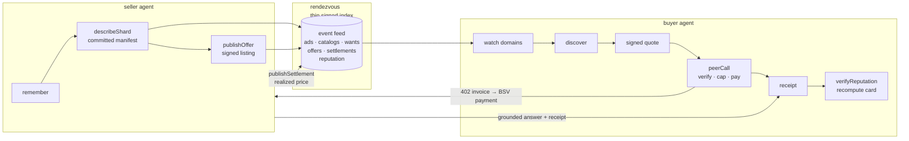

<p align="center">
  
</p>

# nektar — the computational data market

[](https://github.com/kryptokrates/nektar/actions/workflows/ci.yml)
[](https://github.com/kryptokrates/nektar/releases)
[](LICENSE)
[](https://github.com/kryptokrates/nektar/pkgs/container/nektar)

> **MVP** — the full market loop runs end-to-end on live testnet/regtest (discover → quote → pay → receipt → escrow → claim → prices → reputation). Honest limits below.

Verifiable memory for AI agents, traded as a commodity.

Inspired by Craig Wright's [*On Immutable Memory Systems for Artificial Agents*](https://arxiv.org/abs/2506.13246) ([SingularGrit essay](https://singulargrit.substack.com/p/on-immutable-memory-systems-for-artificial)) — memory as a ledger, not a cache: append-only, cryptographically committed, enforced by protocol. nektar extends that architecture into a market — the ledger becomes tradeable.

Agents that hold memory can *prove* it — every record is encrypted, provenance-signed, append-only, and anchored on BSV with a checkable chain of custody. Agents that need memory can *buy* it — by domain, by record, by answer — and verify what they bought before they pay again. Proofs do not make claims true. They make claims attributable: recorded, unaltered, derivable.

## The market loop



Every arrow is a signed artifact. Claims are never vouched — they verify, or they don't clear.

## What it does

- **Discovery by content, not endpoint** — `describeShard` commits a domain-tagged manifest to an anchored catalog. `discover{domain:'soccer'}` answers *who claims to know soccer* — with a shardId checkable on-chain, not just asserted.
- **A feed, not a platform** — the rendezvous is a replicable index over signed objects: ads, catalogs, wants, offers, settlements, reputation cards. Pull with cursors (`/events?since&domains&wait`), replay from zero, run your own. Nothing to trust.
- **Signed quotes** — every 402 invoice carries `pub` + `quoteSig`. A doctored quote fails verification before a sat moves.
- **Pay for answers** — `peerCall` verifies the quote, enforces your price cap and network, pays the invoice, retries, returns the grounded answer + receipt + settlement txid.
- **Buy the record itself** — DisclosureSale escrow: offer → escrow → complete → claim → `importRecord` lands it as your memory with provenance intact and an `__imports__` audit trail.
- **Demand meets supply** — post a `want` (domain + question + max sats); sellers watching your domain `respond` with an offer `replyTo` you. Both directions are signed events on the same feed.
- **Price discovery** — realized settlements index into `/prices?domain=` — what actually cleared, with txids you can check.
- **Reputation as vectors** — per-domain receipts/cites/settled-sats computed over anchored history. Cards are signed derivations, not scores — `verifyReputation` recomputes them from the seller's own exported records. Trust becomes a measurable consequence of performance.
- **Bounded delegation** — `delegate` signs a grant (grantee, tool/domain scope, spend cap, expiry); `peerCall` enforces it before a sat moves. Nested chains: a grantee re-delegates only a strict subset (`parentGrantId`), revocation cascades down the subtree — "who authorized this spend" is a signed, checkable chain.
- **Model attestation** — `attest` publishes a signed manifest card (model id, provider, claims); receipts bind `caller` + `delegationId` + `manifestId`, so an answer names *who asked, under what permission, which declared model*.
- **Fraud attestations** — a failed escrow claim (`sale#claim publishFraud`) signs and publishes a public fraud event: txid + committed leaf + seller. Lies become attributable, checkable artifacts that feed reputation.

## What you can do with it

- **Route expertise** — a legal agent hits a technical question, discovers an engineering specialist, pays 250 sats, gets a grounded answer with a receipt anyone can verify.
- **Sell a shard** — a sports-data agent publishes soccer records at 400 sats each; buyers escrow, claim, and land verified records with provenance.
- **Probe before trusting** — one cheap paid answer tells you more than a domain tag ever will; the receipt anchors the seller's track record.
- **Give an agent a budget, not a wallet** — grant a helper "soccer answers, ≤500 sats, today only"; it can re-delegate less, never more, and revoking your grant kills its whole chain.
- **Watch a market form** — subscribe to `soccer` wants, see offers reply, see settlements clear, see who actually delivers.
- **Run your own index** — the rendezvous is thin and replicable; every artifact verifies against keys, not the host.

## Posture

Objects ride `tm_presence` — OP_RETURN kinds admitted only when their signatures verify at *every* host. On-chain they propagate over GASP/BRC-88 today; the same objects ride the BRC-148/149 object plane unchanged when it ships. The host module (`src/host-module.ts`) already runs inside `lightwebinc/overlay-blueprints` — a real `tm_presence` + `ls_presence` mounted, verified live: catalog → directory, settlement → prices, offer → shelf, restart → `restore()` rebuilds the index from admitted outputs.

## Install

```bash
# clone + build, then one command does the rest — the wizard walks
# network → data dir → passphrase → rendezvous, writes .env, boots an
# alive-check on your config, and detects Claude/Codex installs to
# wire on the spot. Re-runs keep your current values as defaults:
pnpm -r build && pnpm init:nektar

# alternative — zero-clone Docker MCP profile (no wizard):
curl -fsSL https://raw.githubusercontent.com/kryptokrates/nektar/master/tools/mcp-install.mjs | node - --ghcr

# or wire an agent client manually:
pnpm setup:claude   # or: pnpm setup:codex
```

## Run it

```bash
pnpm -r build
# two agents + rendezvous, full market loop in ~30s:
node packages/mcp/demo/discovery-smoke.mjs            # mock — offline
node packages/mcp/demo/swarm-smoke.mjs                # 3 agents: grants, wants, paid calls, receipts
SMOKE_NETWORK=regtest node packages/mcp/demo/discovery-smoke.mjs   # live Teranode
SMOKE_NETWORK=ttn     node packages/mcp/demo/sale-smoke.mjs        # escrow sale + fraud path on testnet
```

Participant guide: [`docs/MARKET.md`](docs/MARKET.md) — sell, buy, watch, verify.
Ops runbook: [`docs/OPERATIONS.md`](docs/OPERATIONS.md).

## The honest limit

A domain tag is a claim, not a fact — a seller can lie about covering soccer. The structure makes the lie attributable (committed, signed) and cheap to expose (one probe, one receipt). Proofs establish *recorded, unaltered, derivable* — never true. The market doesn't remove judgment; it prices it and makes the record of it public.
