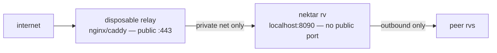

# edge-relay — the disposable public front

The rv's kernel + port never touch the internet. A thin stateless relay
(nginx or Cloudflare) takes the public heat and proxies to the rv on a
private interface. The relay is disposable — kill it, spin another; the
stateful rv never exposed its attack surface.



The rv reaches OUT to peers itself — it never needs an inbound rule. The
relay answers everything on the public side and proxies; it holds no state,
so a popped relay costs you nothing.

## Compose

```yaml
# deploy/edge-relay/compose.yaml — public relay → private rv
services:
  relay:
    image: nginx:alpine
    ports: ["443:443"]
    volumes: ["./nginx.conf:/etc/nginx/conf.d/default.conf:ro", "./certs:/etc/nginx/certs:ro"]
    networks: [edge]
  rv:
    build: ../../   # packages/overlay/serve.mjs
    environment:
      # bind to the container interface — 127.0.0.1 would hide it from the
      # relay; the `edge` network keeps it private, and `expose` (not `ports`)
      # means the host never publishes it. Enforce the boundary with a
      # network policy / firewall rule in production.
      - NEKTAR_OVERLAY_HOST=0.0.0.0
      - NEKTAR_OVERLAY_PORT=8090
      - NEKTAR_NETWORK=testnet
      - NEKTAR_PEERS=${NEKTAR_PEERS}
    expose: ["8090"]   # private network only — never published
    networks: [edge]
networks: { edge: {} }
```

## nginx.conf

```nginx
server {
  listen 443 ssl;
  server_name rv.nektar.run;
  ssl_certificate     /etc/nginx/certs/fullchain.pem;
  ssl_certificate_key /etc/nginx/certs/privkey.pem;
  location / {
    proxy_pass http://rv:8090;
    proxy_http_version 1.1;
    proxy_set_header Connection "";
    proxy_read_timeout 60s;
  }
}
```

Kill-and-replace the relay on a schedule; the rv's OS never faces the port.
