# mamem architecture

mamem is a BSV-native implementation of the Merkle Automaton (arXiv:2506.13246). It is encrypted, provenance-bearing agent memory whose history is append-only and anchored. State transitions are enforced by Rúnar UTXO contracts. Everything a verifier needs ends in the BSV header chain (GEN-003).

## 1. Layers

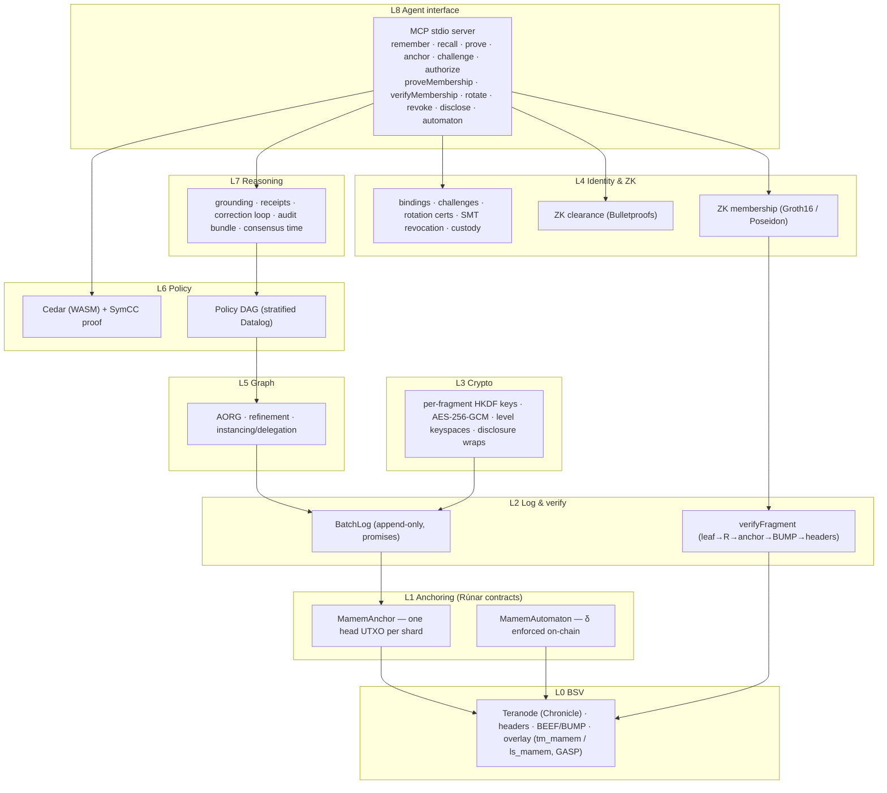

## 2. Package graph

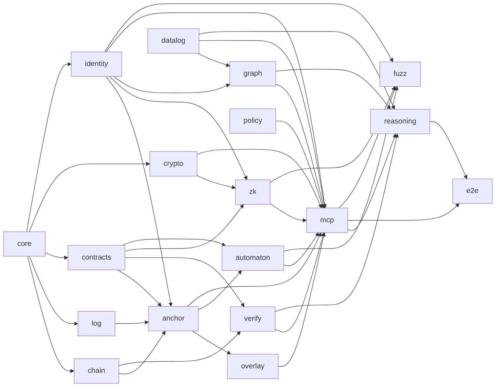

## 3. Write path: remember → batch → anchor

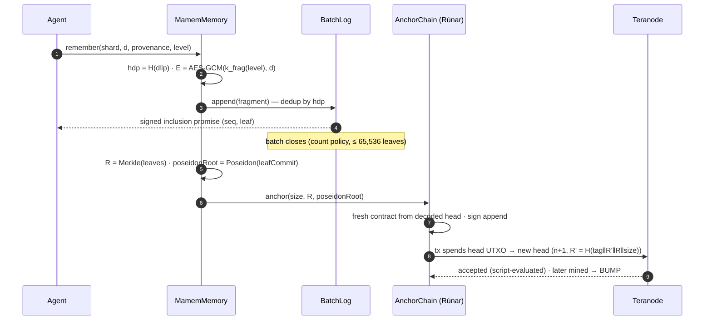

## 4. Read path: recall with identity, ZK clearance, Cedar and DAG

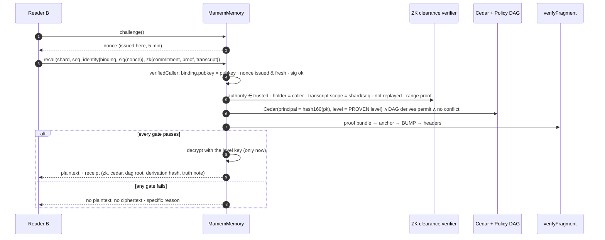

## 5. Anchor contract state machine (`MamemAnchor`)

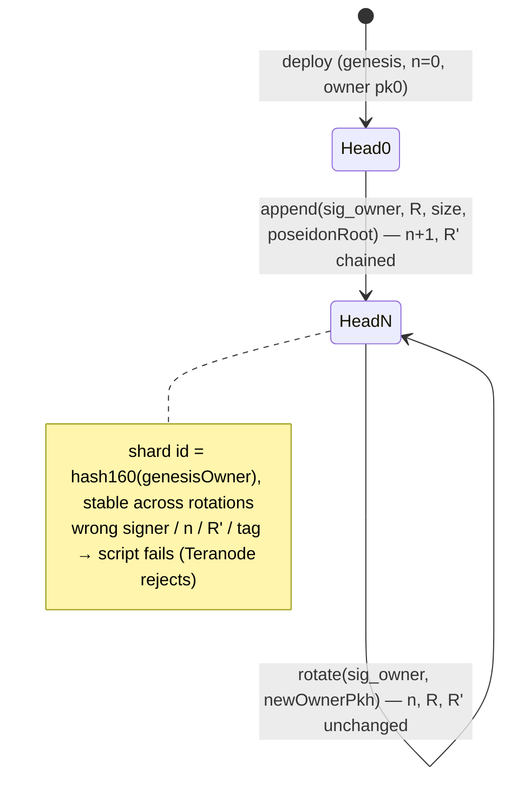

## 6. Automaton contract (`MamemAutomaton`)

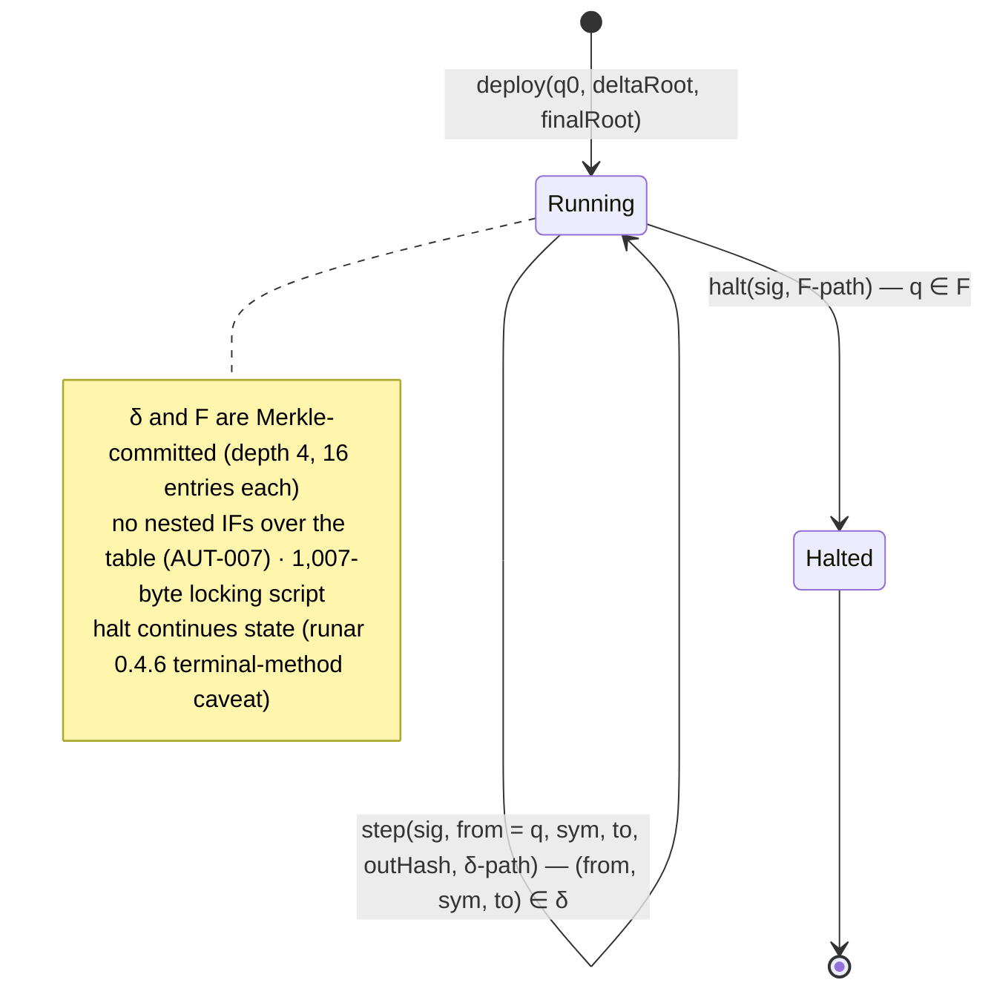

## 7. Identity, rotation and revocation

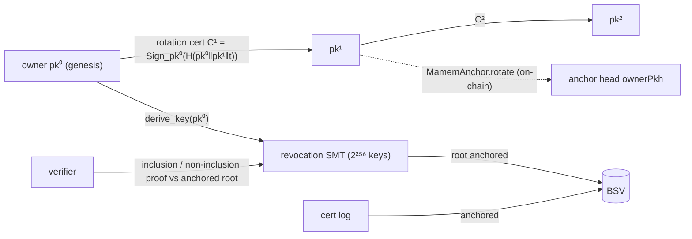

## 8. ZK: membership and clearance over one query

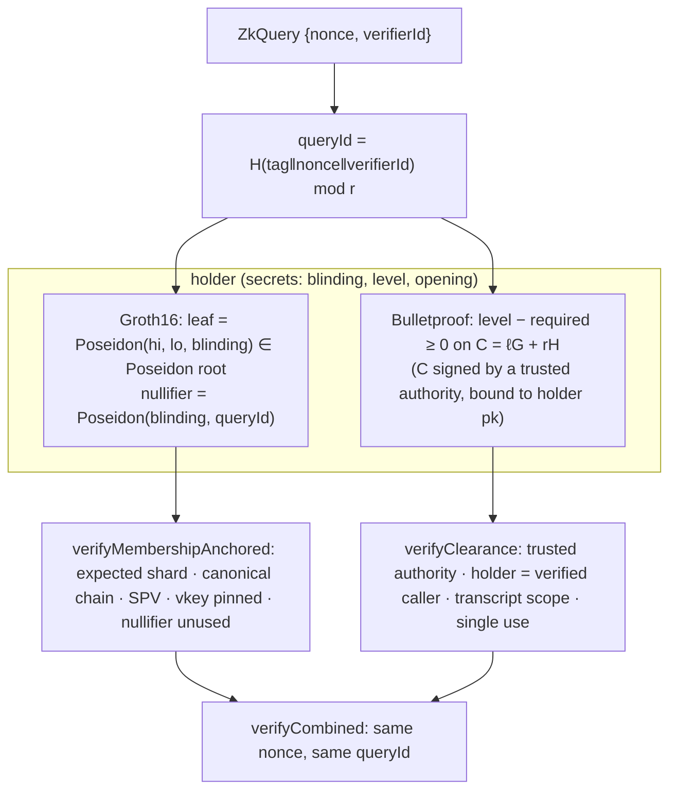

## 9. Overlay synchronisation (GASP)

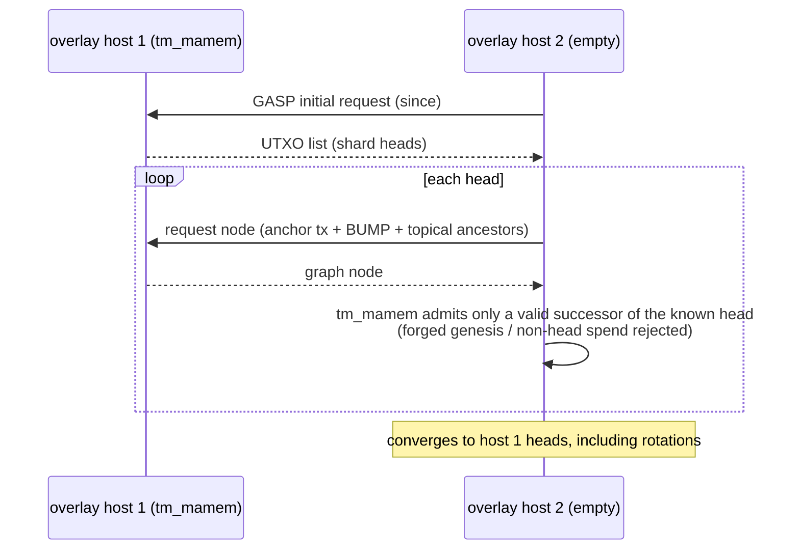

## 10. Reasoning, correction and audit

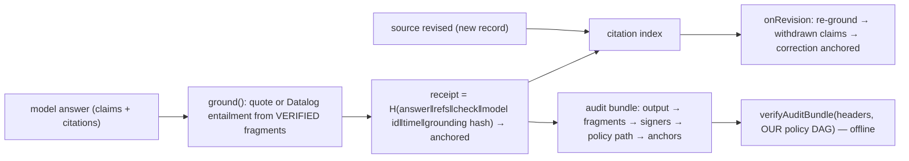

## 11. Data model

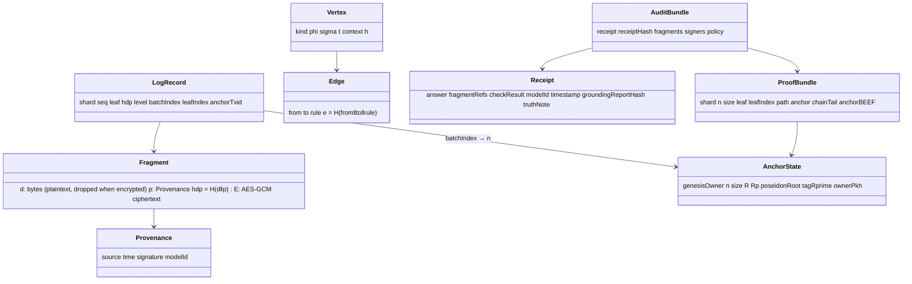

## 12. Deployment

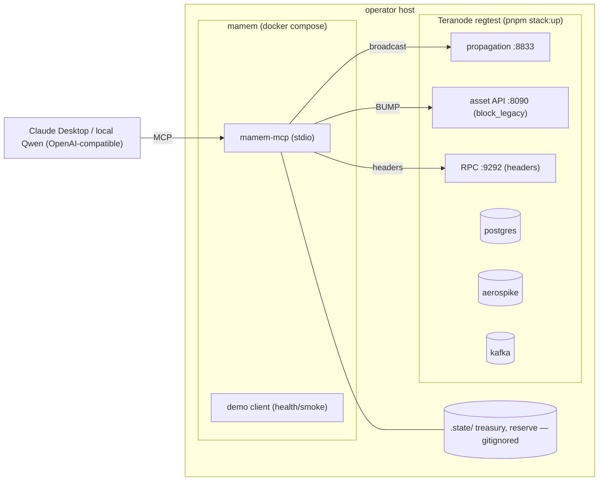

## 13. Checkpoints, promise monitor, finality and the HTTP surface

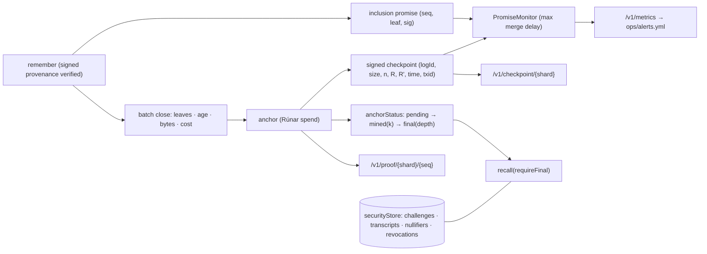

## 14. Test and release pipeline

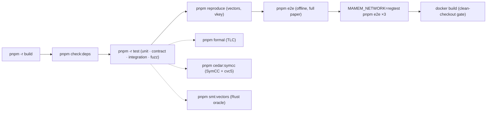

## Key decisions (ADR summary)

| ADR | Decision |
|---|---|
| 001 | TypeScript on `@bsv/sdk`; Rust references used as vector oracles (SMT run via Docker cargo) |
| 002 | Double-SHA-256 Merkle, odd self-pairing, leaf count committed |
| 003 | Trillian is a design reference only; fork-freedom comes from the head UTXO |
| 011 | Standard BSV stack (Teranode, overlay, BEEF/BUMP) replaces custom chain code |
| 012 | One anchor UTXO per shard; every successor spends it (Rúnar `MamemAnchor`) |
| 013 | Standard BEEF/BUMP proofs (no patented proof-entity formats) |
| 014 | BRC-42-style key derivation, level as KDF namespace |
| 015 | ~~ZK membership over a Poseidon companion tree whose root rides in the anchor~~ — **superseded by ADR-020** |
| 016 | Horizontal sharding; shards never coordinate |
| 017 | Automaton δ and F Merkle-committed in the Rúnar state; every method continues state |
| 018 | One `@bsv/sdk` version across the dependency graph (pnpm overrides) |
| 019 | Verifier-issued challenges; clearance holder-bound and authority-pinned; the Cedar level comes only from a verified ZK proof |
| 020 | ZK membership as Wright §13 specifies: **one** double-SHA-256 tree (the anchored R_n), proven with a transparent **ZK-STARK** (RISC Zero 3.0.3 succinct receipt; Fiat–Shamir, FRI, no trusted setup), verified off-chain (WASM) against the SPV-verified anchor with a pinned program ID and a verifier-issued single-use queryId. See below. |

### ADR-020 — hash-based STARK over the anchored SHA-256 tree

**Context.** Wright §13 / App. C define π = ZKMerkleProve(h_j, R_n, P_j) over the tree anchored on-chain. H is "a collision-resistant hash, e.g., SHA-256". Proofs are non-interactive via Fiat–Shamir. Only "public parameters for H, ZKProve, ZKAccess" are needed, with no central authority. ADR-015 departed from this in two ways:
- a second (Poseidon) tree, whose equality with R_n was never proven;
- a Groth16 trusted setup.

**Options evaluated (measured or documented, Nov 2026).**

| Option | Finding |
|---|---|
| SP1 (Plonky3 STARK) — the BSV-stack choice (Rúnar ships an SP1 FRI verifier; BSVM verifies SP1 STARKs on-chain) | **Rejected:** Succinct's security model states "individual STARK proofs in SP1 do not currently satisfy the zero-knowledge property". Only the Groth16/PLONK wrapper is ZK, which reintroduces a trusted setup. A non-ZK proof would leak the leaf, breaking §13. |
| RISC Zero succinct receipt | **Chosen:** documented as a zero-knowledge STARK (DEEP-ALI + FRI, trace noise added; "hides all program inputs"). Composite receipts leak the trace length, so only succinct receipts are accepted. |
| Noir/UltraHonk | Not chosen: universal setup (KZG), so not hash-only. |
| Bulletproofs over SHA-256 | Transparent, but impractical prover cost at depth 16. |

**Measured on this machine** (CPU only, prover in Docker; spike `tools/stark/`):
- **Program:** reproduces `core/merkle.ts` for all 561 leaf positions of sizes 1..33, and refuses index ≥ size, a short path, a broken odd self-pair and a foreign leaf at the odd position.
- **Real Teranode anchor** `662e9ae9…7a77`:
  - prove **34.9 s**, succinct receipt **224 KB**;
  - WASM verify in native Node **37–83 ms**;
  - the proven root equals the anchored R and the size equals the anchored size.
- **WASM verifier rejects:** a tampered receipt, a swapped header root or queryId, and a foreign program ID.

**On-chain verification:** not available for RISC Zero receipts in Rúnar, which only has an SP1 FRI verifier. Verification stays off-chain against the SPV-verified anchor, which §13 permits ("executable on-chain if necessary").

**Consequences:**
- the Poseidon tree, the Groth16 circuits and ceremony, and the anchor's `poseidonRoot` are removed (MamemAnchor v3, fresh regtest chains);
- the nullifier is replaced by a verifier-issued single-use queryId;
- proofs are larger (224 KB vs 389 B, all off-chain);
- proving is slower (≈35–50 s per proof on CPU);
- trust moves from a ceremony to the RISC Zero implementation plus the pinned program ID.
