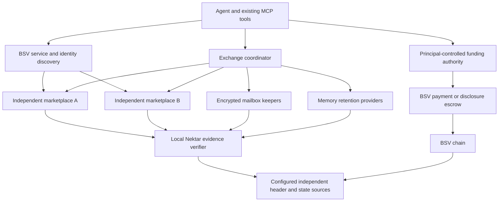

# Nektar: six BSV-native capability extensions

**Status:** proposal for principal-engineer review; not an implementation or a claim of production readiness  
**Date:** 2026-11-09  
**Repository:** https://github.com/kryptokrates/nektar  
**Source baseline:** local working tree inspected against HEAD `367287743768514619fa712dbba94b1117e89c60`; uncommitted work may differ from that commit  
**Scope:** discovery, complete market history, funded delegation, portable evidence, memory availability, and asynchronous exchange  
**Constraint:** no mandatory Lightweb package, 1bsv.net account, tunnel, delivery subscription, or operated endpoint

## 1. Executive decision

Extend Nektar into a BSV-native market in which agents can find independent marketplaces, verify the evidence they receive, spend under a genuinely enforced shared budget, recover missing committed history, retrieve purchased memory after its author goes offline, and negotiate asynchronously.

The architecture keeps four responsibilities separate:

1. **BSV settlement:** resolves payments and conflicting spends under the configured chain policy.
2. **Nektar verification:** validates signatures, memory commitments, provenance, receipts, and application rules.
3. **Marketplace and storage hosts:** index, retain, deliver, and compete on service.
4. **Transport:** moves identical signed objects over ordinary HTTPS initially; other transports remain optional.

Jeff Harris's bstack papers provide useful patterns for these capabilities. They explicitly permit point-to-point deployment without the commercial multicast network [S1]. Adopt applicable mechanisms and public BSV interfaces; do not make Nektar depend on Lightweb's deployment or assume that adopting the papers creates interoperability automatically.

**Recommended implementation order:** foundations and authenticated revocation → native discovery → funded cumulative budgets → portable evidence → complete market history → asynchronous exchange → paid memory retention. Feature numbering below preserves the six-feature research list, rather than this dependency order.

### 1.1 Decisions proposed for approval

| Decision                  | Proposed default                                                                                                                    |
| ------------------------- | ----------------------------------------------------------------------------------------------------------------------------------- |
| Discovery                 | BRC-88 SHIP/SLAP plus BRC-180 domain manifests; BRC-169 handles as a subsequent interoperability milestone                          |
| Global budget enforcement | One principal-controlled funding authority with a durable transactional ledger; no general budget covenant in the first release     |
| Market history            | Per-producer signed sequences and bounded intervals committed by existing Nektar anchoring mechanisms                               |
| Portable memory           | Existing Nektar evidence in a versioned package; experimental off-chain carriers are a separate profile                             |
| Availability              | Content-addressed encrypted objects, explicit retention contracts, bounded possession challenges; no automatic slashing             |
| Asynchronous exchange     | A small encrypted mailbox profile over HTTPS with durable deduplication; standard mailbox compatibility tested separately           |
| Chain environment         | regtest for controlled chain tests, explicitly configured public BSV testnet for integration evidence |
| Mainnet                   | A later deployment decision after integration and financial recovery gates pass                                                     |

## 2. Goals, limits, and terminology

### 2.1 Product outcomes

- An agent can discover a compatible marketplace without a hardcoded seller endpoint.
- A reader can detect and repair missing records within a known, anchored producer interval.
- All spending charged to one grant shares one enforceable cumulative limit, including concurrent calls through different marketplaces.
- A purchased memory package remains verifiable when served by a different host.
- Independent providers can retain encrypted memory and earn for a defined service.
- Agents can exchange requests, offers, and delivery notices without being online simultaneously.

### 2.2 Explicit non-goals

- No alternative blockchain, new token, global non-BSV discovery network, or mandatory multicast deployment.
- No claim that signatures, majority agreement, inclusion proofs, or model declarations establish factual truth.
- No claim of instantaneous finality, instantaneous revocation, guaranteed storage, cryptographic erasure, or universally discoverable agents.
- No promise that all BRCs cited here have identical maturity, installed support, or deployed counterparties. Pin reviewed revisions and test actual implementations.
- No automatic on-chain enforcement of natural-language topic restrictions. A script can enforce concrete encoded conditions, not interpret whether prose is about soccer.
- No change to the meaning or digest of existing receipt versions without explicit versioning and migration.

### 2.3 Proof vocabulary

| Property     | What establishes it                                                                      | What it does not establish                                                       |
| ------------ | ---------------------------------------------------------------------------------------- | -------------------------------------------------------------------------------- |
| Attribution  | Valid signature and the applicable key/identity binding                                  | Truth, authorization for every action, or uncompromised keys                     |
| Integrity    | Recomputed hashes and commitment paths                                                   | Availability or freshness                                                        |
| Inclusion    | Transaction proof checked against an accepted header chain                               | Current unspent status or irreversible finality                                  |
| Freshness    | A declared observation policy, current state observations, and anti-rollback rules       | Absolute proof that no newer publication exists anywhere                         |
| Completeness | Recomputed commitment for a specified producer, interval, sequence range, and object set | All real-world events, every producer, or arbitrary semantic search completeness |
| Authority    | Verified grant chain, scope, expiry, revocation policy, and funding authorization        | Funds exist unless separately verified                                           |
| Availability | Successful retrieval or a possession challenge under its stated assumptions              | Permanent retention or independent physical copies                               |

**MUST**, **SHOULD**, and **MAY** describe requirements of this proposed Nektar implementation. They do not add requirements to the external BRCs.

## 3. Current implementation baseline

The following are source observations, not a complete security audit. Revalidate them before implementing because the repository is actively changing.

| Area                    | Existing building blocks                                                                                                                                                       | Gap addressed by this spec                                                                      |
| ----------------------- | ------------------------------------------------------------------------------------------------------------------------------------------------------------------------------ | ----------------------------------------------------------------------------------------------- |
| Overlay engine          | `packages/overlay/src/node.ts`, `tm.ts`, `ls.ts`: `tm_nektar`, `tm_presence`, `ls_nektar`, `ls_presence`, BEEF parsing, anchor successors, persistent anchor heads             | Standard public discovery and protocol conformance at deployment boundaries                     |
| Marketplace transport   | `packages/overlay/serve.mjs`: signed announcements, configured `NEKTAR_PEERS`, beacons, event feeds, GASP routes                                                               | Discovered peers, complete security-event propagation, durable recovery and bounded fan-out     |
| Delegation              | `packages/overlay/src/presence.ts`: signed grants, parent scope/cap/expiry checks; `packages/mcp/src/server.ts`: `delegate`, `peerCall`, `revokeGrant`                         | Shared cumulative accounting, authenticated revocation evidence, full caller/funder enforcement |
| Payments and disclosure | `packages/mcp/src/server.ts`: invoice payment and `sale` offer/escrow/complete/refund/claim; `packages/identity/src/sale.ts`; `packages/contracts/src/DisclosureSale.runar.ts` | Grant-bound funding and durable asynchronous orchestration around the existing escrow           |
| Memory and receipts     | `packages/mcp/src/memory.ts`: anchor operations, shard packs, answer receipts, `receiptDigest`; identity and verify packages                                                   | Portable versioned evidence and explicit assurance/freshness results                            |
| Lightweb compatibility  | `packages/overlay/src/host-module.ts`, vendored `bcommon` engine types                                                                                                         | Optional integration boundary; no requirement to ship this code in the independent core         |

### 3.1 Findings to resolve before expanding federation

1. The inspected peer ingestion map relays delegation events but omits `revocation`. A peer can retain stale grant state. Security-relevant event types MUST have explicit handlers and replay tests.
2. The inspected `revokeDelegation` interface accepts `{grantId, pub, ts}`. Comparing `pub` with the stored owner is not cryptographic authentication. Introduce independently verifiable owner-signed revocations, or a verified chain-spend profile, before trusting relayed revocation requests.
3. Peer cursors are initialized in memory, and ingestion errors are swallowed after the cursor advances. Define durable cursor advancement, retry, quarantine, and backfill semantics.
4. `peerCall` compares the individual invoice amount with `spendCapSats`. The inspected path does not establish a shared cumulative reservation ledger. Its tool schema describes a cumulative limit; that description needs to match the actual funding guarantee.
5. Grants and catalogs received through HTTP are not automatically mined transaction evidence. Network/tip binding, signature validation, and transaction inclusion are separate checks.
6. Existing custom routes such as `/overlay/submit` do not by themselves establish interoperability with every BRC-22 client. Wire format, route resolution, lookup results, authentication, and errors require conformance fixtures.

### 3.2 Existing receipt compatibility

The inspected `AnswerReceipt` and its digest have their own defined fields. This spec does not assume that `grantId`, payment authorization, mailbox message identifiers, or the new assurance model are already bound into every current receipt.

Use a separately signed, versioned **exchange receipt** referencing the existing receipt digest where necessary. A later answer-receipt version may incorporate these fields explicitly. Never add fields to a JSON response and claim an older signature covers them.

## 4. Shared architecture and requirements



This is a logical diagram, not a requirement to deploy a separate service for every box. Reuse existing packages and processes where practical.

### 4.1 Shared object discipline

New signed objects MUST bind, as applicable:

- Object kind, schema version, and signature domain separator.
- Chain/network identity; private networks additionally require an unambiguous configured chain identity.
- Issuer identity key, object identifier, creation time, and expiry.
- Referenced object hashes, recipient identity, and operation-specific fields.
- Exact canonical payload bytes under a published encoding profile.

Use SHA-256 for new content identifiers unless an existing verified Nektar structure requires its established digest. Do not silently replace existing digest algorithms. For new JSON objects, specify RFC 8785 canonicalization with safe-integer numeric fields and reject unsupported values. Publish fixtures covering Unicode, absent versus null fields, empty collections, and boundary integers. Amounts MUST be nonnegative safe integers in satoshis; arithmetic MUST reject overflow.

The transport MUST preserve the signed payload. Hosts may add unsigned delivery metadata outside it. Unknown authorization-critical versions or semantics MUST fail closed. Unknown optional discovery metadata may be ignored under its declared profile.

### 4.2 Shared verification result

Expose separate results rather than one undifferentiated `verified` flag:

```json
{
  "schema": "nektar.verification.v1",
  "signature": "valid",
  "commitment": "valid",
  "inclusion": "confirmed",
  "authority": "not-required",
  "freshness": "unknown",
  "availability": "retrieved",
  "truth": "not-established",
  "evidenceRefs": [],
  "observedAt": "2026-11-09T12:00:00Z"
}
```

These values are illustrative. Define enums and reason codes in implementation. Pending, unknown, stale, unavailable, conflicting, and invalid MUST remain distinguishable. Offline verification may establish historical integrity while leaving present authority or freshness unknown.

### 4.3 Shared operational requirements

- Discovery and retrieval need timeouts, byte limits, concurrency limits, and bounded retries. No unbounded recursive peer crawling.
- Endpoint resolution needs an outbound network policy, redirect limits, and protection against unintended private-network access and DNS rebinding. Explicit local-development profiles may allow localhost/private addresses.
- Operator, funder, storage, and encryption key roles MUST be explicit. Do not copy the principal's funding key into an agent's execution environment.
- SQLite is sufficient for a single local authority with correctly serialized transactions. A multi-instance funding authority needs one consistent transactional store and fencing; asynchronous replica counters are insufficient.
- Define network, header freshness, confirmation, reorg, and spend-observation policies. Multiple URLs are not proof of independent operators.
- Metrics and logs MUST omit plaintext private memory, decryption keys, raw credentials, and full sensitive message bodies.
- Keep provider configuration replaceable. Do not weaken proof validation when a preferred provider is unavailable.

## 5. Feature 1 — native BSV marketplace and agent discovery

### 5.1 Outcome and source mechanisms

An agent supplied with a domain, handle, or requested Nektar service can locate compatible independent hosts. BRC-88 SHIP/SLAP advertises topics and lookup services; BRC-180 declares a domain's service URLs; BRC-169 supplies handle resolution and identity/payment/messaging bindings [S7–S9]. The bfinger paper motivates a portable, verifiable identity record [S3].

This is not a global semantic search engine. Host discovery precedes querying Nektar's catalogs for expertise.

### 5.2 Proposed behavior

1. Preserve explicit endpoint configuration as the deterministic override.
2. Resolve a named domain using its BRC-180 manifest. Do not guess alternate hostnames when a declaration is absent.
3. Discover candidate service hosts through configured SHIP/SLAP trackers. Allow multiple bootstrap sources and user-supplied replacements.
4. Query the exact requested lookup service and validate the returned Nektar objects locally.
5. Probe candidate service capabilities, network identity, schema versions, and declared authentication requirements before paid actions.
6. Cache discovery results with source, observation time, identity, and expiry. Revalidate before payment under the configured policy.
7. Add BRC-169 handle resolution with certificate validation and explicit domain trust anchors. A handle must not become a trusted payee from a display string alone.

Illustrative domain declaration, valid only after these service names and endpoints are actually served:

```json
{
  "metanet": {
    "overlays": {
      "tm_nektar": "https://market.example",
      "ls_nektar": "https://market.example",
      "tm_presence": "https://market.example",
      "ls_presence": "https://market.example"
    }
  }
}
```

Service names MUST match deployed topic/lookup names. Publishing metadata for an absent service is not compliance. A domain declaration expresses the domain operator's claim; the client still verifies identity and returned evidence.

### 5.3 Interfaces and integration

Extend the existing `discover` implementation with an explicit discovery-source/profile input, preserving current directory queries. Return candidate endpoint, host key, network, supported service names, discovery source, expiry, and verification warnings. Distinguish the marketplace host key from the seller key and payment recipient.

Implement standard submission/lookup bindings at the server boundary, reusing the current engine. Maintain existing Nektar convenience routes for compatibility. Evaluate SDK `LookupResolver` and `TopicBroadcaster` plus an independent advertiser implementation before creating another discovery protocol. Pin exact dependencies after testing.

### 5.4 Acceptance criteria

- F1-01: A stock compatible BSV lookup client discovers and queries a Nektar host through its advertised service without a hardcoded seller URL.
- F1-02: BRC-180 points a website domain to a distinct API host; the client uses that declaration without hostname guessing.
- F1-03: With the first tracker or marketplace unavailable, another independently configured source yields a compatible host within the configured timeout budget.
- F1-04: A validly signed catalog on the wrong network is rejected for the requested paid flow.
- F1-05: Expired advertisements, identity conflicts, unsupported service versions, and malicious redirects produce explicit failures or exclusions.
- F1-06: A BRC-169 handle with an invalid certificate or unexpected key change cannot silently authorize payment.
- F1-07: Public discovery works with no 1bsv.net credentials or calls to Lightweb-operated services.

**Demo:** Bob starts with a topic or verified handle, finds two marketplaces, loses A, then discovers Alice's matching catalog through B. Discovery is genuinely exercised; the seller URL is not pre-seeded.

## 6. Feature 2 — complete and repairable committed market history

### 6.1 Outcome and source mechanism

Detect omission, reordering, and alteration within a known producer interval; recover missing committed records from another host. The blogs pattern uses signed sequence-numbered batches, predecessor references, and a mined interval commitment [S4].

Reuse Nektar's existing hash/tree and anchoring structures where they meet this requirement. Adopting the property does not require implementing the external blogs wire format. Claim direct compatibility only after testing that format.

### 6.2 Record and interval model

Define a producer as one signing identity publishing one named stream. Each event binds:

`version, network, producerKey, streamId, sequence, previousEventHash, kind, payloadHash, payloadReference, createdAt, signature`.

Sequences start at a specified value, advance by one, and are producer-signed. The marketplace's local SQL cursor remains a delivery cursor; it MUST NOT substitute for a portable producer sequence.

An interval commitment binds:

`producerKey, streamId, intervalId, firstSequence, lastSequence, eventCount, merkleRoot, previousIntervalHash, anchorReference`.

Specify the exact leaf encoding, tree algorithm, empty-tree rule, and ordering. If reusing existing Nektar trees, record that choice and provide vectors; do not claim RFC 6962 compatibility unless the construction matches. Anchor the commitment through the existing chain mechanism and include its proof.

Events cover published catalogs/offers, accepted deals, settlements, grants, and authenticated revocations under declared stream policies. Private events may commit encrypted bytes or digests and provide restricted access; do not leak private content into a public history.

### 6.3 Publication, verification, and repair

1. Persist an event and its sequence assignment atomically before publication.
2. Close an interval by count or time; sign its exact range and root.
3. Anchor it and distinguish pending from confirmed evidence.
4. A reader obtains the trusted interval commitment and all events, or sufficient range evidence for its requested operation.
5. Recompute the root and check range/count, producer signature, predecessor links, and anchor evidence.
6. Fetch gaps by producer/stream/range or content hash from a sibling host. Validate replacements before storing them.
7. Persist a peer cursor only after successful durable application, or after recording a rejected object in a durable quarantine with a retry/review policy. A timeout is not a successful ingest.

A producer presenting conflicting signed successors generates an equivocation evidence pair. Do not silently choose the later timestamp. If an anchored state chain resolves the conflict, record the branch and settlement policy used.

### 6.4 Boundaries

- Completeness is relative to a specified committed interval, not every event that happened in the world.
- A marketplace can prove completeness of its own admitted event stream; that does not prove that it indexed every seller or returned every semantic match.
- A reader cannot discover a withheld latest interval from old evidence alone. Freshness requires independent observations and a policy.
- Redacted content may leave a committed position and digest. Distinguish intentionally unavailable content from an unaccounted sequence gap.
- Revocation must be checked before a paid action; an asynchronously anchored audit trail is not the sole real-time revocation mechanism.

### 6.5 Acceptance criteria

- F2-01: Deleting one event from a closed interval causes verification to fail and identifies the missing range.
- F2-02: Reordering, duplicating, or replacing events cannot produce the accepted root.
- F2-03: A fresh host reconstructs and verifies an interval while the producer is offline, using a sibling's retained data.
- F2-04: Restarting either host does not skip an unapplied event or apply a financial side effect twice.
- F2-05: Grant revocation is relayed, authenticated, persisted, and remains effective after restart and backfill.
- F2-06: Conflicting signed histories are exposed; an invalid branch is not merged into accepted state.
- F2-07: The verifier reports `complete-for-interval` with the exact producer/range/anchor, never `complete-market` without a stronger specified proof.

**Demo:** A returns events 41, 42, and 44 for a committed four-event interval. Bob detects missing 43, fetches it from B, and verifies the recomputed root. Include a hidden revocation as a separate fail-closed authorization test.

## 7. Feature 3 — funded cumulative delegation across marketplaces

### 7.1 Outcome and trust model

Alice can authorize Bob to spend at most a declared lifetime amount of Alice's funds, including concurrent purchases on different marketplaces. Bob holds his own identity key, not Alice's unrestricted funding key.

BRC-169 distinguishes per-action caps from cumulative caps: a cumulative total is not counterparty-verifiable from a certificate alone and requires a principal-funded enforcement arrangement [S9]. The first implementation therefore uses a principal-controlled funding authority. This is an explicit online dependency for new authorizations, not a claim of permissionless distributed budget accounting.

### 7.2 Grant v2

Publish a new grant schema rather than reinterpret old signatures. Bind:

| Field                                             | Purpose                                                                               |
| ------------------------------------------------- | ------------------------------------------------------------------------------------- |
| `grantId`, `version`, `network`                   | Stable identity and replay boundary                                                   |
| `principalKey`, `delegateKey`, `parentGrantId`    | Authority chain and actors                                                            |
| `scope`                                           | Allowed tools, resources, domains, and counterparties under a specified matching rule |
| `perActionCapSats`                                | Maximum all-in debit for one action                                                   |
| `totalCapSats`                                    | Maximum lifetime budget debit including allowed fees                                  |
| `expiresAt`, optional `expiryHeight`              | Expiry; earliest applicable bound wins                                                |
| `delegable`, `maxDepth`                           | Explicit ability to delegate further                                                  |
| `fundingAuthorityKey`, `fundingAuthorityEndpoint` | Identity and route of the budget enforcer                                             |
| `revocationReference`, `issuedAt`, `signature`    | Revocation profile and authenticated grant                                            |

Unknown scopes deny access. A child cannot broaden scope, expiry, per-action cap, total allocation, or delegation depth. Omitted/empty scope semantics MUST be explicit; omission cannot turn a restricted parent into an unrestricted child.

Legacy grants remain verifiable under their original schema, but are labeled with their actual enforcement profile. Do not upgrade a legacy per-call check to a cumulative guarantee by changing its description.

### 7.3 Budget accounting invariant

For every root grant and each constrained ancestor:

```text
committedAllInDebits + outstandingWorstCaseReservations <= totalCapSats
```

All-in debit includes the purchase and attributable network/service fees. Fee estimation reserves an explicit upper bound. Fees outside the grant, such as an owner's separately funded audit anchor, must be disclosed and cannot be silently charged to the grant.

The cap is lifetime consumption, not a revolving credit line: completed purchases do not replenish it. Releasing an unused reservation restores headroom. Refunding an escrow releases only recovered principal; actual fees remain consumed. A previously completed purchase refund does not automatically restore lifetime spending capacity unless a future explicit policy version defines that behavior.

Subgrants draw from the same root pool. A cap is a ceiling, not a reserved entitlement. Their caps may overlap, but concurrent reservations MUST atomically enforce all ancestor ceilings. If guaranteed child allocations are introduced, capacity transferred to a child must be deducted from the parent's unallocated capacity. Never count the same reservation twice in root totals.

### 7.4 Action state machine

```text
requested -> reserved -> signed -> submitted -> confirmed
                 |          |          |
                 |          +----------+-> reconciliation-required
                 +-> cancelled-before-signing

escrow-funded -> seller-completed -> consumed
             -> refund-eligible -> refund-submitted -> refund-confirmed
```

Required rules:

1. Bind an idempotency key to the caller, grant, invoice/offer digest, recipient, network, amount, fee ceiling, and operation. Reusing it for different parameters is an error.
2. Authenticate Bob, validate every grant link, scope, expiry, and revocation freshness before reserving.
3. Reserve budget and wallet inputs atomically. One active funding authority serializes this decision; HA deployments require fencing, not independent counters.
4. Persist the reservation and exact transaction template before signing. Record the signed transaction/txid durably before exposing or broadcasting it.
5. The authority signs only outputs allowed by the verified invoice/escrow configuration. Binding a generic amount is insufficient.
6. Once signed bytes may have escaped, do not release the reservation on timeout or expiry alone. The transaction may settle later. Reconcile its inputs and conflicting spends first.
7. A confirmed escrow remains a budget commitment until valid completion or a verified refund outcome. Completion must not consume the purchase amount twice.
8. Revocation rejects new reservations immediately at the authority; it does not invalidate already signed Bitcoin transactions. Define whether existing escrow completion is allowed and how refund recovery proceeds.
9. A reorg moves affected actions into reconciliation and retains conservative exposure until resolved. Never free budget merely because a confirmation disappeared.

All delegated payment entrypoints, including direct invoice helpers and escrow funding, MUST pass through this boundary when spending principal funds. Agent-side `peerCall` checks remain useful but cannot be the sole enforcement point. Funds Bob independently controls remain outside Alice's grant guarantee.

### 7.5 Exchange evidence

The authority issues a signed authorization record binding the grant chain digest, action ID, invoice/offer digest, network, authorized outputs, reserved all-in debit, transaction reference when known, and policy version. An exchange receipt references it and the outcome.

A seller can verify this authorization and payment evidence. The seller still cannot independently infer every other action charged to the root grant. The hard cap relies on the principal's funding authority controlling the relevant funds and enforcing its ledger.

### 7.6 Revocation profiles

- **Initial:** owner-signed revocation objects plus authority-local enforcement and relayed tombstones. Bind grant ID, issuer, network, monotonic state version, time, and signature. Verify complete ancestry at use time.
- **Optional interoperability profile:** BRC-52/BRC-169 revocation outpoints with fresh spend observations. Inclusion evidence does not prove an outpoint remains unspent.
- A proof of authority observed yesterday is not a fresh authorization today. Unknown revocation state denies new principal-funded actions under the strict profile.

### 7.7 Acceptance criteria

- F3-01: A 500-sat all-in grant permits a confirmed 300-sat all-in debit and rejects a further 250-sat debit through another marketplace.
- F3-02: Two simultaneous 300-sat all-in reservations under a 500-sat root cannot both succeed, including across two authority workers.
- F3-03: Two children cannot collectively exceed any ancestor budget, and a child cannot omit a restricted scope to widen authority.
- F3-04: Retrying one action after a process crash neither creates a second payment nor releases unresolved signed exposure.
- F3-05: Revocation blocks new reservations on every route; forged and replayed revocations cannot revoke another principal's grant.
- F3-06: Escrow funding, completion, refund, and fee consumption reconcile to actual wallet outputs without double-counting.
- F3-07: Network mismatches, invoice mutation, recipient substitution, integer overflow, expired grants, and unexpected fee growth are rejected before signing.
- F3-08: Authority outage prevents new delegated spending and returns an explicit recoverable error; it never falls back to an unrestricted funding key.

**Demo:** Alice grants 500 all-in sats. Bob spends 300 through A; attempts 250 through B and is refused; buys an affordable item through B; Alice revokes; another attempt is refused. Display the real budget ledger and payment transactions.

## 8. Feature 4 — portable memory and transaction evidence

### 8.1 Outcome and profile separation

A buyer can verify a memory package obtained from any compatible host without trusting that host as the source of truth.

The first release packages existing Nektar evidence. The data-carrier paper's transaction-shaped off-chain carriers are a separate experimental profile, not a prerequisite [S2]. Reuse BEEF for transaction evidence without implying every memory record is itself a mined transaction.

### 8.2 Package v1

The logical package contains:

| Component                 | Requirement                                                                                                                   |
| ------------------------- | ----------------------------------------------------------------------------------------------------------------------------- |
| Manifest                  | Schema, network, issuer, content identifiers, media types, byte sizes, record identity, encryption profile, component hashes  |
| Record material           | Public canonical bytes or ciphertext; plaintext and private keys absent unless explicitly intended for this buyer             |
| Provenance                | Existing Nektar author signature and derivation/provenance evidence                                                           |
| Commitment                | Record leaf, tree path, root, shard sequence/state identity, and anchor reference                                             |
| Transaction evidence      | Required transaction bytes/BEEF, inclusion paths, and references needed to verify the anchor against locally accepted headers |
| Receipt references        | Existing answer receipt and optional versioned exchange receipt, each preserving its original signing rules                   |
| Authority/status evidence | Grant/revocation observations if relevant; observation time and freshness policy                                              |
| Availability references   | Optional providers/content locations; never substitutes for content hashes                                                    |

The package manifest signs component hashes with typed roles, preventing substitution of a payment receipt for a memory commitment. Content-address each component and bound aggregate/decompressed size before parsing. The archive/container encoding is chosen during implementation; hash canonical components, not incidental ZIP timestamps.

### 8.3 Verification pipeline

1. Validate schema, size bounds, network, component hashes, and manifest signature.
2. Validate identity and provenance under the caller's trust policy.
3. Verify record commitment, tree path, anchor state, and required transaction ancestry.
4. Validate inclusion against accepted headers; distinguish unconfirmed ancestry from a confirmed subject transaction.
5. Verify applicable receipt digests and signatures using their own versions.
6. For live authorization, obtain fresh status separately. Offline verification reports historical assurance and unknown current state.
7. Decrypt buyer-specific content only after verifying its binding to the agreed commitment. Import into memory only after the existing claim/fragment checks succeed.

### 8.4 Experimental carrier profile

If adopted, specify the funding outpoint, carrier transaction bytes, signature encoding, parent evidence, commitment binding, locktime/finality rules, and spend-based retraction semantics. Nonfinal transaction handling must be tested against the chosen SDK verifier and relay assumptions.

The paper's far-future locktime is not an eternal consensus guarantee of unmineability. A production profile must state its horizon and migration policy. Parent inclusion does not prove the carrier was mined or that its funding output remains unspent. Retraction means rejection by conforming current readers/hosts, not deletion of cached copies.

### 8.5 Acceptance criteria

- F4-01: Export from Alice, serve from an unrelated host, and verify without contacting Alice.
- F4-02: Alter any record, component role, ciphertext, tree path, receipt, or network tag; verification fails with a specific reason.
- F4-03: Offline verification succeeds for historical evidence against supplied accepted headers while current revocation status remains explicitly unknown.
- F4-04: A mined parent plus unmined carrier is never displayed as confirmed inclusion of that carrier.
- F4-05: Malformed, oversized, recursively nested, truncated, and unsupported-version packages are rejected within resource limits.
- F4-06: Existing receipt fixtures continue to verify unchanged; new exchange fields cannot be stripped or injected without breaking their own signature.
- F4-07: A package naming private memory does not accidentally expose plaintext, fragment keys, or access-bearing metadata in public discovery.

**Demo:** Export a purchased record, take its original host offline, retrieve its package elsewhere, verify it, then show a one-byte alteration fail.

## 9. Feature 5 — paid retention and retrieval of memory

### 9.1 Outcome and source mechanisms

Separate payment for expertise from payment for retaining and delivering its bytes. The bstore pattern combines content addressing, provider advertisements, sampled possession checks, and committed listings [S5]. BRC-26 UHRP is a relevant retrieval advertisement mechanism [S11].

Start with explicit provider contracts and successful retrieval. Add sampled possession audits after the challenge protocol is reviewed. Do not begin with a general storage-chain implementation, on-chain slashing, or a new proof system.

### 9.2 Retention contract and advertisement

A signed retention contract binds:

`contractId, ownerKey, providerKey, network, packageManifestHash, objectRoot, proofRoot, encodingVersion, byteSize, start, expiry, priceSats, paymentSchedule, retrievalPolicy, challengePolicy, deletionPolicy`.

Encrypt private memory before upload. Storage providers receive ciphertext and public verification material only. A content hash identifies immutable bytes; changing encryption produces a new object identity. Small records may be packed into an immutable object to amortize fees, with record inclusion paths retained.

Use UHRP advertisements where compatible and include Nektar retention metadata in a separate signed object as necessary. A provider advertisement is a statement and retrieval hint, not proof of ongoing custody.

### 9.3 Lifecycle

```text
offered -> accepted -> uploaded -> initial-retrieval-verified -> active
active -> renewed | expired | unreachable | challenge-failed | retired
```

1. The buyer selects providers, price ceilings, retention duration, and desired redundancy.
2. Upload ciphertext and verify an initial retrieval/content commitment before starting the paid active period.
3. Record the provider's signed terms and receipt. Use feature 3 when payment is delegated.
4. Retrieve by content hash from any eligible provider, checking every chunk and the final package.
5. Challenge active copies under the agreed schedule; record outcomes with evidence and their assurance level.
6. Renew or repair replication before expiry. Do not silently charge beyond the grant or contract.

The first payment profile is bounded prepaid retention epochs or payment after completed service intervals, with the non-delivery risk stated. Existing disclosure escrow may protect an initial content delivery where appropriate; it does not prove future retention. Automatic script-based possession settlement is a later, separately specified contract.

### 9.4 Possession challenges

Define chunk sizes, tree construction, sample selection, proof encoding, identity binding, challenge nonce, deadline, and maximum response size. Challenges MUST be unpredictable to a provider before the agreed challenge point and bind the provider's key to prevent simple response replay.

For uniform independent sampling with replacement, if fraction `f` of committed segments is missing, detection probability after `k` samples is `1 - (1 - f)^k`. State the model and sample count; do not advertise full possession from a sample. A provider may fetch challenged bytes from another provider within the response window, so this is not a proof of independent physical storage.

A signed invalid answer can provide evidence of misbehavior. A timeout can be observed and recorded by a client but does not alone prove malicious loss to a third party. Do not label a timeout as cryptographic proof of fraud.

### 9.5 Acceptance criteria

- F5-01: After Alice and the original marketplace stop, Bob retrieves and verifies purchased memory from a paid provider.
- F5-02: A corrupt chunk is rejected and another provider is tried within the retrieval budget.
- F5-03: Expired or invalid advertisements do not satisfy the active-copy target.
- F5-04: Deterministic challenge fixtures validate sample generation, paths, identity binding, replay refusal, and corrupt-response rejection.
- F5-05: A missing-data experiment reports its sample size and confidence model, without claiming certainty or physical provider independence.
- F5-06: Renewal never exceeds the retention contract or delegated budget; retries do not charge twice.
- F5-07: Providers cannot decrypt uploaded private memory, and deleting a listing is not reported as erasing all existing copies.

**Demo:** Buy a record, pay two providers to retain its encrypted package, stop Alice and one provider, retrieve from the survivor, and verify the original commitment and purchase receipt.

## 10. Feature 6 — asynchronous requests, offers, and delivery notices

### 10.1 Outcome and source mechanism

Agents negotiate and coordinate purchases without simultaneous availability. The bbox paper describes encrypted envelopes kept by multiple hosts, signed acknowledgements, and optional enclosed payments [S6]. BRC-33 and BRC-169 provide relevant mailbox and identity semantics [S9, S12].

Build a narrow Nektar exchange profile first. If it uses a custom mailbox payload or protocol extension, label it explicitly. Compatibility with bbox or a stock BRC-33 server requires interoperability fixtures, not a similar concept.

### 10.2 Envelope and confidentiality

An authenticated envelope binds:

`messageId, version, network, senderKey, recipientKey, conversationId, operationId, kind, createdAt, expiresAt, replyTo, ciphertextHash, encryptionProfile, signature`.

Supported message kinds initially: `request`, `offer`, `acceptance`, `delivery-reference`, `acknowledgement`, `cancellation`. Payloads carry existing signed wants/offers or references to them rather than inventing new sale economics.

Use reviewed authenticated encryption and recipient-key derivation consistent with the selected BSV profile. Publish test vectors. Do not design a new encryption primitive. Plaintext, fragment keys, and spendable transaction bytes MUST NOT appear in public envelopes. Metadata disclosure includes sender, recipient, timing, size, and conversation linkage unless a later profile protects it. Do not claim forward secrecy without implementing it.

### 10.3 Delivery and sale state

```text
created -> published-to-keepers -> received -> acknowledged
      \-> expired | cancelled

request -> offer -> accepted -> escrow-funded -> disclosure-observed -> claimed
                                    \-> refund-eligible -> refunded
```

These are separate state machines. Keeper acceptance is not recipient delivery; acknowledgement is not content truth; a mailbox receipt is not payment confirmation.

1. Sender publishes the same encrypted envelope to a bounded set of keepers and records each admission result.
2. Recipient polls configured/discovered keepers, verifies the sender and envelope, decrypts, and durably deduplicates by message and operation ID.
3. Receipt of an `acceptance` does not authorize unlimited payment. The exchange coordinator rechecks the offer, grant, expiry, budget, and network immediately before funding.
4. The existing sale escrow remains the payment/disclosure mechanism. Seller completion is observed through transaction evidence even if a mailbox delivery notice is lost.
5. The recipient signs an acknowledgement referencing the exact message hash. Keepers retain the acknowledgement/tombstone for the configured replay window.
6. Repeated or out-of-order envelopes cannot repeat a payment, downgrade a newer offer, or resurrect an expired action.
7. Coordinator restart reconstructs state from durable exchange records, payment records, and evidence. It does not treat a missing acknowledgement as permission to buy again.

### 10.4 Optional enclosed payments and postage

Do not include transferable payments in the first release unless a concrete flow requires them. If later adopted, encrypt them to the recipient and implement the applicable BRC-169 claim/reclamation rules. A signed unbroadcast transaction may be conflicted before settlement; it is not funded escrow merely because a message contains it.

Initially apply authenticated quotas, byte limits, expiry, and a configurable BSV fee policy to keeper admission. A later funding-output/postage profile must define one-use admission, conflict detection, and replay behavior. Copying an unsigned `postage paid` field proves nothing.

Keep a small free discovery/health surface. Mailbox pricing, content pricing, storage pricing, and miner fees MUST be distinguishable in quotes and budget reservations.

### 10.5 Acceptance criteria

- F6-01: Bob posts a request while Alice is offline; Alice later receives it and posts an offer while Bob is offline; the purchase completes after Bob returns.
- F6-02: Killing one keeper does not lose an envelope retained by another; duplicate delivery creates one exchange action.
- F6-03: A forged sender, altered ciphertext, wrong recipient, expired offer, or wrong network cannot trigger funding.
- F6-04: Replaying acceptance or delivery messages after a crash does not create another escrow or payment.
- F6-05: A lost completion notice is reconciled from valid sale transaction evidence; a nonexistent disclosure does not become successful from a mailbox acknowledgement.
- F6-06: If the seller never completes, the buyer follows the real escrow refund condition and obtains a verified refund outcome.
- F6-07: Keeper logs and public listings contain no plaintext memory, decryption keys, or unencrypted spendable transactions.

**Demo:** Alice and Bob alternate offline periods. Keepers carry the negotiation; Bob's funding authority enforces the budget; the existing BSV escrow settles the sale; Bob verifies the delivered package and receipt.

## 11. Proposed engineering surfaces

These are logical operations, not a mandate to create one MCP tool or npm package per row. Prefer extending existing tools and internal modules where that preserves clarity.

| Surface        | Proposed operations                                                                   | Existing integration point                                             |
| -------------- | ------------------------------------------------------------------------------------- | ---------------------------------------------------------------------- |
| Discovery      | Resolve domain/services/handle; discover candidates; refresh advertisements           | `discover`, overlay server, engine wiring                              |
| History        | Publish interval; retrieve range; verify interval; repair gap                         | Presence event log, anchor package, GASP and event feeds               |
| Funding        | Issue grant; reserve action; authorize transaction; reconcile; revoke; inspect budget | `delegate`, `peerCall`, `payInvoice`, sale funding, chain/wallet layer |
| Evidence       | Export package; verify package; import verified record                                | Shard packs, `sale#claim`, `importRecord`, receipt/verify modules      |
| Retention      | Quote; place; advertise; retrieve; challenge; renew                                   | Content/package store, BSV payment path, provider adapter              |
| Async exchange | Send; receive; acknowledge; reconcile exchange                                        | Existing want/offer/sale tools and a durable coordinator               |

### 11.1 Exchange receipt v1

Define a separately signed receipt containing `exchangeId`, network, participant keys, accepted offer hash, memory/package commitment, grant-chain digest if used, authorization/action ID, payment/escrow references, verified outcome, existing answer-receipt hash if present, observation timestamps, policy version, and signature.

Only include states supported by evidence. A receipt can say that a payment was submitted, confirmed under policy, refunded, or unresolved. It must not call a broadcast timeout a successful sale. Reference secret-bearing objects by digest, not by embedding secrets.

### 11.2 Error taxonomy

At minimum distinguish: invalid signature; unsupported schema; wrong network; identity conflict; expired object; stale or unknown authority; revoked grant; scope denied; insufficient remaining budget; unresolved payment exposure; invalid commitment; incomplete interval; conflicting history; content unavailable; invalid possession response; provider timeout; unsupported protocol profile.

Errors must include stable machine-readable codes and safe evidence references. Avoid returning private payloads or credentials in diagnostic messages.

## 12. Delivery plan and release gates

| Milestone                  | Deliverable                                                                                                                            | Gate                                                                                  |
| -------------------------- | -------------------------------------------------------------------------------------------------------------------------------------- | ------------------------------------------------------------------------------------- |
| M0 — foundations           | Pin source/spec revisions, shared encoding fixtures, authenticated revocations, durable event ingest, explicit network/provider policy | Forged revocations rejected; restart/backfill preserves state; no silent downgrade    |
| M1 — discovery             | Standard service advertisements, domain manifests, compatible submission/lookup bindings                                               | F1 core discovery tests with a standard client and two independently configured hosts |
| M2 — funded delegation     | Grant v2, principal funding authority, transactional reservations, recovery, budget receipts                                           | All F3 concurrency/crash/reorg tests pass before enabling delegated principal funding |
| M3 — portable evidence     | Package v1 and exchange receipt v1                                                                                                     | F4 offline/historical and tamper tests; legacy receipt fixtures unchanged             |
| M4 — history               | Producer sequences, interval commitments, gap detection/repair                                                                         | All F2 tests; withheld latest state never presented as proven current                 |
| M5 — asynchronous exchange | Durable encrypted mailbox and sale coordinator                                                                                         | All F6 tests including refund and crash replay                                        |
| M6 — retention             | Content-addressed provider adapters, retrieval, bounded payment and challenge profile                                                  | All F5 tests with explicit confidence and service limits                              |

BRC-169 full identity/certificate/payment compatibility may be delivered after basic M1 service discovery. Experimental carriers, storage challenge settlement contracts, and alternative transports are separately reviewed follow-ups. Do not couple the whole program to their completion.

For every milestone, record which BRC revision and SDK release were tested, which implementation acted as the counterparty, and any deviations. An internal mock alone cannot establish external interoperability.

## 13. Cross-feature validation and demonstration

### 13.1 Test layers

1. **Deterministic fixtures:** canonical bytes, signatures, proof roots, receipts, network bindings, grant chains, and failure codes.
2. **State-machine integration:** crash at every funding/exchange transition; replay messages and intervals; run concurrent purchases and revocations.
3. **Controlled chain tests:** regtest for confirmation, conflicting spends, refund conditions, and reorg handling.
4. **Interoperability:** actual standard discovery/lookup clients, wallet/authentication bindings where adopted, and independent verifier runs.
5. **Public testnet:** real funding, escrow, disclosure, refund where exercised, and evidence checked against the explicitly selected BSV testnet. Record actual transaction IDs separately from scripts and documentation examples.
6. **Operator independence:** block access to 1bsv.net and configured Lightweb-operated endpoints; run with no related credentials or packages in the core deployment. Independently configured BSV broadcasters/header sources remain available. Verify actual egress, not just an empty environment variable.

### 13.2 One integrated acceptance story

1. Alice publishes a signed catalog and portable memory commitment.
2. Two marketplace operators advertise compatible services. A fresh Bob discovers them through BSV discovery without Alice's endpoint being preconfigured.
3. Alice authorizes Bob through the principal-controlled funding authority with a 500-sat all-in grant.
4. Alice goes offline. Bob sends an encrypted request to multiple keepers.
5. Alice returns, responds, and a valid first exchange consumes a measured 300-sat all-in debit.
6. Marketplace A is stopped. Bob finds the same seller through B and attempts a 250-sat all-in purchase. The authority refuses it because at most 200 remains.
7. A cheaper purchase is funded through the existing disclosure escrow, completed, and verified. Record the actual debit and remaining balance including fees.
8. One host omits an event from a known anchored interval. Bob detects and repairs that gap from a sibling.
9. Purchased encrypted memory is retained by two providers. Stop Alice and one provider; Bob retrieves and verifies from the surviving provider.
10. Alice revokes Bob's grant. A new funding request is refused. An old historical receipt still verifies as historical evidence; it does not become current authority.

These events must be real operations. A demonstration is acceptance evidence only when its underlying state, signatures, payments, and failures can be inspected. A native Codex session can present the MCP calls, but the screen recording is not itself proof.

## 14. Risks and engineering decisions still open

| Question                 | Required decision before implementation                                                                                                       |
| ------------------------ | --------------------------------------------------------------------------------------------------------------------------------------------- |
| Bootstrap diversity      | Which discovery trackers and header/state sources are operated independently, and how does a user replace them?                               |
| Identity authority       | Which domain trust anchors/certifiers are accepted, how are key changes handled, and what is the certificate revocation freshness bound?      |
| Chain policy             | Confirmation counts, mempool acceptance treatment, reorg response, maximum state staleness, and endpoint disagreement behavior                |
| Budget HA                | Single-writer deployment versus fenced multi-instance store; transaction/input reconciliation ownership                                       |
| Budget refunds           | Confirm the proposed lifetime accounting policy and the treatment of fees and recovered escrow principal                                      |
| Public history           | Which event kinds and fields may be public; retention/redaction policy; acceptable anchoring latency and cost                                 |
| Evidence format          | Existing-tree reuse, canonical component encoding, package size limits, and streaming verification                                            |
| Mailbox profile          | BRC-33/BRC-169 conformance target, encryption/key rotation, admission price, expiry, acknowledgement retention                                |
| Storage profile          | Provider selection, retention economics, chunk/proof tree, sample count, challenge deadline, and outcome dispute semantics                    |
| Lightweb source boundary | Remove the optional adapter or keep it as a separately distributed integration; preserve required attribution while any vendored code remains |

Public specifications and papers are design inputs, not substitutes for adversarial tests. Distinct signatures do not prove distinct operators; agreement on a hash does not prove truth; a lookup response does not establish the absence of a newer state.

## 15. Sources and interpretation

Papers were reviewed as architectural proposals. Their performance and economic claims are not Nektar benchmarks. This specification does not reproduce their implementations or declare Nektar compatible with them without tests.

| ID  | Primary source                                                                                                                                                                                                                                                                                      | Relevant use                                                                                        |
| --- | --------------------------------------------------------------------------------------------------------------------------------------------------------------------------------------------------------------------------------------------------------------------------------------------------- | --------------------------------------------------------------------------------------------------- |
| S1  | Jeff Harris, [The bstack: publish once, prove everything, and let users ride free](https://1bsv.net/papers/bstack-patterns.pdf)                                                                                                                                                                     | Separate verifiable state from delivery; point-to-point deployment remains possible                 |
| S2  | Jeff Harris, [The data carrier](https://1bsv.net/papers/data-carrier.pdf)                                                                                                                                                                                                                           | Off-chain transaction-shaped carriers, parent evidence, payment separation, and limits of SPV       |
| S3  | Jeff Harris, [bfinger](https://1bsv.net/patterns/bfinger.pdf)                                                                                                                                                                                                                                       | Identity records, replaceable hosts, and freshness/retraction boundaries                            |
| S4  | Jeff Harris, [blogs](https://1bsv.net/patterns/blogs.pdf)                                                                                                                                                                                                                                           | Signed sequences, interval anchoring, scoped completeness, and sibling repair                       |
| S5  | Jeff Harris, [bstore](https://1bsv.net/patterns/bstore.pdf)                                                                                                                                                                                                                                         | Retention markets, content/proof roots, possession sampling, and limits of independence/enforcement |
| S6  | Jeff Harris, [bbox](https://1bsv.net/patterns/bbox.pdf)                                                                                                                                                                                                                                             | Encrypted multiple-keeper mailboxes, acknowledgements, enclosed payments and their limits           |
| S7  | [BRC-88: Overlay Services Synchronization Architecture](https://github.com/bsv-blockchain/BRCs/blob/master/overlays/0088.md)                                                                                                                                                                        | SHIP/SLAP host discovery and overlay synchronization architecture                                   |
| S8  | [BRC-180: Overlay Service Discovery at an Internet Domain](https://github.com/bsv-blockchain/BRCs/blob/master/overlays/0180.md)                                                                                                                                                                     | `metanet.overlays` domain declarations                                                              |
| S9  | [BRC-169: Universal Handle Addressing and Resolution](https://github.com/bsv-blockchain/BRCs/blob/master/peer-to-peer/0169.md)                                                                                                                                                                      | Handle identity, message/payment interoperability, delegation and cumulative-cap limitations        |
| S10 | [BRC-178: Race-Settled Collection Markets](https://github.com/bsv-blockchain/BRCs/blob/master/overlays/0178.md)                                                                                                                                                                                     | Optional future pricing across multiple delivery hosts; not a consensus or truth mechanism          |
| S11 | [BRC-26: Universal Hash Resolution Protocol](https://github.com/bsv-blockchain/BRCs/blob/master/overlays/0026.md)                                                                                                                                                                                   | Content-addressed retrieval advertisements                                                          |
| S12 | [BRC-33: Message Box Protocol](https://github.com/bsv-blockchain/BRCs/blob/master/peer-to-peer/0033.md)                                                                                                                                                                                             | Standard mailbox semantics to evaluate and test                                                     |
| S13 | [BRC-22](https://github.com/bsv-blockchain/BRCs/blob/master/overlays/0022.md), [BRC-24](https://github.com/bsv-blockchain/BRCs/blob/master/overlays/0024.md)                                                                                                                                        | Overlay submission and lookup contracts                                                             |
| S14 | [BRC-62 BEEF](https://github.com/bsv-blockchain/BRCs/blob/master/transactions/0062.md), [BRC-95 Atomic BEEF](https://github.com/bsv-blockchain/BRCs/blob/master/transactions/0095.md)                                                                                                               | Portable transaction evidence formats                                                               |
| S15 | [BRC-100 wallet interface](https://github.com/bsv-blockchain/BRCs/blob/master/wallet/0100.md), [BRC-103 authentication](https://github.com/bsv-blockchain/BRCs/blob/master/peer-to-peer/0103.md), [BRC-104 HTTP transport](https://github.com/bsv-blockchain/BRCs/blob/master/peer-to-peer/0104.md) | Optional standardized wallet/auth boundaries; explicit conformance work required                    |
| S16 | [1BSV standards](https://1bsv.net/standards.html), [overlay object plane paper](https://1bsv.net/papers/overlay-object-plane.pdf)                                                                                                                                                                   | Optional BRC-148/149 delivery compatibility, outside the mandatory deployment                       |

### 15.1 Avoiding scope creep

Do not import the entire bstack to implement these six outcomes. Reuse Nektar's existing memory commitments, disclosure escrow, receipts, and chain verification. Introduce only the wire interfaces and state needed by each milestone. Keep compatibility claims tied to tested behavior, and keep the commercial delivery network outside the core dependency graph.
