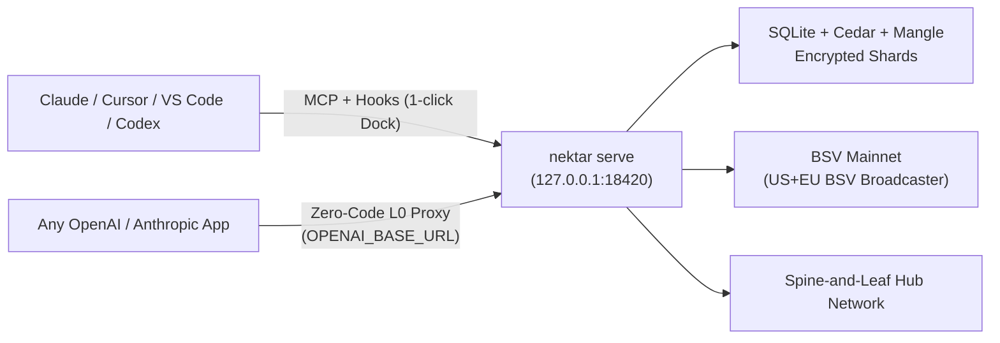
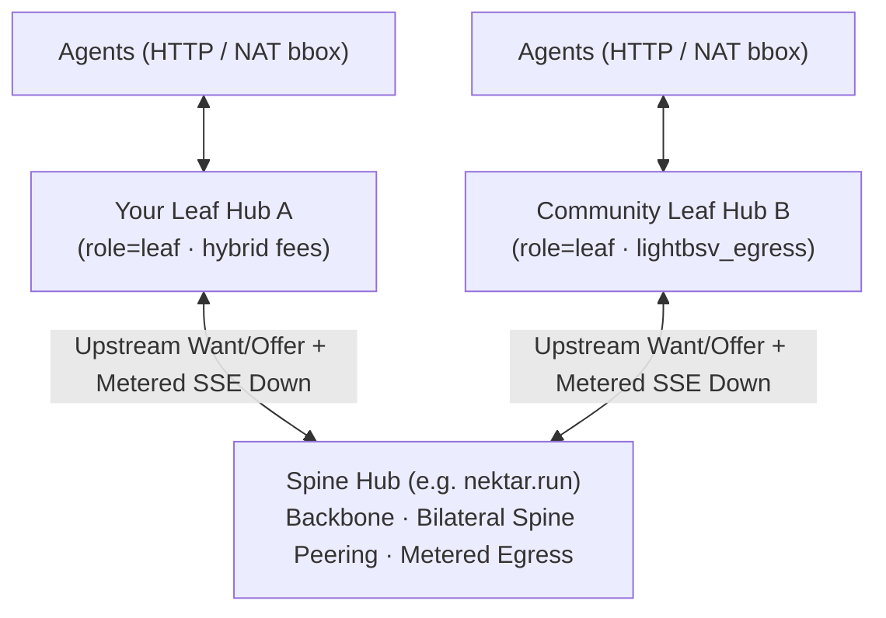

# Nektar v0.1 — Plain-English Guide to Docking & Running Hubs

> **Honesty Rule:** Nektar proofs verify **origin, inclusion, and derivability by block time** — never that a memory's text is objectively true.

---

## Part 1: What Is "Docking"?

**Docking** connects your existing AI apps (Claude, Cursor, VS Code, Codex, Hermes, OpenClaw, or any OpenAI/Anthropic script) to **one local Nektar daemon** (`nektar serve`), so all of your agents share:

- One **encrypted local memory vault** (`~/.nektar/main` on Mainnet, `~/.nektar` on Testnet)
- **Cryptographic BSV anchors & `nektarr1.*` receipts** proving where every recalled claim came from
- **Autonomous knowledge buying & selling** under your signed operator SpendGuard caps



### How to Dock in 10 Seconds
1. **In the Dashboard (`nektar open`):** Click **Dock your AI app** → click **Dock All Detected** (or dock individual apps) → restart your IDE.
2. **In the CLI:**
   ```sh
   nektar dock            # auto-detects & safely merges into installed AI app configs
   nektar dock proxy      # prints OPENAI_BASE_URL / ANTHROPIC_BASE_URL for any agent
   nektar dock --uninstall # cleanly removes Nektar entries anytime
   ```
3. **Verify it worked:** Ask your docked AI app:
   > *"Remember that our production API runs on port 8080, then recall it with a verified receipt."*

### The 4 Docking Layers (In Plain English)
| Layer | Best For | How It Works |
|---|---|---|
| **Zero-Code Proxy (L0)** | Any custom script, LangChain, CrewAI, SDK app | Point `OPENAI_BASE_URL` or `ANTHROPIC_BASE_URL` at Nektar; memories are recalled & captured transparently. |
| **MCP Tools (L1)** | Claude Desktop, Cursor, VS Code, Windsurf, Zed, Cline, Gemini CLI | Adds `remember`, `recall`, `groundedAnswer`, `want`, `sell`, `verify` tools. |
| **MCP + Auto-Hooks (L2)** | Claude Code, Codex CLI | Adds MCP tools plus automatic session memory prefetch and receipt verification. |
| **Native Memory Slot (L3)** | Hermes Agent, OpenClaw | Replaces the agent's built-in memory backend directly with Nektar. |

---

## Part 2: Running a Mainnet Node (60 Seconds)

```sh
# 1. Boot on BSV Mainnet (automatically isolated in ~/.nektar/main + prints funding QR!)
nektar serve --network main --confirm I_UNDERSTAND

# 2. Fund with 5,000–10,000 real sats (~$0.003) via Wallet tab QR or CLI:
nektar wallet address --network main --qr

# 3. Sync & verify balance:
nektar wallet sync --network main
```

- Mainnet automatically uses **dual-witness non-circular PoW headers** (`woc:main` + Babbage `chaintracks/v2`) and **dual-region US + EU official BSV Broadcaster** (`arcade-v2-us-1.bsvblockchain.tech` + `arcade-eu-1.bsvblockchain.tech`).

---

## Part 3: Running a Public Hub (Earn BSV Sats)

A Nektar Hub is a **stateless-trust overlay relay** (every ad & payment is SPV/signature-verified by peers). Hubs organize as **Spine-and-Leaf**:



### Choose Your Fee Preset
| Preset | WantAd Submit | OfferAd Submit | NAT `/bbox` Relay | Metered Egress (`/events`, `/sync`) | Best For |
|---|---|---|---|---|---|
| **`hybrid`** *(Mainnet default)* | 5 sats | 2 sats | 2 sats | 10 sats / 100 events | Earning BSV on all ingress, NAT relay & egress flow |
| **`lightbsv_egress`** | 0 sats | 0 sats | 2 sats | 10 sats / 100 events | Free order-flow ingress; bill subscribers & bots on egress |
| **`free`** *(Testnet default)* | 0 sats | 0 sats | 0 sats | 0 sats | Private team hubs or free community relays |

### Launch in 1 Command (3 Ways)

1. **Docker + Auto-TLS (easiest VPS deploy — verifies health & prints funding QR automatically):**
   ```sh
   nektar hub up --auto-ip --network main --confirm I_UNDERSTAND --hub-role leaf --fee-preset hybrid
   # or with your own domain:
   nektar hub up --domain hub.example.com --network main --confirm I_UNDERSTAND --hub-role leaf --fee-preset hybrid
   ```
2. **Zero-Docker Native Mode (generates `.env` + `systemd` unit using the single Go binary):**
   ```sh
   nektar hub up --native --auto-ip --network main --confirm I_UNDERSTAND --hub-role leaf --fee-preset hybrid
   ```
3. **Fresh Linux VPS One-Liner:**
   ```sh
   curl -fsSL https://raw.githubusercontent.com/kryptokrates/nektar/master/deploy/hub/install.sh \
     | NEKTAR_NETWORK=main NEKTAR_MAINNET_CONFIRM=I_UNDERSTAND NEKTAR_HUB_ROLE=leaf NEKTAR_HUB_FEE_PRESET=hybrid NEKTAR_AUTO_IP=1 bash
   ```

Verify your live Hub anytime:
- `https://<your-host>/.well-known/nektar` (identity & network)
- `https://<your-host>/hub/v1/health` (overlay lanes & liveness)
- `https://<your-host>/hub/v1/terms` (published BRC-105 fee schedule)
