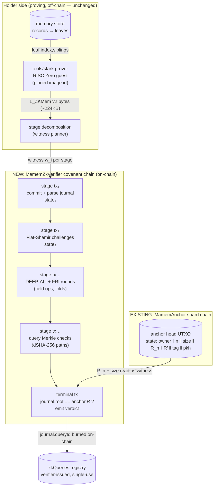
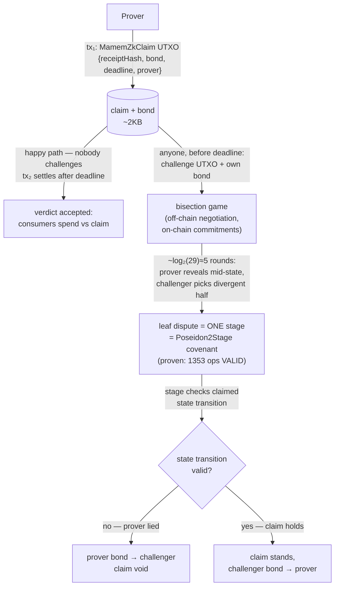

# GOAL-v9 — On-Chain Trustless Verification: §13 π Verified Inside Bitcoin Script

Scope: take the paper's §13 ZK inclusion proof `π_j` — today verified
**off-chain** by the WASM RISC Zero verifier — and make the **blockchain
itself** verify it, on BSV mainnet-compatible rules, with **no trusted
setup**. This is the last unimplemented reading of the paper's most
ambitious sentence (§18): *"the entire validation protocol is
executable on-chain if necessary, or via zero-knowledge circuits for
privacy-preserving attestation."*

Status: **Stage 0 COMPLETE (2026-11-02) — the mechanism is proven under
the real Script interpreter; architecture = optimistic-first.**

The economics constraint (sub-cent, on-the-fly) made the primary path
clear: **optimistic verification (BitVM-style)** — a claim+bond UTXO
settles in ~2 txs in the honest case; the full on-chain verification
machinery exists as the *dispute backstop* that punishes a lying prover.
Full-validity mode (every permutation checked by consensus, ~10⁴ txs)
remains the documented upgrade for high-value finalities — same stage
primitive, same covenant interface.

**Gate decision:** no trusted setup — Groth16-wrap rejected; the prover
uses the existing transparent RISC Zero STARK receipts unchanged.

This document is the single reference: what we want, why, the evidence
it is feasible, the exact component connections, the stage plan, and
the honest remaining unknowns.

---

## 1. What we want to achieve

Today the system is *anchored* but not *consensus-verified*:

- A write becomes a leaf in a Merkle batch; a `MamemAnchor` covenant
  spends the shard's UTXO head and commits the new root `R_n`.
  **Consensus enforces the anchor** — nobody can fork the shard chain.
- A ZK proof `π_j` (RISC Zero succinct receipt, ~224 KB) proves *"some
  leaf sits in the tree under that anchored `R_n`"* — but **only
  software running the WASM verifier can check it**. The chain sees the
  anchor; it never sees the proof.
- A verifier must trust our verifier *code* and *that it ran*. The proof
  is cryptographically unforgeable, but its verification is a
  client-side computation — invisible to the ledger.

**GOAL-v9 makes the ledger the verifier.** The Script VM itself checks
the STARK: every miner validates `π_j` the same way they validate a
signature. The verdict is not "our server says valid" — it is "the
consensus of the network accepted the proof." That is the difference
between a proof system and a *trustless* proof system, and it is what
lets **money be gated by a proof**: an escrow that releases payment
only when a valid `Π_j` accompanies the claim, enforced by Script, not
by any party's software.

The paper's exact target:

- §13: `Π_j = (π_j, ZKAccess(ℓ_q ≥ ℓ_j))` — a *dual* commitment:
  existence of the fragment AND legitimacy of access, over one verifier
  challenge.
- App. C: the proof verifies *"against the blockchain-anchored root
  `R_n = Root(M_n)` embedded in transaction `T_n`"* — the on-chain check
  must bind the proven journal root to the shard's anchor, on-chain.
- §18: the validation protocol "executable on-chain … via
  zero-knowledge circuits" — endorsing exactly this construction.

**Constraint from the user: trustless + sub-cent + on-the-fly.**
Groth16-wrapping (1 tx, ~500 KB script, proven on BSV mainnet July
2024) is rejected for its trusted setup. Full multi-transaction STARK
verification (the BWS architecture, ~74 txs/~790 KB on Signet) is
*measured-feasible* here (~10⁴ txs naive — Stage 0) but cannot meet
the economics: consensus executes every op, so it costs what it costs.
**The path that satisfies all three constraints is the optimistic
model (§4.5):** the claim+bond covenant settles the honest case in ~2
txs for fractions of a cent, while a bisection game — whose leaf is the
very same `Poseidon2Stage` covenant proven in Stage 0 — makes lying
provable and punishable. No trusted party at any point; the full
validity chain remains as the upgrade for high-value finalities.

## 2. Why we do it — the concrete gap

Three places in the system where "trust our verifier" is currently the
load-bearing assumption, and what on-chain verification upgrades:

| Surface | Today (off-chain verify) | With on-chain verify |
|---|---|---|
| **DisclosureSale escrow** | Payment releases on key-reveal only; "proof was valid" is asserted by software | The covenant can require *proof validity itself*: **pay-iff-proven**, enforced by consensus |
| **Checkpoint bonds (V2)** | Bond guarantees an anchored checkpoint exists; correctness is a verifier-side check | Bond can be conditioned on a *valid derivation proof* — slashing-for-bad-math becomes scriptable (computation fraud IS Script-checkable; signature equivocation is not — §5.4) |
| **Third-party / light verifier** | Must run our WASM verifier + trust it ran | Reads the tx: "the chain accepted this proof" is ground truth for anyone who trusts consensus |

And the philosophical one, which is the paper's own framing: *"the agent
becomes not a vault of secrets but a structure of proofs"* — those
proofs should terminate in the same consensus substrate the anchors do,
not in a runtime dependency.

## 3. Why it is feasible on BSV — the evidence

This is not speculative. Every primitive needed exists on BSV mainnet
**today**, and the two hardest precedents are already demonstrated:

### Prior art

- **Groth16 verified on BSV mainnet, 19 July 2024** (Zhang, Barbacovi,
  Larraia, Germouty — ESORICS 2024). BLS12-381 pairing verifier:
  480 KB locking + 40 KB unlocking script, inside default ~500 KB
  script policy. sCrypt separately did BN256 on testnet (~1.2 MB after
  ZkBaguette's optimization). Pairings are not a precompile — they are
  hand-built Miller loops on big-number Script arithmetic.
- **STARK verified on Bitcoin Signet, 12 July 2024** (StarkWare /
  Bitcoin Wildlife Sanctuary): a Circle-STARK verifier split across
  ~74 OP_CAT-covenant-chained transactions, ~790 KB total, real
  transactions in real blocks. BTC lacks OP_CAT (soft-fork pending);
  **BSV has OP_CAT natively** — the design ports directly.
- **Our own precedent:** `MamemAnchor` is already a covenant-chained
  UTXO state machine — a Script-verified state transition per spend.
  The verifier chain is the same pattern with a richer state.

### The opcode inventory (Genesis 2020 + Chronicle 2026-04-07, live)

| Capability | Since | Why the verifier needs it |
|---|---|---|
| `OP_MUL`, `OP_CAT`, `OP_SPLIT` | Genesis | big-number field ops; witness encoding |
| `OP_LSHIFTNUM`/`OP_RSHIFTNUM`, `OP_2MUL`/`OP_2DIV` | **Chronicle** | modular reduction of the STARK field (BabyBear `p = 2^31−2^27+1`) is shift+add — the per-op cost driver |
| `OP_SUBSTR`/`OP_LEFT`/`OP_RIGHT` | **Chronicle** | Merkle decommitment byte-slicing |
| `SIGHASH_CHRONICLE` (0x20) → OTDA | **Chronicle** | simpler sighash preimage for the covenant glue, mixable per-input with BIP143 |
| Functional opcodes in unlocking scripts (v>1) | **Chronicle** | the proof-carrying spend can compute; lock script stays a checker |
| Unbounded script size, unbounded ops, 32 MB numbers | Genesis→Chronicle | the only real constraint is tx bytes + miner policy, not expressiveness |
| `OP_SHA256`/`OP_HASH256` | always | the Merkle fold (our tree is dSHA-256 — native opcode) |

### What stays missing (honest)

- **No `OP_CHECKSIGFROMSTACK`/`OP_CHECKDATASIG`** — arbitrary-message
  signature checks remain impossible → V2 punitive slashing for
  *off-chain* equivocation stays blocked. On-chain equivocation is
  already impossible by UTXO uniqueness. Unaffected by this work.
- **No loops** — everything fully unrolled; that is *why* the design
  spans ~N chained txs rather than one script. The chain is the loop.
- **No new hash opcodes** — SHA-256/HASH256 only. The RISC Zero
  transcript hash (Poseidon2 where present) must be hand-unrolled in
  bignum Script — the dominant artifact cost and Stage 0's decisive
  measurement.

## 4. The architecture — components and their connections

### Component connections — who touches what

| Component | Exists? | Role in GOAL-v9 |
|---|---|---|
| `tools/stark` (R0 guests + host) | ✅ | Produces the receipt bytes — **unchanged**. The on-chain verifier consumes the identical `L_ZKMem v2` wire format; pinned image ids untouched. |
| `packages/zk` (codec, `verifyZkm2`) | ✅ | The WASM verifier stays **authoritative off-chain** — dual-verifier, never a fork. On-chain verify is additive. |
| `MamemAnchor`/`AnchorChain` | ✅ | Supplies the anchor head whose `R_n`/`size` the terminal stage must match. The verifier chain *references* it; does not consume it. |
| `zkQueries` / `issueZkQuery` | ✅ (GOAL-v8/Π work) | queryIds already carry `{nonce, verifierId}` — the on-chain state carries the queryId through stages; the terminal tx burns it on-chain. |
| `MamemZkClaim` covenant | 🆕 **primary artifact** | The optimistic claim+bond UTXO (§4.5): settle-after-deadline happy path, challenge/bisection dispute path, `Poseidon2Stage` leaf proof. ~2 txs ≈ fractions of a cent. |
| `MamemZkVerifier` chain | 🆕 (full-validity mode) | The A-mode artifact: every permutation consensus-checked across ~10⁴ covenant txs. Same stage primitive; deferred to the high-value-finality upgrade. |
| Stage-emitter | 🆕 | TS generator producing the unrolled per-stage scripts (sCrypt-style emitted code), driven by a stage decomposition table. |
| `verifyCombined` / Π | ✅ | Off-chain Π stays; **Stage 3** adds the on-chain ZKAccess leg (Bulletproof verifier in Script — EC ops proven feasible by the Groth16 work). |
| `DisclosureSale`, `MamemCheckpointBond` | ✅ (V2/V3) | **Consumers**: gain "release/pay iff valid-proof-attached" script conditions — the actual reason this matters. |

### 4.5 The optimistic path — the economics-viable architecture (PRIMARY)

Full consensus-verification of a STARK can never be sub-cent — miners
must execute the ops. The optimistic model is the **only** trustless
structure that meets the economics: pay for the honest case, make lying
more expensive than it gains.

**Claim format** (`MamemZkClaim` covenant, new contract):
- state = `{receiptHash, journalRoot, journalSize, queryId, bondSats,
  proverPkh, deadline}` — a commitment to "this receipt verifies against
  this anchor", not the receipt itself (bytes stay off-chain).
- `settle(preimage, anchorTx)` — spendable by the consumer once
  `locktime ≥ deadline`: asserts `journalRoot == decodeMamemAnchor(
  anchorTx).R` on-chain (the App-C binding), burns `queryId`, releases
  the verdict UTXO the consumer's covenant references.
- `challenge(challengerPkh)` — anyone before deadline: converts the
  claim UTXO into a dispute UTXO carrying both bonds.
- `reveal(midState)` / bisect methods — the game: prover posts
  intermediate Poseidon2-state commitments; each response halves the
  disputed round range; ~5 rounds isolate ONE disputed stage.
- `proveStage(stageIdx, inState, outState)` — the leaf: a
  `Poseidon2Stage`-family covenant checks that `outState` really
  follows from `inState` for that round — **the exact contract proven
  in Stage 0d**. Prover-can't-prove → challenger sweeps both bonds
  after timeout; challenger-is-wrong → prover keeps claim + both bonds.

**Why 1-of-N honesty is still trustless:** no designated verifier —
*any* third party (the buyer, a watcher service, a random node) can be
the challenger. A false claim can only finalize if literally every
independent observer stays silent for the whole window. The prover
also carries the bond: lying loses money by construction, so the
challenge path is a deterrent that honest economics never triggers.

**Honest costs:** happy path ≈ 2 txs ≈ ~3–4KB ≈ **fractions of a cent,
seconds.** Dispute path ≈ 5 bisection txs + 1 stage tx ≈ ~$0.10,
borne by the liar.

### What a stage tx must satisfy

Each stage's locking script checks four things (the `MamemAnchor`
pattern generalized):

1. **Continuity** — I spend state UTXO_{i−1} whose stage counter is
   `i−1` and whose transcript hash matches; my output emits state_i.
2. **Work** — the stage's claimed computation actually ran on witness
   `w_i`: the unrolled field ops/folds/hash-checks of *this* stage only.
3. **Commitment** — `w_i` is bound to the real receipt: earlier stages
   commit a hash of the receipt fields; later stages open them.
4. **Termination** — the last stage checks `journal.root ==
   decodeMamemAnchor(anchorTx).R` and `journal.size == anchor.size`,
   burning `queryId` into the emitted state.

## 5. Inside the artifact — what Script must actually compute

A RISC Zero 3.0.3 succinct-receipt verify decomposes (approximate stage
budget — Stage 0 measures the real numbers):

| Stage | Work | Script cost driver |
|---|---|---|
| Parse + journal | read `(version, root, size, queryId)`; check image id | trivial — byte compares |
| Commit phases | hash the proof's commitment fields into the transcript | **hash opcode coverage** — SHA-256 native; Poseidon2 = hand-unrolled bignum permutation (~thousands of ops per invocation) |
| Fiat-Shamir | derive challenges from transcript | same hash question |
| DEEP-ALI + FRI rounds | field arithmetic: BabyBear mul/add/reduce per round | Chronicle shifts+OP_MUL — ~tens of ops per field op × hundreds |
| Query checks | each DEEP query = dSHA-256 Merkle path | `OP_SHA256` chain — cheap per query, ~dozens of queries |
| Terminal | `journal.root == anchored R_n`, `size == anchor.size`, burn queryId | anchor-script decode (exists) + compares |

**Stage 0b — RESOLVED (audit done, 2026-11-02):** the wasm symbols in
`packages/zk/stark/verifier_bg.wasm` are unambiguous — the R0 3.0.3
succinct transcript runs on **Poseidon2 over BabyBear**
(`Poseidon2Rng as risc0_zkp::core::hash::Rng<BabyBear>` — Fiat-Shamir;
`Poseidon2HashFn` — in-proof Merkle commitments). `Sha256HashFn`
appears only at the receipt seal/journal layer — native `OP_SHA256`,
cheap. risc0-zkp 3.0.5 parameters: `QUERIES = 50`, `FRI_FOLD = 16`,
`INV_RATE = 4`, `FRI_MIN_DEGREE = 256`, BabyBear ext-degree 4.
Estimated Poseidon2 budget: ~50 queries × ~10–16 path levels +
~10² transcript absorptions ≈ **~10³ permutations**; at ~2–4k
unrolled ops per permutation ≈ 3–8 M ops total — byte-heavy but
structurally the BWS design, and Poseidon2 is *field-native*
(friendlier to bignum Script than their byte-oriented Blake2s).
The artifact is large, not infeasible — Stage 0a/0c measure the real
per-op cost.

## 6. Execution — staged, with go/no-go gates

### Stage 0 — feasibility spike (regtest only)

- **0a field-op cost — MEASURED (2026-11-02, real interpreter):**
  `packages/contracts/src/BabyBearProbe.runar.ts` compiled to a
  **126-byte** locking script covering three methods; evaluated under the
  @bsv/sdk `Spend` interpreter (consensus semantics, not MockChain
  ANF): `mulmod` = **11 executed ops** (incl. edge `(p−1)² mod p = 1`),
  `sbox7` (x⁷ — the Poseidon2-BabyBear S-box, 4 chained mulmods) =
  **25 ops**, `mdsRow` (16 muls + 15 adds + mod) = **47 ops**. Wrong
  results correctly rejected. **Finding: BabyBear field arithmetic is
  ~2–6 ops per op — native `OP_MOD` removes the shift-fold entirely; no
  Chronicle opcodes were even needed for the arithmetic itself.** The
  verifier's cost is therefore op-COUNT (code unrolling volume), not
  per-op cost.
- **0b transcript-hash audit:** exactly which hash the R0 3.0.3
  succinct transcript uses and invocation counts (risc0 `zkp`/`core`
  source, our WASM symbols, receipt structure).
- **0c Poseidon2 component costs — MEASURED (2026-11-02, real
  interpreter):** risc0-zkp 3.0.5 `poseidon2_mix` confirmed from source:
  CELLS=24, 8 full + 21 partial rounds, x⁷ sbox, M_ext/M_int diffusion.
  Generated `packages/contracts/src/Poseidon2Blocks.runar.ts` (6,262B
  for 5 methods) and evaluated via @bsv/sdk `Spend` (`isRelaxed` —
  Chronicle rules; runar txs are v1 so clean-stack must be relaxed, real
  deployment needs v>1):
  `mExt`=440 ops ×9, `fullRound`=930 ops ×8, `partialRound`=290 ops ×21
  → **≈14k executed ops per permutation**; peak stack ≤490B per
  component. Two hard findings: (1) a naive single-method permutation
  hits stack depth **2338 > compiler limit 800** — the 24-cell state
  *cannot live on the Script stack*, it must live in the UTXO chain
  (per-round/per-component stage granularity — this is the multi-tx
  design forced, not optional); (2) at ~10³ permutations per verify ≈
  **~14M ops / ~15–20MB of bytecode → order 10³–10⁴ covenant txs**
  (~29 stages/perm). Feasible mechanically but ~100× the BWS footprint;
  optimization headroom (deferred mod-reductions, shared path data,
  hand-scheduled Script) is significant — the gate hinges on whether the
  engineering+cost budget justifies it vs. Groth16-wrap (1 tx, trusted
  setup).
- **0d covenant shim — MEASURED (2026-11-02, real interpreter):**
  `Poseidon2Stage` (StatefulSmartContract, 24-cell UTXO state +
  `addOutput` continuation + sighash-preimage covenant + round constants
  baked as per-stage literals): `fullStep` **VALID — 1,353 ops, spend tx
  14.5KB**; `partialStep` **VALID — 598 ops, spend tx 11.4KB** under
  @bsv/sdk `Spend` (isRelaxed). The covenant wrapper costs ~400 ops /
  ~9–11KB over the bare round math — the atomic chain primitive works
  end-to-end. Refined footprint: ~29 stages/perm ≈ ~360KB/perm at this
  naive shape → order 10⁴ txs / ~300MB per verify at ~10³ perms —
  **expensive but structurally proven**; big reductions available
  (single-method stage variants ~2×, RC-in-state generic stage ~5×,
  deferred mods ~1.5×, permutation sharing across queries).
- **GATE:** total estimated footprint + stage count. If Poseidon2-bound
  and infeasible → documented fallback (Groth16-wrap with R0's public
  ceremony, or a SHA-256-only STARK variant) — decided with real
  numbers, not guesses.

### Stage 1 — optimistic claim contract (the shippable artifact)

- `MamemZkClaim` covenant ✅ **interpreter-green (14/14 spends)**:
  `settle` (deadline + `ClaimVerdict` covenant output + bond return,
  277 ops), `challenge` (346), `reveal` (334), `bisect` (392,
  arithmetic-select midpoint — see §4.5 note), `proveStage` leaf (270,
  real `hashPrevouts`+outpoint co-spend pin + real stage UTXO),
  `claimTimeout`/`slashTimeout` (239), `verdict-authorize` (112),
  `buyGated` (95), `verdict-in-sale` (112). Canonical eval:
  `packages/contracts/claim-lifecycle.mjs`.
- `Poseidon2Stage` family — 29 round-variants (constants baked) —
  now co-spendable: `fullStep`/`partialStep` take `(postSats,
  postScript)` and emit `addRawOutput` after their `addOutput`
  continuation, so a real stage UTXO is spent inside the `proveStage`
  tx and its script is the consensus judge of the disputed round
  (VALID 1,373 ops input-side; claim side 249 ops).
- Bisection protocol spec: state-commitment format, response windows
  (nLockTime), bond amounts, who-watch duty documented.
- Consumer hooks ✅: `settle` emits a `ClaimVerdict` covenant UTXO
  (state = receiptHash ‖ journalRoot ‖ queryId ‖ payeePkh, 297B
  codePart baked into claim state). `DisclosureSale.buyGated` pins the
  committed verdict outpoint as input1 (`hash256(prevouts) ==
  hashPrevouts` + exact two-input pin) — pay-iff-settled; the verdict's
  own `authorize` enforces the payee payout inside the same tx.
  Interpreter-green 14/14 incl. `verdict-in-sale`.
- Known SDK gap (callers, not consensus): terminal methods need the
  `[codePart][opSig][args][changePKH][changeAmount][preimage][selector]`
  unlock layout + trailing 0-sat change output; `call()` doesn't emit it
  (callers patch `prepareCall` or hand-build, as the eval does). And the
  terminal path can't add co-spend inputs — `proveStage` txs must be
  built manually.

### Stage 2 — full-validity mode (the upgrade)

- Stage-decomposition table for the whole succinct receipt → ordered
  `MamemZkVerifier` covenant chain (~10⁴ txs naive, ~10²–10³ optimized:
  RC-in-state generic stage, deferred mods, shared paths).
- Terminal stage: `journal.root == R_n`, `size == anchor.size`, queryId
  burned — same interface as the settled claim, so consumers swap
  modes by config, not by code.
- Regtest vectors per stage; e2e on `zkm2-n5i4.json`; TTN cost table.

### Stage 3 — Π completeness + consumers

- `verifyCombinedOnchain`: the full §13 Π — STARK leg on-chain +
  ZKAccess Bulletproof verifier in Script (separate spike; EC point
  ops proven feasible by the Groth16 Script work).
- Consumer hooks: `DisclosureSale` pay-iff-proven;
  `MamemCheckpointBond` proof-gated release.
- Docs: PROOFS.md on-chain row, THREAT-MODEL update, README.

## 7. Honest deferrals / non-goals

- Groth16-wrap is the *documented alternative*, not built unless the
  Stage-0 gate fails — transparent STARK is the requirement.
- ZKAccess-on-chain is Stage 3 — its own artifact (Bulletproof ≠ FRI).
- The optimistic model's one assumption, stated honestly: a false claim
  finalizes only if *zero* independent observers challenge within the
  window — 1-of-N honesty, the standard BitVM trustless model. Watchers
  are permissionless; the bond makes lying a losing bet either way.
- Full-validity mode (zero assumptions, ~10⁴ txs) is Stage 2 — real
  and measured, deferred only because economics reserve it for
  high-value finalities.
- `settle`'s anchor binding (`journalRoot == MamemAnchor.R` on-chain):
  the anchor's state isn't reachable from the claim's preimage — needs
  an anchor-side witness method co-spent in the settle tx (same
  shared-outputs pattern as the stage/verdict co-spends). Deferred —
  the verdict binds the claim's own committed fields today.
- Leaf stage-script template binding: the co-spend pins the stage
  *outpoint*; binding the expected script template on-chain needs the
  generic RC-in-state stage variant (Stage 2) — per-round baked
  constants make template reconstruction in-claim impractical.
- No guest or receipt-format changes — pinned image ids, the reproduce
  gate, every existing ZK test stay green by construction.
- V2 signature-equivocation slashing stays blocked (no
  `OP_CHECKSIGFROMSTACK`) — unrelated to this work.
- **runar 0.4.6 compiler traps** (found the hard way, worked around in
  `MamemZkClaim`): `readonly` ctor slots shift `codeSeparatorIndex` and
  break state deser → keep config in state; `readonly` fields break
  inside method math → bake literals; statement-level `if { this.x = }`
  and self-referential ternaries (`this.x = c ? v : this.x`) silently
  drop state writes → use arithmetic selection (`x + s·(y−x)`); temps
  referenced inside ternary branches get lost in the stack schedule
  ("t31 not found") → keep ternary branches to literals/locals only;
  `hashPrevouts` is sha256**d** → `hash256`, not `sha256`.

## 8. Verification

- Stage 0 ✅ done: @bsv/sdk `Spend` interpreter (consensus semantics —
  stronger than MockChain ANF), `isRelaxed` Chronicle rules; measured
  ops/bytes per component and per covenant stage.
- Stage 1: interpreter lifecycle ✅ 14/14 (`claim-lifecycle.mjs` —
  full dispute lifecycle + `settle` emitting the `ClaimVerdict`
  covenant + `verdict-authorize` + `DisclosureSale.buyGated` and the
  verdict's own `authorize` inside the gated sale tx); regtest e2e ✅
  ALL PASS (`e2e-claim-regtest.mjs` — settle with verdict emission,
  challenge, reveal, bisect×2 to leaf, proveStage co-spend **with a
  real `Poseidon2Stage` UTXO as the leaf**, both timeouts, all accepted
  by Teranode mempool).
- Stage 2: per-stage vectors + `zkm2-n5i4` fixture e2e on MockChain +
  regtest; real-sats cost table.
- Repo gates unchanged: `pnpm -r build`, `check-deps`, `pnpm -r test`,
  e2e, `pnpm reproduce`.
