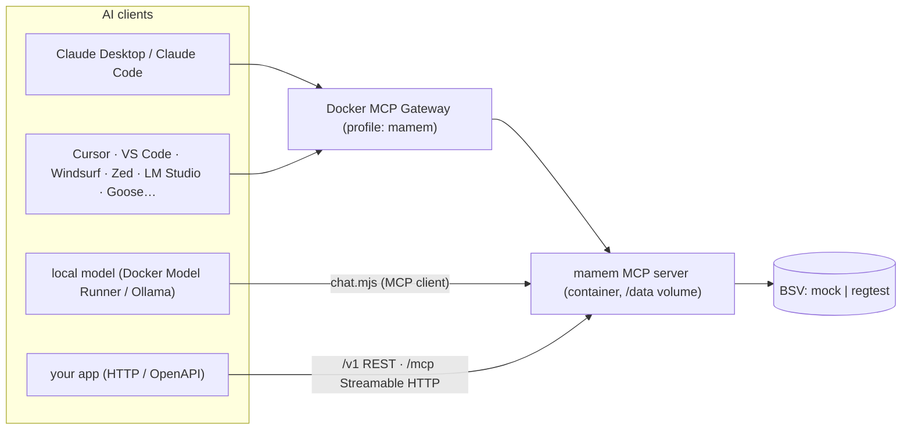

# Using mamem from AI tools

mamem is an **MCP server**, built on the official SDK. It exposes 12 tools, resources (`mamem://record/{shard}/{seq}`, `mamem://checkpoint/{shard}`) and prompts (`grounded-answer`, `remember-with-source`, `audit-answer`). It also sends server instructions that tell the model to recall before answering, remember facts with their source, cite proofs, and never claim truth.



## 1. Recommended: Docker Desktop MCP Toolkit (one install, every client)

```sh
pnpm mcp:install                              # build image, create profile "mamem", add the server
pnpm mcp:install claude-desktop cursor vscode # …and connect clients
pnpm mcp:smoke                                # remember → anchor → prove THROUGH the gateway
```

- Supported clients for `docker mcp client connect`: claude-code, claude-desktop, cline, codex, continue, crush, cursor, gemini, goose, gordon, kiro, lmstudio, opencode, sema4, vscode, zed.
- For any other client, configure the command `docker` with args `["mcp","gateway","run","--profile","mamem"]`.
- The server runs **long-lived** in a sandboxed container (`--security-opt no-new-privileges`, 1 CPU, 2 GB), with data in the `mamem-data` volume.
- The default backend is the offline mock chain, which needs zero setup. For a real chain, see §5.

## 2. Direct stdio (no Docker)

```json
{ "mcpServers": { "mamem": { "command": "node", "args": ["C:/path/to/mamem/packages/mcp/dist/src/bin.js"], "env": { "MAMEM_MODEL_ID": "claude-sonnet-4-5 (Anthropic API)" } } } }
```

Claude Desktop: `claude_desktop_config.json`. Claude Code: `claude mcp add mamem -- node <path>/bin.js`. Cursor/Windsurf: their MCP settings, with the same command.
Set `MAMEM_MODEL_ID` to the exact model release, because receipts bind it (AGT-011).

## 3. Local models (Docker Model Runner, Ollama, LM Studio)

```sh
docker model pull ai/qwen3            # or any tool-calling model
pnpm chat "What torque does drain port 4 need?"
MAMEM_LLM_URL=http://localhost:11434/v1 MAMEM_LLM_MODEL=qwen3 pnpm chat "…"   # Ollama
```

- `chat.mjs` runs the mamem MCP server and gives the model the core tools (`MAMEM_CHAT_TOOLS=all` for every tool), using the server's instructions as the system prompt.
- Tool calls are validated: unknown tool names and invalid JSON go back to the model as errors.
- **Measured on this machine (CPU-only DMR, llama.cpp `latest-cpu`):**
  - `ai/qwen3` 8B: the first token did not arrive within Node's 5-minute HTTP header timeout, so it is unusable on this CPU.
  - `ai/qwen3:0.6B`: answers in seconds, but writes pseudo-tool tags into its text instead of making real tool calls, so it is too small for reliable tool use.
  - `ai/qwen3.8-flash-next:q8_0` downloads, but this llama.cpp build rejects it with `unknown model architecture: 'qwen4exp'`. It needs a newer Model Runner engine (Docker Desktop update).
- Use a GPU or a ≥4B tool-calling model for practical speed.

## 4. Custom apps: HTTP

`MAMEM_HTTP_PORT=8080 node packages/mcp/dist/src/bin.js` serves:
- `/mcp`: **MCP Streamable HTTP** (sessions via `mcp-session-id`; unknown sessions are refused);
- `/v1/*`: REST (tools, public proofs, checkpoints, metrics), documented in `/v1/openapi.json`.

OpenAI/Anthropic function-calling apps can call `/v1/tools/{name}` directly.

**Remote connectors (claude.ai, ChatGPT)** need this `/mcp` endpoint on a public HTTPS host with OAuth 2.1. That is **not deployed yet** (no public host, no OAuth). The transport is ready.

## 5. Real chain (regtest now, testnet later)

| env | meaning |
|---|---|
| `MAMEM_NETWORK` | `mock` (default) · `regtest` · `testnet` (refused until configured) |
| `MAMEM_DATA_DIR` | records (sqlite), anchor state, security state, funding reserve, keys (0600). `/data` in the image |
| `MAMEM_FUND_WIF` / `_FILE` | fee-paying key (regtest: the miner key) |
| `MAMEM_RPC_PASS` / `_FILE`, `MAMEM_RPC_URL`, `MAMEM_PROPAGATION_URL`, `MAMEM_ASSET_URL` | Teranode endpoints (from a container: `http://host.docker.internal:…`) |
| `MAMEM_AUTOMINE=1` | regtest only: mine when anchors wait |

**Restart safety:**
- the server resumes each shard from its persisted head;
- the next anchor spends exactly that UTXO, so there is no fork;
- a confirmer attaches BUMPs to every unproven anchor;
- replay protection (challenges, ZK transcripts, nullifiers, revocations) persists.

## What the model sees

- **Tools:** remember, recall, prove, anchor, proveMembership, verifyMembership, rotate, revoke, disclose, challenge, authorize, automaton. Annotations: read-only for recall, prove and the ZK verifiers; destructive for rotate and revoke.
- **Prompts:** `grounded-answer` (recall → answer only from verified items → cite), `remember-with-source`, `audit-answer`.
- **Every answer receipt states:** inclusion and integrity are verified; the truth of the content is **not** established.
