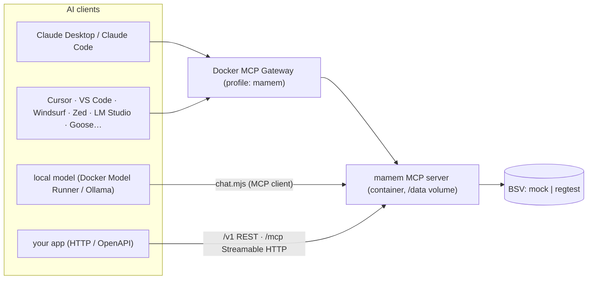

# Using mamem from AI tools

mamem is an **MCP server**, built on the official SDK. It exposes 12 tools, resources (`mamem://record/{shard}/{seq}`, `mamem://checkpoint/{shard}`) and prompts (`grounded-answer`, `remember-with-source`, `audit-answer`). It also sends server instructions that tell the model to recall before answering, remember facts with their source, cite proofs, and never claim truth.



## 1. Recommended: Docker Desktop MCP Toolkit (one install, every client)

```sh
pnpm mcp:install                              # build image, create profile "mamem", add the server
pnpm mcp:install claude-desktop cursor vscode # …and connect clients
pnpm mcp:smoke                                # remember → anchor → prove THROUGH the gateway
```

- Supported clients for `docker mcp client connect`: claude-code, claude-desktop, cline, codex, continue, crush, cursor, gemini, goose, gordon, kiro, lmstudio, opencode, sema4, vscode, zed.
- For any other client, configure the command `docker` with args `["mcp","gateway","run","--profile","mamem"]`.
- The server runs **long-lived** in a sandboxed container (`--security-opt no-new-privileges`, 1 CPU, 2 GB), with data in the `mamem-data` volume.
- The default backend is the offline mock chain, which needs zero setup. For a real chain, see §5.

### Docker + real chain (regtest)

```sh
pnpm stack:up                              # Teranode regtest
node packages/mcp/dist/src/init.js --network=regtest   # wallet: key → .env, funding check
pnpm mcp:install --regtest claude-desktop  # profile "mamem_regtest"
MAMEM_PROFILE=mamem_regtest pnpm mcp:smoke
```

- The funding WIF and RPC password are read from the gitignored `.env` files and stored in the **Docker MCP keychain** (`docker mcp secret set`, via stdin, never printed).
- The container reaches Teranode via `host.docker.internal`.
- Data lives in the `mamem-regtest-data` volume.
- Verified:
  - session 1: `remembered seq=0`, anchored n=0, `prove ok` against real headers;
  - session 2 (a new gateway, new container): `remembered seq=1; anchored n=1`, `prove ok`. The shard chain continued from the persisted head.
- It has its own profile because the tool names match the mock server's.

## 2. Direct stdio (no Docker)

```json
{ "mcpServers": { "mamem": { "command": "node", "args": ["C:/path/to/mamem/packages/mcp/dist/src/bin.js"], "env": { "MAMEM_MODEL_ID": "claude-sonnet-4-5 (Anthropic API)" } } } }
```

Claude Desktop: `claude_desktop_config.json`. Claude Code: `claude mcp add mamem -- node <path>/bin.js`. Cursor/Windsurf: their MCP settings, with the same command.
Set `MAMEM_MODEL_ID` to the exact model release, because receipts bind it (AGT-011).

## 3. Local models (Docker Model Runner, Ollama, LM Studio)

```sh
docker model pull ai/qwen3            # or any tool-calling model
pnpm chat "What torque does drain port 4 need?"
MAMEM_LLM_URL=http://localhost:11434/v1 MAMEM_LLM_MODEL=qwen3 pnpm chat "…"   # Ollama
```

- `chat.mjs` runs the mamem MCP server and gives the model the core tools (`MAMEM_CHAT_TOOLS=all` for every tool), using the server's instructions as the system prompt.
- Tool calls are validated: unknown tool names and invalid JSON go back to the model as errors.
- `chat.mjs` streams responses, so slow CPU models don't hit fetch's header timeout.
- **Measured on this machine (CPU only; Docker Desktop 4.97, llama.cpp `b9879-cpu`):**

| Model | Result |
|---|---|
| **`ai/qwen3:4b-instruct-2507` (2.3 GB) — recommended** | real tool calls: `remember` → `recall`, then an answer that cites shard/seq and states the truth caveat, in **~15 s** |
| `ai/qwen3` 8B | too slow on this CPU (no first token after several minutes) |
| `ai/qwen3:0.6B` | fast; with streaming it makes real `remember` calls, but answers poorly |
| `ai/qwen3.8-flash-next:q8_0` | still rejected even by llama.cpp `b9879`: `unknown model architecture: 'qwen4exp'` (an experimental architecture not yet in llama.cpp) |

- **OpenAI.** Run `MAMEM_LLM_PROVIDER=openai pnpm chat "…"`. The default model is `gpt-4.1-mini`; override it with `MAMEM_LLM_MODEL`. The key is read from `OPENAI_API_KEY` in the environment or in the gitignored `mamem/.env`, never from the command line.
  - Verified run (about 9 s): `remember` ×2 → `recall` seq 0 → `prove` seq 0.
  - The model answered "45 Nm, shard manual seq 0". It reported correctly that the record was committed but **not yet anchored** (the batch hadn't closed), and added the truth caveat.
- **Port check.** Docker Desktop's Model Runner must be reachable over TCP: `docker desktop enable model-runner --tcp=12435`. On this machine port 12434 belonged to a separate runner inside WSL with an older model store, which made newly pulled models "not found". Use `MAMEM_LLM_URL=http://localhost:12435/engines/v1`.
- **Robustness for small models.** The tool schemas describe every parameter (e.g. `level`: omit unless restricted). `recall` with a wrong `seq` returns a hint listing the existing seqs, so the model can correct itself.

## 4. Custom apps: HTTP

`MAMEM_HTTP_PORT=8080 node packages/mcp/dist/src/bin.js` serves:
- `/mcp`: **MCP Streamable HTTP** (sessions via `mcp-session-id`; unknown sessions are refused);
- `/v1/*`: REST (tools, public proofs, checkpoints, metrics), documented in `/v1/openapi.json`.

OpenAI/Anthropic function-calling apps can call `/v1/tools/{name}` directly.

**Remote connectors (claude.ai, ChatGPT)** need this `/mcp` endpoint on a public HTTPS host with OAuth 2.1. That is **not deployed yet** (no public host, no OAuth). The transport is ready.

## 5. Real chain (regtest now, testnet later)

| env | meaning |
|---|---|
| `MAMEM_NETWORK` | `mock` (default) · `regtest` · `testnet` (refused until configured) |
| `MAMEM_DATA_DIR` | records (sqlite), anchor state, security state, funding reserve, keys (0600). `/data` in the image |
| `MAMEM_FUND_WIF` / `_FILE` | fee-paying key (regtest: the miner key) |
| `MAMEM_RPC_PASS` / `_FILE`, `MAMEM_RPC_URL`, `MAMEM_PROPAGATION_URL`, `MAMEM_ASSET_URL` | Teranode endpoints (from a container: `http://host.docker.internal:…`) |
| `MAMEM_AUTOMINE=1` | regtest only: mine when anchors wait |

**Restart safety:**
- the server resumes each shard from its persisted head;
- the next anchor spends exactly that UTXO, so there is no fork;
- a confirmer attaches BUMPs to every unproven anchor;
- replay protection (challenges, ZK transcripts, issued ZK queries, revocations) persists.

## Agent identity and ZK clearance (level > 0 records)

The model never handles keys or proofs. The **harness** does, using the client kit (`ClientWallet`, `ClearanceAuthority` in `@mamem/mcp`):

1. The server trusts the authorities listed in `MAMEM_CLEARANCE_AUTHORITIES` (Docker config `clearance_authorities`).
2. The authority issues a holder-bound credential to the wallet's pubkey.
3. Per read, the wallet:
   - calls the `challenge` tool and signs the nonce, which proves the caller identity;
   - builds a single-use Bulletproof scoped to `shard/seq`, which proves level ≥ required without revealing the level;
   - sends both as `recall({ shard, seq, identity, zk })`. The wire format is JSON: bigint as a decimal string, bytes as hex.
4. `chat.mjs` with `MAMEM_CHAT_CLEARANCE=<level>` does this transparently whenever a recall comes back `zkaccess required`.

**Rejected, each with a specific reason:**
- no clearance;
- a replayed presentation (persisted across restarts);
- a self-issued or untrusted authority;
- a credential presented by another caller;
- a transcript scoped to another record;
- a level below the requirement;
- malformed wire data.

## Agent-level E2E on local Teranode (`pnpm e2e:mcp`)

The real MCP server process, driven by the SDK client exactly like an AI client. It covers:
- Rúnar anchoring, plus SPV `prove` against real headers;
- **STARK membership** (Wright §13; 224 KB RISC Zero receipt, ~35–50 s on CPU) against the SPV-checked SHA-256 anchor, via `zkQuery` → `proveMembership` → `verifyMembership`; replayed and tampered proofs rejected;
- **Bulletproof clearance** with all the negatives above;
- a restart on the same data dir: the next anchor spends the persisted head, replay is still rejected, and a stored credential still works.

16/16 checks, **3 consecutive passes** over stdio. The same flow through the **Docker MCP Gateway** (`MAMEM_E2E_GATEWAY=mamem_regtest`) also passes 16/16; Groth16 proving takes about 6 s in the 1-CPU container, against 1.5 s natively.

**Model-driven run (OpenAI `gpt-4.1-mini`, regtest, harness clearance level 3):**
- `remember` ×2 (one at level 2) → `anchor` → `recall` (the harness attached ZK clearance → `verified`) → `prove` ×2;
- the answer cited both seqs, the anchor txid and the truth caveat.

**Operational lessons:**
- **The server exits when its stdio client disconnects.** Before this fix, leaked `docker run -i` containers kept auto-mining and writing to the same volume.
- **One writer per data dir.** The runtime refuses to start when a live heartbeat lock is present.
- **All Teranode calls have timeouts.** The confirmer indexes each block once (txid → height) and abandons anchors that are not mined within 100 blocks, which happens after a conflicting spend.

## Verified end to end

- **Devin CLI as the MCP client, through the Docker MCP Gateway.** Config `.devin/mcp_config.local.json` → `docker mcp gateway run --profile mamem`. Results:
  - 12 mamem tools listed next to the gateway's own;
  - `remember` ×3 (one record at level 2), then `anchor`;
  - `recall` returns the two level-0 records and **withholds** the level-2 one (`zkaccess required`, no plaintext and no ciphertext);
  - the receipt cites shard/seq/anchor and carries the truth note;
  - `prove` returns `{ok:true}` for a real record and `NotFound` for one that doesn't exist.
- `pnpm mcp:smoke`: the SDK client through the same gateway (remember → anchor → prove).
- `packages/mcp/demo/regtest-runtime.mjs`: the production runtime on live Teranode regtest (anchor → confirmer BUMP → prove), then a restart that resumes the persisted head with no fork.
- Duplicates: a record's identity is H(d‖p), and provenance includes the write time, so storing the same sentence later creates a **new** record. Only an identical (data, source, time, model) write is deduplicated.

## What the model sees

- **Tools:** remember, recall, prove, anchor, zkQuery, proveMembership, verifyMembership, proveSubset, verifySubset, proveDerivation, verifyDerivation, rotate, revoke, disclose, challenge, authorize, automaton. Annotations: read-only for recall, prove and the ZK/subset provers and verifiers; destructive for rotate and revoke.
- **Prompts:** `grounded-answer` (recall → answer only from verified items → cite), `remember-with-source`, `audit-answer`.
- **Every answer receipt states:** inclusion and integrity are verified; the truth of the content is **not** established.
