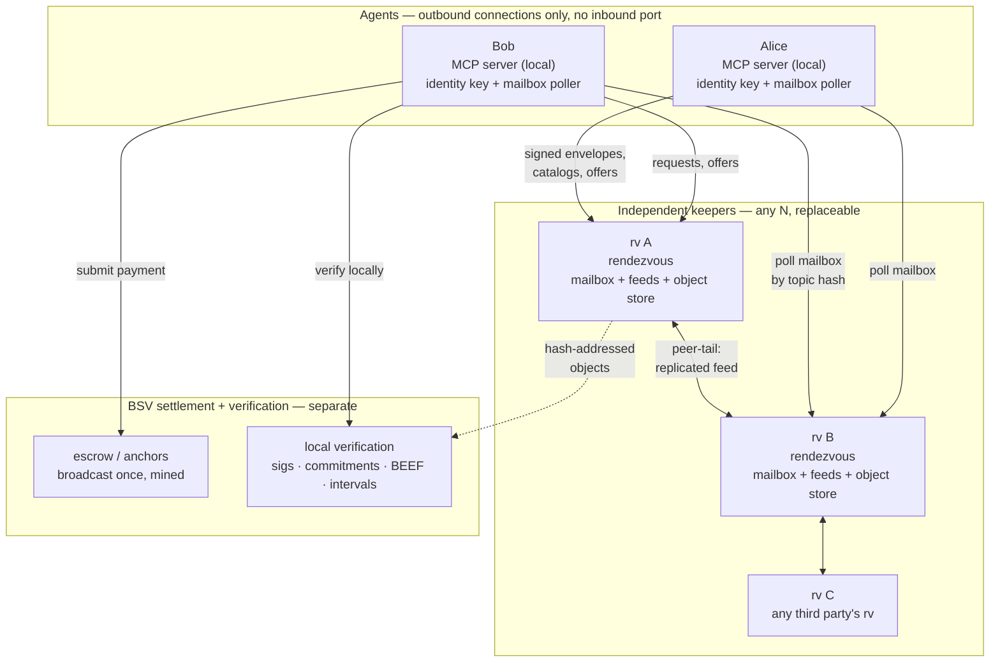
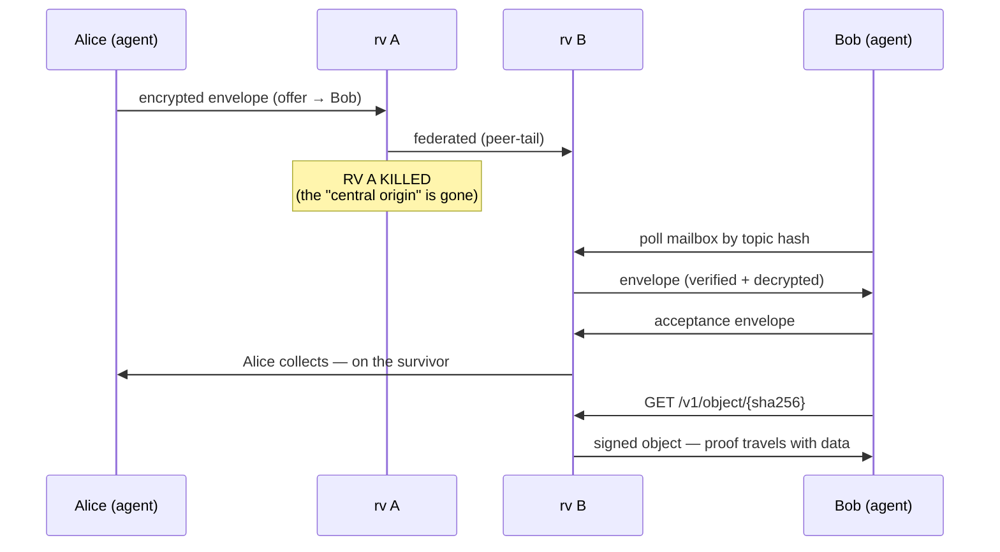

# Nektar resilience — no single point, no central capture

How the architecture answers "one DNS name + one port = DoS target + traffic
capture point." Agents are outbound-only; every signed object is verifiable
through any surviving host.

## The architecture

## The trust separation

| Layer | Who runs it | What it can see | What it cannot do |
|-------|-------------|-----------------|-------------------|
| **Agent** | you | everything (plaintext) | — |
| **Keeper (rv)** | anyone | your IP, timing, topic hashes | read payloads, forge objects, lie about history |
| **Peers** | other operators | same | same |
| **Chain** | miners | public txs | alter committed evidence |

Signed objects carry their own proof — a keeper is a courier, not an authority.

## The kill-the-origin test (what `test/failover.test.mjs` proves)

Exit 0 = the exchange completed with the original host dead — mailbox-mediated,
verified locally, hash-addressed on the survivor.

## What each piece does

| Mechanism | Kills which capture point |
|-----------|---------------------------|
| **Mailbox exchange** (`sendEnvelope`/`collect`/`mailboxServe`) | synchronous connections, inbound ports, "where is the seller's machine" |
| **Topic-addressed envelopes** | keeper sees `sha256("mb:"+pub)`, not the recipient pubkey |
| **`rvSet` + `peers.json` + beacons** | the one-DNS-name bootstrap — last-known set serves when all live fetches fail |
| **`/v1/object/{sha256}`** | host-dependence of evidence — any keeper that saw it serves it |
| **`localMatch` discover** | query-term disclosure — the rv sees your feed cursor, not your interests |
| **`IntervalCommit` (F2)** | a keeper silently dropping/withholding history — gaps are provable |
| **`BudgetAuthority` (F3)** | cumulative grant enforcement survives cross-marketplace spends |

## The honest residual — what we do NOT hide

- Keeper sees **connection IP + timing** (same floor as any mailbox pattern, including the referenced design)
- Chain observer sees **payment linkage** — public txs are public by design
- Funding authority sees **delegated spends** — keep it private + principal-operated

The goal was never anonymity — it was removing the **mandatory single server**
and making evidence **portable + independently verifiable**. That's what the
failover test demonstrates.
