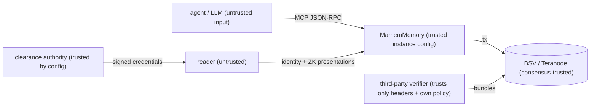

# Threat model (SEC-001)

Scope: the mamem packages, the MCP server, the regtest stack integration. STRIDE per component; §5/§13 adversaries from the paper (a malicious writer, a malicious prover, a malicious verifier, a network adversary, a key thief).

## Trust boundaries

## STRIDE

| Component | Threat | Mitigation | Test |
|---|---|---|---|
| Anchor chain | **T**ampering: a forked or rewritten history | head UTXO single-spend; Rúnar checks n+1, R' chaining, owner sig; overlay admits successors only | contracts/anchor/overlay tests, fuzz decoder |
| Anchor chain | **S**poofing: shard squatting via forged genesis | shard id = hash160(genesisOwner); expected shard pinned by the verifier | `tm.test`, `zk-integration` (shard mismatch) |
| Proof bundles | **T**ampering: leaf, path, BEEF, tail | full recomputation; leaf-count binding; tail must end at the proven anchor | verify tests, fuzz (120 mutations) |
| Regtest broadcast | **D**oS / ambiguity: TX_MISSING_PARENT, timeouts | identical re-broadcast with backoff; own-attempt adoption; fail-fast dry funding | anchor retry tests |
| Confirmations | **T**ampering by BUMP mix-up | each tx keeps only its own BUMP (regression: a descendant's BUMP was assigned to ancestors) | `anchorchain.test` regression |
| Identity | **S**poofing: replayed or self-chosen challenge | nonces issued by the instance, 5-min TTL; binding must match the answering pubkey; separate challenge domain tag | `memory.test` Cedar/ZKA tests |
| ZK clearance | **E**levation: self-issued, borrowed, replayed or mis-scoped credential | trusted authorities pinned; credential bound to the holder pubkey; transcript scoped to shard/seq; single use; level from proof only | `memory.test` ZKA gate (7 negatives) |
| ZK clearance | **I**nformation disclosure: level revealed | public commitment carries no level or blinding (the earlier version leaked both) | `identity.test` key-set assertion |
| Cedar | **E**levation: caller-supplied policy or level | instance-level policy; hash recomputed vs anchored; principal level = PROVEN level only (closed a bypass where a forged proof's requiredLevel raised the Cedar level) | `memory.test` forged-proof case |
| Cedar | policy bug | SymCC proof of level isolation over all typed requests; a mutant is refuted | `pnpm cedar:symcc`, `policy.test` POL-015 |
| Policy DAG | **T**ampering: caller facts or root | EDB only from verified caller/proof; DAG root must equal the anchored root | `graph-anchor.test` POL-016a-c |
| Encryption | **I**nfo disclosure: plaintext level>0 served | ZK gate applies to every level>0 record, plaintext or encrypted; decryption only after verifyFragment | `memory.test` plaintext gate, KEY-008 |
| Encryption | **D**ata loss: dedup collision | hdp binds the plaintext before it is dropped (an earlier bug deduplicated distinct encrypted records) | regression test |
| ZK membership | **S**poofing: proof over the prover's own anchor or a foreign program; **R**eplay | proven R/size must equal an SPV-verified anchor of the verifier's own shard on its canonical chain; program id pinned; queryId issued by the verifier, single use, persisted | `zk-integration`, `stark-verify`, fuzz |
| ZK derivation (§14) | **S**poofing: path under an unanchored/foreign policy, wrong rule, skipped or reordered step; **R**eplay | every step's rule is a DAG node Merkle-proven against the proven policyRoot; the guest re-checks rule application and step chaining; policyRoot must equal the verifier's anchored DAG root; program id pinned; queryId single use (shared registry) | `stark-derivation`, `zk-derivation`, guest vectors, fuzz |
| ZK derivation (§14) | **E**levation: fabricated premises | premises marked as context (EDB) leaves are private and uncommitted — the attestation proves faithful rule application under the anchored rules, not premise truth; premises can optionally be committed DAG fact nodes for full binding | honest statement in `verifyDerivation`, PROOFS.md |
| Subset disclosure (DIS-002) | **S**poofing: proof over a foreign or unanchored root; **T**ampering: non-canonical codec, inconsistent shard fold, wrong shard contribution | claimed root+size must equal an SPV-verified anchor of THIS shard on its canonical chain; strict L_ZKDis v2 codec (ascending canonical order, exact sibling counts); every leaf's subpath must fold to the SAME shard root; the shared top multiproof must reach the anchored R | `zkdis-codec`, `subset-integration`, fuzz |
| Automaton | **E**levation: off-δ transition, halt outside F, stale-state read | δ and F Merkle paths in-contract; every method continues state | `automaton.test`, regtest rejection |
| Disclosure | replay / scope creep | verifier-named, expiring, signed envelope; wrapped value authenticated | disclosure tests + fuzz |
| Ingest | **S**poofing: forged source attribution | originator signature over (d, p\σ) verified before encryption; `requireSignedProvenance` | TC-70 |
| Log | **R**epudiation of a promise | signed checkpoints + promise monitor + alert | TC-71 |
| Restart | replay after restart | persisted security state | TC-73 |
| HTTP API | input abuse | 1 MB body limit; same verified-identity / clearance gates as MCP; public routes are read-only proofs | TC-74 |
| Decoders | **D**oS / confusion by malformed input | typed errors only; byte-authenticated decoders | `packages/fuzz` |
| Supply chain | malicious dependency | pinned versions (≥7 days old), lockfile, single `@bsv/sdk`, `check:deps`; ⚠ `dangerouslyAllowAllBuilds: true` in `pnpm-workspace.yaml` allows every install script — review before production | `pnpm check:deps`, Docker clean build |
| Secrets | leakage via repo | `.env`, `.state/` gitignored; RPC creds from env only | `git check-ignore` |
| Repudiation | writer denies a record | signed provenance, signed inclusion promises, anchored receipts | audit bundle |

## Residual risks

- **Origin falsehood**: by design, out of scope for cryptography (labelled everywhere).
- **Mainnet MVP hot fee key**: the operator fee key is online, so compromise of the host means losing the float.
  - Mitigations: a small float; per-tx, per-day and interval caps enforced before broadcast and fail-closed on unresolvable input values or a negative fee; keys encrypted at rest; a low-balance alert.
  - Not in the MVP: user-owned BRC-100 funding, HSM/KMS, and an external audit. Use the MVP for non-sensitive, low-value data only.
- **Third-party mainnet services**: BSV Broadcaster (GorillaPool) and WhatsOnChain can be unavailable or lie about status; a 200/202 means "accepted", not "mined".
  - Proofs are still SPV-verified against headers, so a lying service can delay but not forge.
  - Headers come from one provider (WoC). Cross-checking a second header source is future work.
- **ZK implementation trust (ADR-020)**: the membership and derivation STARKs have no trusted setup, and they are proven over the same double-SHA-256 structures that are anchored, so there is no tree-equality gap any more. Residual risks:
  - a bug in the RISC Zero 3.0.3 prover or verifier;
  - a wrong pinned program id. They are rebuilt reproducibly, and `reproduce` checks both against committed real receipts.
- **ZK derivation premises are private context by default**: a §14 attestation proves the path is well-formed under rules committed in the anchored DAG; context (EDB) premises are uncommitted. When full binding is required, premises must be committed DAG fact nodes — the guest supports both modes.
- **Prover sees the witness**: proving runs locally (Docker). Outsourcing proving would hand the leaf and path to the prover.
- **Proof size and latency**: about 224 KB and 35–50 s to prove on CPU; DoS via expensive verification is bounded by a max receipt size and cheap pre-checks.
- **Clearance authority honesty** is assumed (trust is by configuration).
- **Challenge TTL**: a nonce can be reused by the same caller within 5 minutes on the same instance. ZK transcripts are single-use.
- **Security-state persistence**: challenges, used ZK transcripts, issued ZK membership queries and revocations persist through `securityStore` (`FileSecurityStore`, atomic replace) and survive a restart (TC-73). Without a configured store they are in-memory, as in the demo server.
- **Ingest signatures** are enforced only when `requireSignedProvenance` is set or a `sourcePub` is supplied. Unsigned agent notes remain possible by configuration.
- **Finality** is a policy parameter (`finalityDepth`). Reads that matter should use `requireFinal`.
- **No external audit / pen test yet** (SEC-004/005): required before mainnet.
- **Key-compromise playbook** (SEC-008): rotate (on-chain) → revoke old key (SMT root anchored) → re-encrypt future writes under new seeds. Records already written stay readable to the old seed holder; crypto-shredding the old seed is the only remedy.
