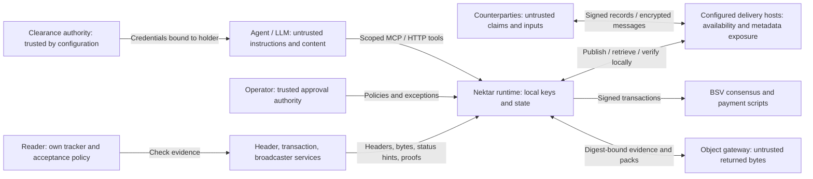

# Threat model (SEC-001)

Reviewed: **2026-11-11**. Scope: the Nektar packages, MCP/HTTP interfaces, autonomous memory trades, configured delivery hosts, recovery notes, deal journals, object storage, and chain integrations. STRIDE per component; §5/§13 adversaries from the paper remain relevant: malicious writers, provers, verifiers, network intermediaries, and key thieves.

This document describes implementation boundaries and residual risks. Test references identify relevant regression coverage, not an external audit or a claim that every suite was rerun for this documentation update. The [README](../README.md) describes the product; [PROOFS.md](PROOFS.md) describes proof semantics; [AUTOMATION.md](AUTOMATION.md) describes operating conditions.

## Security claim

**Portable knowledge and portable payment let providers compete. They do not make a provider honest.**

Nektar checks the evidence attached to an exchange: signatures, commitments, record provenance, inclusion against configured headers, and applicable payment conditions. These checks do not establish factual truth, useful inference, a complete market view, permanent storage, or the future availability of a counterparty.

A memory product is identified by its records and commitments. Different knowledge remains different knowledge. Accepting the same settlement asset neither standardizes service quality nor makes compute, storage, and verification interchangeable. The wider service economy is a market vision; its participants, acceptance terms, metering, privacy, and delivery guarantees require separate assessment.

### Assets and adversaries

| Asset | What an attacker may try to do |
|---|---|
| Signing, fee, and encryption keys | Impersonate the agent, spend its funds, decrypt its memory or recovery notes. |
| Funds and reserved capital | Induce unauthorized purchases, drain fees, duplicate funding, or strand a payment. |
| Memory, answers, and provenance | Substitute bytes, forge attribution, poison knowledge, or present unsupported claims as verified facts. |
| Policies and approval authority | Broaden scope, approve an exception with agent credentials, or reset effective limits through state loss. |
| Recovery state and delivery | Hide an unfinished obligation, replay a message, lose a disclosure, or prevent a deadline action. |
| Journal and stored evidence | Omit, reorder, replace, or withhold records; present partial evidence as a complete account. |
| Privacy and availability | Correlate identities and timing, leak questions, exhaust resources, or isolate a reader behind colluding hosts. |

A signed counterparty can still be malicious. Several keys need not mean several independent businesses. The operator's machine, runtime configuration, policy approvals, local storage, and dependency chain are trusted components; compromising them defeats assumptions that cryptography alone cannot restore.

## Trust boundaries

The agent process is not an isolated custodian merely because its tools are scoped. An agent with shell access to the runtime's files or environment may reach keys or operator authority outside MCP. Deployment isolation is a separate requirement.

## STRIDE

| Component | Threat | Mitigation | Test |
|---|---|---|---|
| Anchor chain | **T**ampering: a forked or rewritten history | head UTXO single-spend; Rúnar checks n+1, R' chaining, owner sig; readers must verify the presented chain against accepted anchors | contract and anchor tests; decoder fuzzing |
| Anchor chain | **S**poofing: shard squatting via forged genesis | shard id = hash160(genesisOwner); expected shard pinned by the verifier | `tm.test`, `zk-integration` (shard mismatch) |
| Proof bundles | **T**ampering: leaf, path, BEEF, tail | full recomputation; leaf-count binding; tail must end at the proven anchor | verify tests, fuzz (120 mutations) |
| Regtest broadcast | **D**oS / ambiguity: TX_MISSING_PARENT, timeouts | identical re-broadcast with backoff; own-attempt adoption; fail-fast dry funding | anchor retry tests |
| Confirmations | **T**ampering by BUMP mix-up | each tx keeps only its own BUMP (regression: a descendant's BUMP was assigned to ancestors) | `anchorchain.test` regression |
| Identity | **S**poofing: replayed or self-chosen challenge | nonces issued by the instance, 5-min TTL; binding must match the answering pubkey; separate challenge domain tag | `memory.test` Cedar/ZKA tests |
| ZK clearance | **E**levation: self-issued, borrowed, replayed or mis-scoped credential | trusted authorities pinned; credential bound to the holder pubkey; transcript scoped to shard/seq; single use; level from proof only | `memory.test` ZKA gate (7 negatives) |
| ZK clearance | **I**nformation disclosure: level revealed | public commitment carries no level or blinding (the earlier version leaked both) | `identity.test` key-set assertion |
| Cedar | **E**levation: caller-supplied policy or level | instance-level policy; hash recomputed vs anchored; principal level = PROVEN level only (closed a bypass where a forged proof's requiredLevel raised the Cedar level) | `memory.test` forged-proof case |
| Cedar | policy bug | SymCC proof of level isolation over all typed requests; a mutant is refuted | `pnpm cedar:symcc`, `policy.test` POL-015 |
| Policy DAG | **T**ampering: caller facts or root | EDB only from verified caller/proof; DAG root must equal the anchored root | `graph-anchor.test` POL-016a-c |
| Encryption | **I**nfo disclosure: plaintext level>0 served | ZK gate applies to every level>0 record, plaintext or encrypted; decryption only after verifyFragment | `memory.test` plaintext gate, KEY-008 |
| Encryption | **D**ata loss: dedup collision | hdp binds the plaintext before it is dropped (an earlier bug deduplicated distinct encrypted records) | regression test |
| ZK membership | **S**poofing: proof over the prover's own anchor or a foreign program; **R**eplay | proven R/size must equal an SPV-verified anchor of the verifier's own shard on its canonical chain; program id pinned; queryId issued by the verifier, single use, persisted | `zk-integration`, `stark-verify`, fuzz |
| Combined Π (§13) | **S**poofing: a valid membership STARK paired with a clearance bound to a different query (Π components verified separately) | `verifyCombined` requires the clearance transcript — and any derivation STARK — to carry the SAME verifier-issued queryId as the membership journal, and the transcript nonce must equal the nonce issued with that query; the stored query must recompute to the proof's queryId | `zk-integration` combined Π, `stark-verify` Π binding |
| ZK derivation (§14) | **S**poofing: path under an unanchored/foreign policy, wrong rule, skipped or reordered step; **R**eplay | every step's rule is a DAG node Merkle-proven against the proven policyRoot; the guest re-checks rule application and step chaining; policyRoot must equal the verifier's anchored DAG root; program id pinned; queryId single use (shared registry) | `stark-derivation`, `zk-derivation`, guest vectors, fuzz |
| ZK derivation (§14) | **E**levation: fabricated premises | premises marked as context (EDB) leaves are private and uncommitted — the attestation proves faithful rule application under the anchored rules, not premise truth; premises can optionally be committed DAG fact nodes for full binding | honest statement in `verifyDerivation`, PROOFS.md |
| Subset disclosure (DIS-002) | **S**poofing: proof over a foreign or unanchored root; **T**ampering: non-canonical codec, inconsistent shard fold, wrong shard contribution | claimed root+size must equal an SPV-verified anchor of THIS shard on its canonical chain; strict L_ZKDis v2 codec (ascending canonical order, exact sibling counts); every leaf's subpath must fold to the SAME shard root; the shared top multiproof must reach the anchored R | `zkdis-codec`, `subset-integration`, fuzz |
| Automaton | **E**levation: off-δ transition, halt outside F, stale-state read | δ and F Merkle paths in-contract; every method continues state | `automaton.test`, regtest rejection |
| Disclosure | replay / scope creep | verifier-named, expiring, signed envelope; wrapped value authenticated | disclosure tests + fuzz |
| Ingest | **S**poofing: forged source attribution | originator signature over (d, p\σ) verified before encryption; `requireSignedProvenance` | TC-70 |
| Log | **R**epudiation of a promise | signed checkpoints + promise monitor + alert | TC-71 |
| Restart | replay after restart | persisted security state | TC-73 |
| HTTP API | input abuse / unauthorized calls | 16,000,000-byte JSON body limit; configured bearer gate, tool-profile restrictions, and identity/clearance checks; operator approvals require a separate operator token | `packages/mcp/test/http.test.ts`, `packages/mcp/test/profile.test.ts`, `packages/mcp/test/automation-http.test.ts` |
| Decoders | **D**oS / confusion by malformed input | typed errors only; byte-authenticated decoders | `packages/fuzz` |
| Supply chain | malicious dependency | pinned versions (≥7 days old), lockfile, single `@bsv/sdk`, `check:deps`; ⚠ `dangerouslyAllowAllBuilds: true` in `pnpm-workspace.yaml` allows every install script — review before production | `pnpm check:deps`, Docker clean build |
| Secrets | leakage via repo | `.env`, `.state/` gitignored; RPC creds from env only | `git check-ignore` |
| Repudiation | writer denies a record | signed provenance, signed inclusion promises, anchored receipts | audit bundle |

## Market and service boundaries

### Agent authority and spending

The default agent tool profile restricts HTTP/MCP exposure. An approved automation policy constrains the runtime's domains, roles, purchase amount, fees, locked capital, unconfirmed exposure, and AI provider/egress choices. A seller can still poison a record or embed instructions designed to persuade a model to buy, disclose, or execute something outside the intended task. Purchased content must be treated as data, not authority.

Policy and exception approval belong to the operator CLI or the separately authenticated approval endpoint. The agent bearer is not approval authority. Revoking a policy stops new work; existing financial obligations continue to be monitored. Manual owner tools are recorded in the ledger but are not all bounded by automation caps. A scoped automation policy is not a global wallet spending guarantee.

HTTP authentication depends on configuration: when `NEKTAR_HTTP_TOKEN` is unset, there is no bearer gate on the tool surface. The operator token must be distinct from the agent token. Public discovery, pack, verification, and status-callback routes have separate exposure; read-only intent does not make a route cheap or private. The JSON body bound does not cap aggregate requests, MCP sessions, proof-verification cost, or object-download memory. Reachability, request limits, and credential handling need deployment controls.

The local ledger persists transaction intent and input leases before outcomes are known, and retries can reuse the same transaction bytes. Broadcaster status is reconciled; an ambiguous submission must not be treated as permission to create another payment. Rejection or unknown status can interrupt progress, and repeated refused refunds or unresolved state can require operator action.

### Offers, disclosure, and payment

Wants, offers, and quotes bind the applicable identities, network, task, and commitments; expiry and reader-side checks constrain replay. These checks authenticate the advertised exchange, not a seller's competence or the usefulness of its output. Selecting from observed offers does not prove that every seller was seen or that the chosen price is globally best. New identities and collusion remain economic threats.

DisclosureSale binds the seller's collection path to the committed `wrapped` value and the contract's payment conditions. The buyer separately checks the disclosed record and provenance. In particular, collection does not wait for a human judgment of answer quality. Refund requires the configured deadline and a still-unspent escrow output; it is not a chargeback for a valid completed sale.

Private disclosure depends on the named buyer's decryption material. On-chain transaction bytes, including `wrapped`, are public. Public disclosure has different front-running and reuse properties. Neither form prevents an authorized recipient from copying or reselling plaintext, and provenance is not a licence-enforcement mechanism.

### Host discovery, publication, and network privacy

Current automation sends records and encrypted envelopes over HTTP(S) to configured hosts; signed identity records can advertise a counterparty's host list. Readers validate returned records locally. Resolving a signed identity record establishes control of the signing key and the record's checked history, not a real-world identity or the latest possible global state. Host URL filters constrain resolved destinations; redirects, DNS, TLS, and operator-supplied endpoints remain deployment and egress boundaries.

Publication acknowledgements are not consensus, possession proofs, or durable replication guarantees. In `submitAll`, `took` counts successful HTTP responses; `admitted` separately records advertised output admission. Automation currently rejects want/offer publication when a target host is missed. Even successful responses from every target do not guarantee later retrieval. Multiple hosts help only to the extent that they are independently available and serve useful evidence; there is no mandatory majority vote on record truth.

Envelope encryption protects message content from hosts without recipient keys. It does not hide all sender/recipient identifiers, timestamps, sizes, public domain tags, public questions, or connection patterns. Fixed endpoints, DNS, network intermediaries, and colluding hosts remain correlation and denial-of-service points. More hosts, outbound-only connections, or larger address space do not establish anonymity.

Broadcaster SSE supplies outbound status updates when configured; webhook handling remains another surface. Neither delivery mechanism makes a status string a mined proof. Callbacks use the configured callback token when present, and carried or fetched inclusion evidence is checked against the runtime's tracker before confirmation is delivered. Callback tokens in request URLs may be exposed to service/proxy logs. Reconnect cursors and events do not establish exactly-once business execution or uninterrupted delivery; reconciliation remains necessary.

### Buyer and seller recovery

Encrypted self-notes can reconstruct escrowed purchases and quoted sales after loss of the automation database. Buyer notes bind the signed want and offer to the observable escrow; seller notes restore the original sale identity. Foreign senders and invalid binding evidence are rejected. Held delivery envelopes avoid acknowledging a disclosure away before the purchase settles.

This is recovery of specific deal state, not recovery of the entire agent. It requires retained keys, underlying memory, available valid notes, and restoration of approved policy; seller execution may need re-enabling. Policies, budgets, earlier operations, and source memory are not rebuilt by these notes. Notes expire, at most after seven days, and hosts can withhold them. Database loss can destroy the accounting context needed to enforce previous limits; do not assume a recovered deal reconstructs the old aggregate budget. A failed recovery does not itself cancel an on-chain obligation.

### Journals and evidence storage

Deal journals contain numbered, linked batches of state transitions, causes, and evidence digests. A reader can recover a missing batch from a sibling host, report unresolved internal gaps, and recompute an interval commitment against verified anchor coverage. Publication and anchoring are asynchronous; pending events are not automatically covered by a mined checkpoint.

A consistent presented prefix does not prove that no later batches exist. A complete-looking recorded interval does not reveal suppressed real-world events, a withheld latest tail, or events the producer never logged. `complete` and `anchoredThrough` describe checked coverage, not truth or universal freshness. A compromised producer can suppress future logging, and journal metadata may expose activity even without private payloads.

Optional object storage records a reference containing a digest and checks fetched bytes against it. The expected digest must come from a trusted or verified reference; a digest supplied alongside attacker-chosen content proves no independent identity. A matching digest does not prove durable storage, independent replicas, a complete bucket listing, or availability. The size checks in `getVerified` include checks after download; they are not a streaming memory-usage guarantee against a malicious response.

Stored trade-evidence bundles are redacted. Verification reports checks that cannot be performed without withheld fields; unavailable checks must not be presented as passed. Redaction is not encryption and still exposes the remaining metadata. The storage integration does not supply provider possession challenges, automatic storage-market payouts, or service guarantees.

### Untrusted execution

A purchased patch is untrusted code even when its record verifies. The patch evaluator restricts paths and size, rejects symlink fixtures, and runs through an isolation backend. The Docker backend disables networking, drops capabilities, uses a read-only root filesystem, and bounds time and resources. Missing isolation returns `BLOCKED`; it must not fall back to running purchased code on the host. Hidden tests are outside the writable checkout but visible to the container when mounted. Passing them is evidence for that test suite, not a proof of general correctness or protection from every container/runtime vulnerability.

## Residual risks

- **Origin falsehood**: by design, out of scope for cryptography (labelled everywhere).
- **Mainnet MVP hot fee key**: the operator fee key is online, so compromise of the host means losing the float.
  - Mitigations: a small float; per-tx, per-day and interval caps enforced before broadcast and fail-closed on unresolvable input values or a negative fee; keys encrypted at rest; a low-balance alert.
  - Not in the MVP: user-owned BRC-100 funding, HSM/KMS, and an external audit. Use the MVP for non-sensitive, low-value data only.
- **Chain data and status providers**: transaction broadcasters, header services, and transaction/proof APIs can fail, censor, or present stale views. A 200/202 response or a status event is not mined confirmation.
  - Main/testnet runtime uses a configured Chaintracks header source with WoC fallback; regtest uses its configured node/tracker. Inclusion is checked relative to those accepted headers. This does not independently establish that the source supplied the latest best-work chain, and fallback is not an independent multi-source agreement check.
  - Header-source authenticity, freshness, chain selection, consensus assumptions, and finality policy are part of the trust boundary. A Merkle path alone does not remove those assumptions.
- **ZK implementation trust (ADR-020)**: the membership and derivation STARKs have no trusted setup, and they are proven over the same double-SHA-256 structures that are anchored, so there is no tree-equality gap any more. Residual risks:
  - a bug in the RISC Zero 3.0.3 prover or verifier;
  - a wrong pinned program id. They are rebuilt reproducibly, and `reproduce` checks both against committed real receipts.
- **ZK derivation premises are private context by default**: a §14 attestation proves the path is well-formed under rules committed in the anchored DAG; context (EDB) premises are uncommitted. When full binding is required, premises must be committed DAG fact nodes — the guest supports both modes.
- **Prover sees the witness**: proving runs locally (Docker). Outsourcing proving would hand the leaf and path to the prover.
- **Proof size and latency**: about 224 KB and 35–50 s to prove on CPU; DoS via expensive verification is bounded by a max receipt size and cheap pre-checks.
- **Clearance authority honesty** is assumed (trust is by configuration).
- **Challenge TTL**: a nonce can be reused by the same caller within 5 minutes on the same instance. ZK transcripts are single-use.
- **Security-state persistence**: challenges, used ZK transcripts, issued ZK membership queries and revocations persist through `securityStore` (`FileSecurityStore`, atomic replace) and survive a restart (TC-73). Without a configured store they are in-memory, as in the demo server.
- **Ingest signatures** are enforced only when `requireSignedProvenance` is set or a `sourcePub` is supplied. Unsigned agent notes remain possible by configuration.
- **Finality** is a policy parameter (`finalityDepth`). Reads that matter should use `requireFinal`.
- **No external audit / pen test yet** (SEC-004/005): required before mainnet.
- **Key-compromise playbook** (SEC-008): rotate (on-chain) → revoke old key (SMT root anchored) → re-encrypt future writes under new seeds. Previously disclosed plaintext and records decryptable by a stolen seed cannot be made secret again by rotation. Deleting the operator's old seed does not delete an attacker's copy. Rotate and revoke to limit future exposure, preserve incident evidence, and assess every affected record and outstanding payment.
- **Rúnar 0.4.6 compiler trust (GOAL-v7)**: the three covenants are only as correct as the compiled artifact. Mitigations: negatives are exercised against real node script eval on regtest (not just the mock interpreter), artifacts are rebuilt deterministically by `pnpm -r build`, and the known 0.4.6 quirks are documented in GOAL-v7 V0 — conditional state mutation (worked around by host-computed transition witnesses, still asserted on-chain), multi-method injected frames (pad args + auto-change), dead-coded nested `cat` (fully-inlined out() asserts). A compiler upgrade requires re-running the full regtest covenant E2E before deploy.
- **Covenant residual limits**: the FeeVault's auto-change output is bounded (`leftover ≤ maxFee+1`) but not destination-pinned — an operator could route the ≤(maxFee+1) sat residual away; the CheckpointBond prevents forked checkpoints but cannot punish a false root (no `checkDataSig`); the DisclosureSale binds `sha256(wrapped)`, not the usefulness of the plaintext. The V3 escrow is buyer-funded (BIP-199 shape): the depositor pins the change destination in the contract itself, `buy` enforces `fee ≤ maxFee` so the completer cannot burn the deposit, and `refund` is depositor-signed behind `refundAfter` — the seller's only paths are "reveal + collect exactly `price`" or "buyer reclaims after the deadline". `wrapped` is publicly visible on-chain — private mode relies on BRC-42 ECDH confidentiality to the named buyer; nothing prevents a buyer from reselling the plaintext after claiming, and a *public* payload can be front-run by anyone who sees it in the mempool before the buy confirms.
- **GOAL-v8 residuals**:
  - **Level floor covers only declared premises** — `premiseRefs` floor the new record's level at `max(cited)`, but the caller *asserts* the citation set. A writer that derives from a level-5 record without citing it can still write level-0 — the floor enforces the lattice over the declared derivation graph, not knowledge itself (same fundamental limit as the paper's; taint tracking inside the model is out of scope).
  - **`__access__` leaks the access pattern when enabled** — the opt-in audit shard records who decrypted what when, in plaintext. Enable `NEKTAR_ACCESS_LOG` only where that tradeoff is acceptable; the flag is off by default. The log is for the honest operator's auditability — a writer with process access could suppress entries, so it is not a tamper-proof monitor.
  - **Rotation ledger completeness** — `verifyAnchoredRotationChain` proves the cert chain *as presented* links genesis→latest; an operator withholding the newest cert makes `activePub` stale but never forged (a lower bound). Completeness needs the covenant to carry cert state, which the anchor layout doesn't (documented divergence).
  - **Delegation map is caller-asserted** — D1 binds `opts.delegations` into the signed receipt, but the caller chooses which delegations to declare. An omitted delegation is invisible to the signature; each declared entry is independently verified (`verifyReceiptDelegations`).
  - **Model binding is attestation, not execution** — `receipt.model` commits `{id, params, weightsHash}` but nothing proves those params ran; the LLM output remains non-deterministic (inherent).
  - **Signed-offer relayability stands** — an unexpired offer can still be forwarded to another buyer (harmless: they bind their own `depositorPkh`); `expiresAt` now bounds the window.

## Regression coverage for the current market surfaces

These files are evidence to inspect and rerun for relevant implementation changes. Their presence is not a security certification, proof of production deployment, or a claim that a mock tracker establishes public-network consensus.

| Surface | Relevant source and regression coverage |
|---|---|
| Tool and approval boundaries | [server.ts](../packages/mcp/src/server.ts), [profile tests](../packages/mcp/test/profile.test.ts), [approval tests](../packages/mcp/test/automation-http.test.ts) |
| Budget, transaction state, and crashes | [market engine](../packages/mcp/src/automation/market.ts), [store tests](../packages/mcp/test/automation-store.test.ts), [market fault tests](../packages/mcp/test/market-faults.test.ts) |
| Buyer/seller self-notes and held disclosures | [market transport tests](../packages/mcp/test/market-bstack.test.ts) |
| Host publication, reads, and identity resolution | [hosts.ts](../packages/bstack/src/hosts.ts), [market tests](../packages/bstack/test/market.test.ts), [identity tests](../packages/bstack/test/finger.test.ts) |
| Journal gaps, sibling retrieval, and anchor mismatch | [journal implementation](../packages/bstack/src/log.ts), [journal tests](../packages/bstack/test/log.test.ts) |
| Object integrity and redaction | [object store](../packages/mcp/src/objectstore.ts), [evidence verifier](../packages/mcp/src/automation/evidence.ts), [object-store tests](../packages/mcp/test/objectstore.test.ts) |
| Status transport and confirmation handling | [chain integration](../packages/chain/src/mainnet.ts), [SSE tests](../packages/chain/test/sse.test.ts), [HTTP handling](../packages/mcp/src/http.ts) |
| Purchased patches | [sandbox implementation](../packages/mcp/src/automation/sandbox.ts), [sandbox tests](../packages/mcp/test/automation-sandbox.test.ts) |

For execution prerequisites and distinctions between mock, regtest, testnet, and mainnet, use the [operating guide](OPERATIONS.md) and [automation notes](AUTOMATION.md). The wider market vision does not extend any of these guarantees to an unrelated service merely because it accepts BSV.
