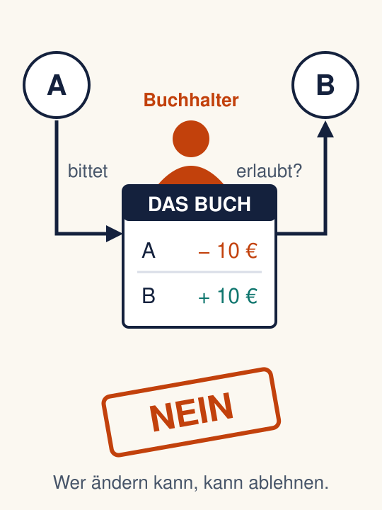
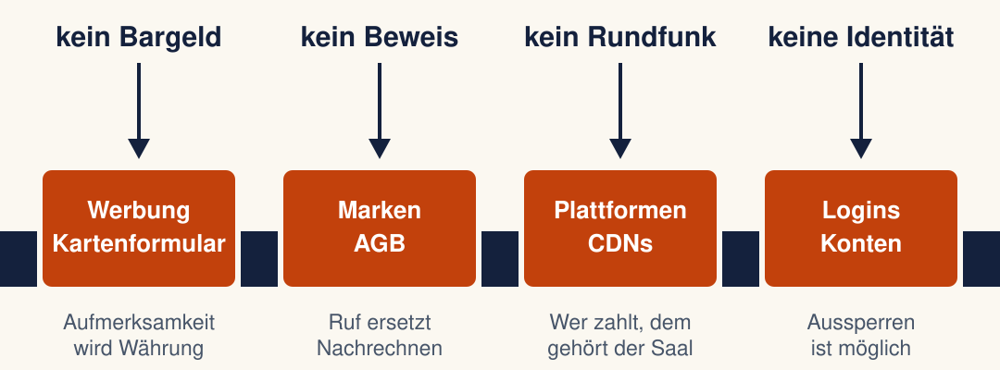
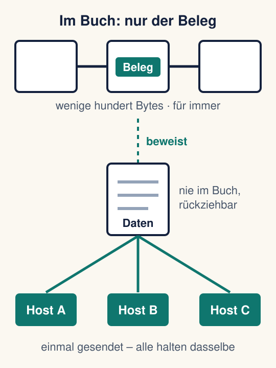
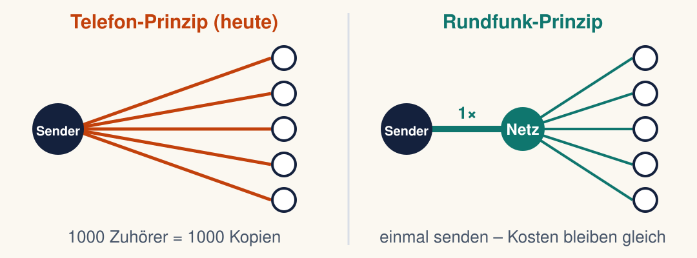

<!-- _class: lead -->
<!-- _paginate: false -->
<!-- _footer: "" -->

## ChatGPT Wallet · ganz dumm erklärt

# Die Mautstelle und die offene Straße

Warum dein Agent Geld braucht – und keinen Hallenpass

<!--
Langfassung mit allen Quellen: ../SOVEREIGN-INTERNET-VS-AGENTIC-WALLETS.md
Regel für diesen Vortrag: Jede Behauptung bekommt Beispiele, die wirklich passiert sind.
-->

---

<!-- _class: zitat -->

## 13. November 2026 · OpenAI stellt ChatGPT Wallet vor

> „Ein Agent, der einkauft, sollte das Vertrauen im Zahlungsverkehr **stärken, nicht umgehen**.“

Sherri Haymond, Mastercard · eigene Übersetzung

Der ganze Vortrag dreht sich um ein Wort: **umgehen**.

<!--
Original: "An agent making a purchase should strengthen, not bypass, the trust built into payments."
Quelle: https://openai.com/index/introducing-chatgpt-wallet/
-->

---

<!-- _class: dicht -->

## Das Problem in einem Satz

# Das Internet kann nur kopieren

- Alles im Netz ist eine Kopie: Bild, Mail, Song. Super für Informationen.
- Geld darf man **nicht** kopieren. Eine kopierbare Münze ist keine Münze.
- Also brauchte es immer jemanden, der aufpasst, dass niemand doppelt ausgibt.

> Wer aufpasst, sitzt zwischen dir und deinem Geld. Für immer.

<!--
Das Double-Spend-Problem ist der einzige Grund, warum digitales Geld je einen Mittelsmann hatte.
-->

---

<!-- _class: dicht -->

## Der einzige bekannte Ausweg – bisher

# Der Buchhalter

- Jemand führt ein Buch: Wer hat wie viel?
- Bezahlen heißt: **Du bittest**, er ändert zwei Zeilen.
- Er entscheidet die Reihenfolge. Wer zuerst ausgab, hat ausgegeben.

Der Buchhalter kann vier Dinge, die du nicht kannst:

**Nein sagen · mitkassieren · alles sehen · dich einfrieren**

> Wer ändern kann, kann ablehnen.

---

<!-- _class: beleg -->

## Das ist passiert – keine Verschwörung, nur Archiv

# Wer das Buch führt, kann Nein sagen

- **2010** Visa, Mastercard und PayPal sperren Spenden an WikiLeaks.
- **2020** Visa und Mastercard trennen sich über Nacht von Pornhub.
- **2022** Kanada friert rund 257 Konten von Protestierenden ein.
- **2022** Visa und Mastercard stellen ihr Geschäft in Russland ein.
- **2025** Deutsche Banken stoppen PayPal-Lastschriften über 10 Mrd. €.

> Ob du jede Entscheidung gut findest, ist egal: Der Knopf existiert. Und er wird gedrückt.

<!--
WikiLeaks-Blockade ab Dez. 2010; Pornhub Dez. 2020 (NYT-Reportage vorausgehend);
Emergencies Act Kanada Feb. 2022; Visa/MC Russland März 2022;
PayPal-Lastschriftstopp Deutsche Banken Sep. 2025 (FinanzBusiness/Bloomberg).
-->

---

<!-- _class: beleg -->

## Die Rechnung

# Der Buchhalter ist teuer – und grobschlächtig

- **Karte** – 1,5 % + 0,25 € je Zahlung (Stripe, EWR)
- **Ausland** – ~6 % im Schnitt (Weltbank)
- **Minimum** – unter ~1 € kostet die Abrechnung mehr als der Kauf

> Kein Kleingeld → keine Cent-Preise → Werbung, Abos, Datenhandel. Du bist das Produkt, weil die Maut zu hoch war.

<!--
Stripe-Preise EWR: stripe.com/de/pricing. Weltbank Remittance Prices Worldwide.
-->

---

<!-- _class: dicht -->

## Vier Löcher im Fundament

# Dem Netz fehlen vier Teile

| Loch                             | Wer das Loch gestopft hat             |
| -------------------------------- | ------------------------------------- |
| **Kein Bargeld**                 | Banken, Kartennetze, PayPal           |
| **Kein Beleg, der sich prüft**   | „Vertrauen Sie uns“-Infrastruktur     |
| **Kein Rundfunk**                | CDN-Rechnung pro Kopie, pro Zuschauer |
| **Kein Ausweis, der dir gehört** | Login bei Google, Apple, Meta         |

> Jede Lücke wurde eine Industrie. Niemand baut am Fundament – alle vermieten die Lücke.

---

<!-- _class: lead -->

# Akt 2

## Jetzt soll dein Agent bezahlen

Und die Antwort der Großen: ein Hallenpass.

---

<!-- _class: dicht -->

## ChatGPT Wallet, ganz dumm

# Kein Geldbeutel. Ein Hallenpass.

- Dein Agent hält **kein Geld**. Er hält ein Token – die Erlaubnis, deine Karte zu benutzen.
- Karte hinterlegt bei OpenAI. Jeder Kauf einzeln per Fingerabdruck freigegeben.
- Das Token gilt nur im System aus Netz, Bank, Händler und Risiko-Firma.

> Klingt wie ein Konto? Ist eins. Mit einem Bot davor.

<!--
Token = EMV-Payment-Token, gleiches Modell wie Apple Pay. Quelle: OpenAI-Ankündigung + Help-Center-Artikel.
-->

---

<!-- _class: beleg -->

## Sechs Türen

# Jede Tür kann zumachen

- **Deine Bank** – kann die Karte sperren
- **Kartennetz** – kann den Token entwerten
- **OpenAI** – kann den Agenten abschalten
- **Risk-Check** – Forter, Riskified & Co. sagen ja oder nein
- **Händler** – kann Bot-Verkehr blockieren
- **Plattform** – nur USA, 18+, Pro, US-Karten

> Eine Tür reicht, und dein Agent steht dumm da.

<!--
Risiko-Partner und Region-/Plan-Beschränkungen: OpenAI-Ankündigung + Help-Center + Merchant-Onboarding-Seiten.
-->

---

<!-- _class: dicht -->

## Der Ausweis-Plan

# Bots dürfen rein – mit Badge

OpenAIs Anleitung an Händler:

- **Web Bot Auth** – der Agent signiert jede Anfrage
- **Profil claimen** – Firma bei OpenAI eintragen
- **Produkt-Feed** – der Warenkorb läuft über OpenAIs Format

Und schon Realität:

- **Juli 2025:** Cloudflare blockt KI-Crawler ab Werk
- **Nov. 2025:** Amazon verklagt Perplexity – Agent unerwünscht
- **Nov. 2026:** OpenAI bittet Händler um Ausnahme für eigene Agenten

> Kein Gesetz nötig. Die Grenze entsteht dort, wo Geld fließt.

<!--
Kein Gesetz nötig: Die Grenze entsteht dort, wo Geld fließt – per Firewall-Regel und Geschäftsbedingung.
-->

---

<!-- _class: dicht -->

## Was der Agent nie kann

# Ein Hallenpass ist kein Eigentum

- **Geld empfangen?** Nein – das Token kann nur ausgeben.
- **Einen Fremden bezahlen?** Nein – nur angeschlossene Händler.
- **0,1 Cent für einen Artikel?** Nein – das Minimum frisst es.
- **Mitnehmen zum nächsten Anbieter?** Nein – das Token gehört dem System.

> Ohne OpenAI ist das Token Plastik. Dein Agent kann nichts besitzen – nur dürfen.

<!--
OpenAI-Hilfeseite: Wallet kann nicht empfangen; Token ist an Karte+Plattform gebunden;
Approval "does not confirm that the merchant has placed your order".
-->

---

<!-- _class: lead -->

# Akt 3

## Wie sähe Geld aus, das keinen Buchhalter braucht?

Kurz nachdenken, bevor irgendjemand „Bitcoin“ sagt.

---

<!-- _class: dicht -->

## Das Pflichtenheft, ganz dumm

# Bargeld für das Internet

1. **Ein Beleg, den jeder selbst prüft** – ohne den Schreiber zu fragen
2. **Senden = fertig** – kein Konto, kein Bitten, kein Zurückholen durch Dritte
3. **Beweis reist mit** – Inhalt und Herkunft in einem Paket
4. **Einmal senden, alle empfangen** – Radio, nicht Telefon
5. **Der Schreiber ist austauschbar** – das Buch überlebt jede Firma

> Das ist die Spezifikation. Kein Produktname. Kein Coin. Nur Anforderungen.

---

<!-- _class: dicht -->

## Gibt es schon · seit 2009

# Fünf Sätze, kein Hexenwerk

- **Das Buch ist öffentlich.** Wer schreibt, wird beweisbar bezahlt – Miner, keine Freiwilligen.
- **Jeder Beleg prüft sich selbst.** Bytes + Pfad + Header, keine Vertrauensfrage.
- **Einmal senden erreicht alle.** Lanes mit Nummern, Lücken werden repariert.
- **Senden frei, Empfangen billig.** Kosten hängen an Daten, nicht an Zuschauern.
- **Hosts sind austauschbar.** Wer das Buch hält, ist Diener, nicht Herr.

> Das ist BSV plus 1BSV. Name ist egal – die fünf Punkte sind die Einlösung des Pflichtenhefts.

<!--
1bsv.net: Layered Multicast, nummerierte Frames, NACK-Reparatur, Free Ingress, metered receive, BRC-124–149.
SPV-Prüfung: Transaktionsbytes + Merkle-Pfad + Header-Kette = eigenständige Verifikation ohne Full Node.
-->

---

<!-- _class: lead -->

# Akt 4

## „Aber die Eliten lassen das nicht zu!“

Das beliebteste Argument gegen alles. Es hat eine Schwachstelle.

---

<!-- _class: beleg -->

## Dasselbe haben sie immer gesagt

# Liste der toten Vetos

- **Taxis** verboten Fahrdienst-Apps → Uber trotzdem, Medaillons wertlos
- **Musik** verklagte Napster → MP3 gewann, heute heißt es Streaming
- **Telekom** hasste Internet-Telefonie → SMS-Gebühr tot, WhatsApp lebt
- **Brockhaus** lachte über Wikipedia → praktisch verschwunden
- **Microsoft** nannte Linux „Krebs“ → Azure läuft heute auf Linux

> Das Muster: erst verbieten, dann aufkaufen – oder sterben. Die Rechnung siegt immer.

<!--
Uber-Medaillons NYC: ~1 Mio. $ (2013) → ~100k (2018). Napster 1999 verklagt, Streaming
dominiert seit ~2015. SMS-Volumen brach nach WhatsApp ein. Brockhaus Print eingestellt
2014. Steve Ballmer „Linux is a cancer“ 2001; Azure-Linux-Anteil >50 % seit ~2018.
-->

---

<!-- _class: dicht -->

## Warum das Veto hier nicht trägt

# Man muss sie nicht fragen

- Eine öffentliche Kette braucht **kein Gesetz, das sie erlaubt**. Regulierung trifft die Ränder – Börsen, Onramps. Nicht die Mathe.
- Wer zahlen will, braucht nur einen Schlüssel. Den kann niemand entziehen, ohne das Eigentum selbst abzuschaffen.
- **Der eigentliche Punkt:** Sie müssen es nicht erlauben. Sie müssen nur teurer bleiben als alle anderen.

> Vetos funktionieren bei Erlaubnis-Systemen. Ein öffentliches Buch fragt nicht.

---

<!-- _class: dicht -->

## Die Rechnung entscheidet

# Ihre Infrastruktur stirbt an der Rechnung – nicht an einem Angriff

Was das alte System jeden Tag bezahlt:

- **T+2 Abwicklung** – Geld, das zwei Tage unterwegs ist
- **Chargeback-Abteilungen** – Menschen, die Zahlungen nachträglich rückabwickeln
- **Abgleich-Büros** – Abteilungen, die zwei Datenbanken auf denselben Stand bringen
- **CDN-Rechnung pro Kopie** – jeder Zuschauer kostet extra
- **Compliance prüft alles doppelt** – jeder Partner prüft jeden anderen erneut

Proof-Daten: **einmal prüfen, für immer belegt.** Wer das nutzt, hat schlicht weniger Kosten. Auf lange Sicht gewinnt das Billigere. Immer.

> Ihre Infrastruktur wird nicht gehackt. Sie wird überholt – eine Margen-Frage, keine Ideologie.

---

<!-- _class: zitat -->

## Schluss · ehrlich bleiben

# Die Maut wird nicht abgeschafft. Sie wird umgangen.

Könnte falsch liegen: Karten haben Rückbuchung – die lieben Leute. Netzwerkeffekte sind echt. Regulierung an den Rändern kann wehtun. BSV kann eine Nische bleiben.

Aber die Kosten-Rechnung braucht keinen Glauben. Nur Zeit.

**Fünf Fragen für alles, was zwischen dir und deinem Geld steht:**
Wer hält die Kopie? · Wer kann prüfen? · Wer kann Nein sagen? · Wer zahlt wofür? · Was kostet das Gehen?

Quellen: openai.com · 1bsv.net · Bitcoin-Whitepaper · Weltbank · Pressearchiv
