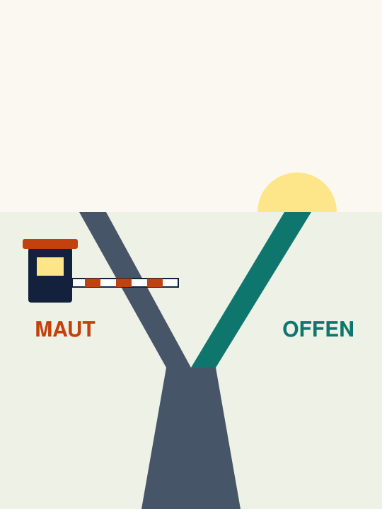
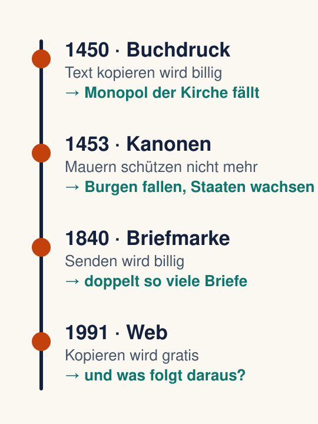
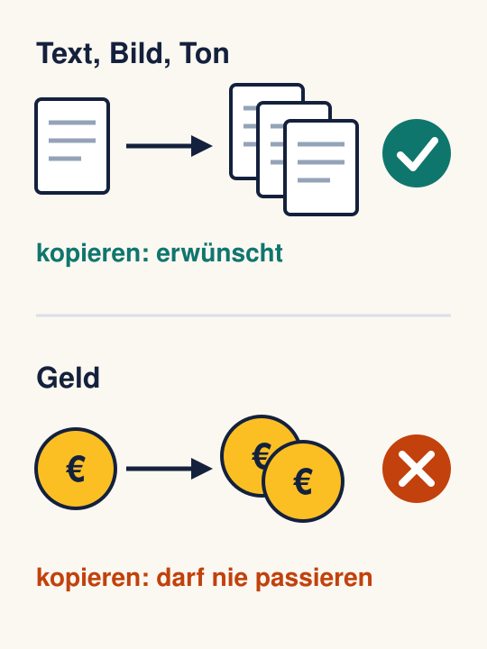
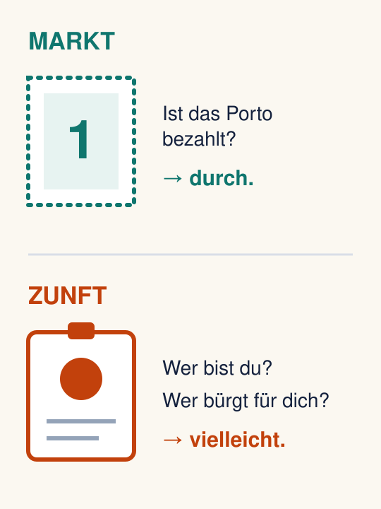
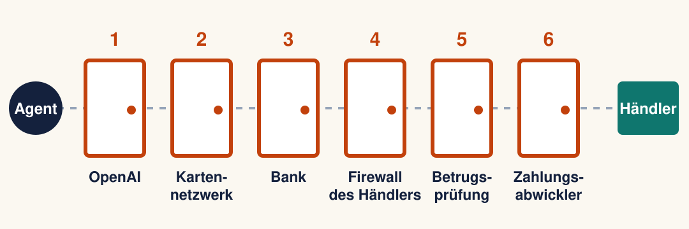
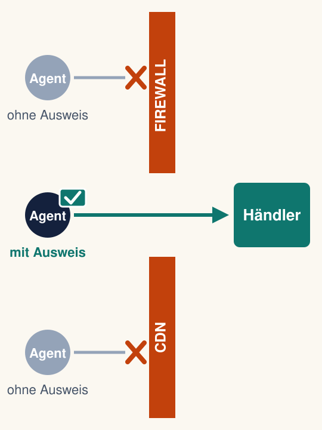

<!-- _class: lead -->
<!-- _paginate: false -->
<!-- _footer: "" -->

## ChatGPT Wallet, aus ersten Prinzipien betrachtet

# Die Mautstelle und die offene Straße

Warum ein Agent Eigentum tragen sollte – und nicht nur eine Erlaubnis

<!--
Langfassung mit allen Quellen: ../SOVEREIGN-INTERNET-VS-AGENTIC-WALLETS.md
Regel für diesen Vortrag: Jede Behauptung bekommt Beispiele, die wirklich passiert sind.
-->

---

<!-- _class: zitat -->

## 13. November 2026 · OpenAI stellt ChatGPT Wallet vor

> „Ein Agent, der einkauft, sollte das Vertrauen im Zahlungsverkehr **stärken, nicht umgehen**.“

Sherri Haymond, Mastercard · eigene Übersetzung

Dieser Vortrag handelt von der **Umgehung**: warum sie nötig ist, was sie können müsste – und ob es sie gibt.

<!--
Original: "An agent making a purchase should strengthen, not bypass, the trust built into payments."
Quelle: https://openai.com/index/introducing-chatgpt-wallet/
-->

---

## Der rote Faden

# Sieben Schritte

1. **Methode** – Folge den Kosten
2. **Problem** – Ein Netz, das nur kopieren kann
3. **Prinzipien** – Was Freiheit verlangt
4. **ChatGPT Wallet** – Heilung oder Symptom?
5. **Pflichtenheft** – Was die Umgehung können müsste
6. **Einwände** – Was dagegen spricht
7. **Auflösung** – Die Umgehung hat einen Namen

> Bis Schritt 7 fällt kein Wort über eine bestimmte Technik.

---

<!-- _class: lead -->

## Teil 1 · Methode

# Folge den Kosten

---

<!-- _class: beleg -->

## Megapolitik · Davidson & Rees-Mogg, 1997

# Institutionen folgen den Kosten – nicht den Absichten

- **1450** Buchdruck in Mainz. 1517 folgt die Reformation: Die Kirche verliert das Monopol auf das Wort.
- **1453** Kanonen brechen die Mauern von Konstantinopel. Die Burg schützt nicht mehr.
- **1840** Briefmarke für einen Penny: Aus 76 Mio. Briefen werden in einem Jahr 168 Mio.

> Wer die Kosten ändert, ändert die Institutionen.

<!--
Megapolitik: Kosten und Erträge der Machtausübung bestimmen, wer wem seinen Willen aufzwingen kann.
Penny Post: 76 Mio. Briefe 1839, 168 Mio. 1840, 347 Mio. zehn Jahre später. Quelle: victorianweb.org/history/pennypos.html
-->

---

## Die Messlatte für den ganzen Vortrag

# Fünf Fragen an jedes System, das zwischen dir und deinem Eigentum steht

1. Wer hält die Kopie?
2. Wer kann prüfen?
3. Wer kann Nein sagen?
4. Wer zahlt – und wofür?
5. Was kostet der Ausstieg?

> Die Antworten zeigen, wer Kunde ist – und wer Ernte.

---

<!-- _class: lead -->

## Teil 2 · Problem

# Ein Netz, das nur kopieren kann

---

## Der Ausgangspunkt

# Das Internet ist eine Kopiermaschine

- Senden heißt kopieren.
- Veröffentlichen heißt kopieren lassen.
- Kopien sind perfekt und kosten nichts.

**Jeder kennt es:** Du schickst ein Foto – der Empfänger hat es, und du hast es immer noch.

> Bei zehn Euro darf genau das nie passieren.

---

## Der einzige bekannte Ausweg

# Ein Buchhalter

- Jemand führt ein Buch: Wer hat wie viel?
- Bezahlen heißt: ihn bitten, zwei Zeilen zu ändern.
- Er entscheidet die Reihenfolge. Wer zuerst ausgab, hat ausgegeben.

**Jeder kennt es:** Überweisung, Kartenzahlung, PayPal – immer ändert jemand anderes sein Buch.

---

<!-- _class: dicht -->

## Was aus dem Buch zwingend folgt

# Sieben Folgen des Buchhalters

| Folge                     | Kennt jeder aus dem Alltag                                      |
| ------------------------- | --------------------------------------------------------------- |
| Konto                     | IBAN, PayPal-Konto: Du hältst kein Geld, sondern eine Forderung |
| Identität                 | PostIdent, Video-Ident, Ausweis hochladen                       |
| Erlaubnis                 | „Zahlung abgelehnt“, gesperrtes Konto                           |
| Rückbuchung               | Lastschrift zurückgeben, Chargeback – Schutz und Leine zugleich |
| Gebühr und Mindestgröße   | 1,5 % + 0,25 € je Kartenzahlung                                 |
| Netzwerke von Buchhaltern | Bank → Visa oder Mastercard → Bank                              |
| Händlerkonto              | Zahlen darf jeder. Geld annehmen darf nur der Zugelassene.      |

> Nichts davon ist Bosheit. Alles folgt aus dem Buch.

<!--
Gebühr: Stripe Deutschland, Standardkarten aus dem EWR: 1,5 % + 0,25 €. Quelle: stripe.com/de/pricing
-->

---

<!-- _class: beleg -->

## Das ist passiert

# Wer das Buch führt, kann Nein sagen

- **2010** Visa, Mastercard und PayPal sperren Spenden an WikiLeaks.
- **2020** Visa und Mastercard trennen sich über Nacht von Pornhub.
- **2022** Kanada: Banken frieren rund 257 Konten von Protestierenden ein.
- **2022** Visa und Mastercard stellen ihr Geschäft in Russland ein.
- **2025** Deutsche Banken stoppen PayPal-Lastschriften über mehr als 10 Mrd. €.

> Egal, wie man die einzelne Entscheidung findet: Die Möglichkeit ist immer da.

<!--
Kanada: Notstandsgesetz 15.–23. Feb. 2022, rund 257 Konten laut RCMP. Quelle: cbc.ca/news/politics/rcmp-names-banks-freeze-1.6376955
PayPal: August 2025, Betrugsfilter ausgefallen, Banken blockieren Lastschriften. Quelle: heise.de (27.08.2025), verbraucherzentrale.de
-->

---

<!-- _class: beleg -->

## Das ist passiert

# Wer das Buch hält, hält dein Geld

- **2013** Zypern: Guthaben über 100.000 € bei der Bank of Cyprus verlieren 47,5 %.
- **2015** Griechenland: höchstens 60 € Bargeld pro Tag.
- **2020** Wirecard: 1,9 Mrd. € standen im Buch – und existierten nicht.
- **2022** FTX: rund 8 Mrd. US-Dollar Kundengeld fehlen.
- **2022** Deutschland: Kartenterminals fallen aus. Tagelang keine Kartenzahlung bei Aldi Nord, Edeka, Rossmann.

<!--
FTX war eine Krypto-Börse – und trotzdem ein Buchhalter: Die Kunden hielten Forderungen, keine Schlüssel.
Terminals: Verifone H5000, ab 24. Mai 2022. Quelle: heise.de, manager-magazin.de
-->

---

## Der Buchhalter ist nur die erste von vier Lücken

# Dem Netz fehlen vier Dinge

> Jede große Institution des heutigen Internets wohnt in einer dieser Lücken.

---

<!-- _class: beleg -->

## Lücke 1 · Kein Bargeld

# Weil nichts Kleines durchs Netz passt, zahlen wir mit Aufmerksamkeit

- **1997** Das Web reserviert den Code 402 „Payment Required“ – „für künftige Nutzung“. Er bleibt fast 30 Jahre leer.
- **Heute** Eine Kartenzahlung kostet 1,5 % + 0,25 €. Ein Artikel für 5 Cent ist damit unmöglich.
- **2019** Blendle, Pionier der Bezahlung pro Artikel, gibt Kleinstzahlungen auf.
- **2025** Werbeumsatz: 295 Mrd. $ bei Alphabet (73 % des Umsatzes), 196 Mrd. $ bei Meta (98 %).

<!--
Blendle: niemanlab.org, Juni 2019.
Werbeumsätze: Geschäftsberichte 2025 (Alphabet 294,7 Mrd. $ von 402,8; Meta 196,2 Mrd. $ von 201,0).
-->

---

<!-- _class: beleg -->

## Lücke 2 · Kein Beweis

# Ein Server kann alles behaupten – wir vertrauen Marken

- **1999–2015** Britische Post: Über 900 Filialleiter werden verurteilt – wegen Fehlbeträgen, die nur die Software „Horizon“ sah.
- **2011** DigiNotar stellt gefälschte Google-Zertifikate aus. Bis zu 300.000 Iraner werden abgehört.
- **2015** Dieselgate: 11 Mio. Fahrzeuge melden Werte, die niemand nachrechnen kann.
- **2020** Wirecard: Jahrelang wird Geld testiert, das es nicht gibt.

> Eine sichere Verbindung beweist, dass du den richtigen Server erreicht hast. Nicht, dass er die Wahrheit sagt.

<!--
Horizon: bbc.co.uk/news/articles/c1wpp4w14pqo – über 900 Verurteilungen, 700 davon durch die Post selbst.
DigiNotar: bbc.com/news/technology-14802673
-->

---

## Lücke 3 · Kein Rundfunk

# Das Netz telefoniert – es sendet nicht

**Jeder kennt es:** Ein Radiosender kostet gleich viel, ob zehn zuhören oder zehn Millionen. Im Internet bezahlt jemand jeden einzelnen Zuhörer.

---

<!-- _class: beleg -->

## Lücke 3 · Das ist passiert

# Wer sich die Wiederholungen leisten kann, dem gehört der Saal

- **1994** Die Rolling Stones übertragen ein Konzert per Internet-Rundfunk. Technisch ging es – wirtschaftlich setzte es sich nie durch.
- **2021** Facebook, Instagram und WhatsApp sind sechs Stunden weg. Selbst die Türausweise der Mitarbeiter versagen.
- **2024** CrowdStrike: Ein fehlerhaftes Update legt 8,5 Mio. Windows-Rechner lahm.
- **2025** AWS (20. Okt.) und Cloudflare (18. Nov.) fallen aus – und mit ihnen ein großer Teil des Webs.

<!--
Rolling Stones: 18. Nov. 1994, Dallas, über das MBone.
Warum Rundfunk im Internet scheiterte: kein Preis für den Sender, keine Zulassungsregel, keine Prüfung für den Empfänger. Ein Megafon, das jeder gratis nutzen darf, geht im Lärm unter.
Cloudflare steht nach eigenen Angaben vor rund 20 % des Webs.
-->

---

<!-- _class: beleg -->

## Lücke 4 · Keine Identität

# Dein Name ist eine Zeile in der Tabelle eines Betreibers

- **2009** Amazon löscht Orwells „1984“ aus der Ferne von gekauften Kindles.
- **2019** Adobe sperrt die Konten seiner Kunden in Venezuela.
- **2020** Apple wirft Fortnite aus dem App Store – Streit um 30 % Gebühr.
- **2022** Google sperrt das Konto eines Vaters wegen Arztfotos seines Kindes: E-Mail, Fotos, Telefonnummer weg.
- **2023** Twitter und Reddit drehen fremden Apps wie Tweetbot und Apollo den Zugang ab.

<!--
Google-Fall: New York Times, 21. Aug. 2022.
-->

---

<!-- _class: zitat -->

## Das Problem in einem Satz

> Das Internet kann alles kopieren und nichts von selbst in Ordnung halten. Wo Ordnung zählt, wurde ein Buchhalter eingesetzt. **Und wer das Buch hält, hält alle, die darin stehen.**

Nicht Gier. Nicht Überwachung. Nicht böse Firmen. Das sind Symptome.

<!--
Ordnung zählt bei vier Fragen: Wer hat zuerst bezahlt? Was wurde wirklich gesagt? Wer darf sprechen? Wem gehört dieser Name?
-->

---

<!-- _class: lead -->

## Teil 3 · Prinzipien

# Was Freiheit verlangt

---

<!-- _class: dicht -->

## Wie sähe Gesundheit aus?

# Acht Prinzipien

| #   | Prinzip                                              | Forderung                                     |
| --- | ---------------------------------------------------- | --------------------------------------------- |
| 1   | Macht folgt den Kosten, nicht den Absichten          | Frage immer: Welche Kosten wurden verschoben? |
| 2   | Wer die einzige Kopie hält, hält dich                | Viele halten, keiner ändert, dein Schlüssel   |
| 3   | Was du nicht prüfen kannst, mietest du               | Jede Antwort trägt ihren Beweis               |
| 4   | Ausstieg ist die einzige Stimme, die zählt           | Anbieter austauschbar, Wechsel kostenlos      |
| 5   | Bepreise die Handlung, nie die Person                | Porto statt Erlaubnis                         |
| 6   | Geld muss mit der Nachricht reisen                   | Endgültig, winzig, für jeden empfangbar       |
| 7   | Reichweite darf mit dem Publikum nicht teurer werden | Einmal sagen, alle hören                      |
| 8   | Freiheit braucht Beweise, die ein Gericht lesen kann | Wer, was, wann – ohne Erlaubnis prüfbar       |

<!--
Belege für 2, 3 und 7 stehen in Teil 2. Die nächsten drei Folien belegen 4, 5 und 6.
Zu 8: Souveränität ist nicht Gesetzlosigkeit. Eigentum, das man nicht beweisen kann, kann man nicht verteidigen.
-->

---

<!-- _class: beleg -->

## Prinzip 4

# Ausstieg ist die einzige Stimme, die zählt

- **2002** Rufnummernmitnahme im Mobilfunk: Wer wechseln kann, wird umworben.
- **2017** Die EU schafft Roaming-Gebühren ab – per Gesetz, weil im Ausland niemand ausweichen konnte.
- **2022** Abschied von Twitter: Gehen kann man. Die Follower bleiben zurück.
- **Alltag** Wer die Bank wechselt, bekommt eine neue IBAN.

> Beschwerden sind das, was man dir anbietet, wenn du nicht gehen kannst.

---

<!-- _class: beleg -->

## Prinzip 5

# Bepreise die Handlung, nie die Person

- **1840** Die Briefmarke fragt nicht, wer du bist. Briefe: 76 → 168 → 347 Mio.
- **2024** E-Mail kostet nichts: 47 % aller Mails sind Spam.
- **Alltag** CAPTCHA, Cookie-Banner, „Bitte anmelden“.

> Wer die Handlung nicht bepreisen kann, muss die Person kontrollieren.

<!--
Briefe im Vereinigten Königreich 1839 / 1840 / rund 1850.
Spam: Kaspersky, Jahresbericht 2024: 47,27 % des weltweiten Mailverkehrs.
Markt oder Zunft: Der Markt fragt nach dem Preis, die Zunft nach der Person.
-->

---

<!-- _class: beleg -->

## Prinzip 6

# Geld muss mit der Nachricht reisen

- **1997** „The Sovereign Individual“ sagt Netz-Bargeld voraus: bezahlt im selben Moment wie bestellt.
- **2007** M-Pesa in Kenia: Geld per Handy, ohne Bankfiliale.
- **2025** 1,3 Mrd. Erwachsene haben kein Konto. 900 Mio. von ihnen haben ein Handy.
- **Heute** Maschinen handeln in Bruchteilen eines Cents: eine Antwort, eine Abfrage, eine Sekunde Rechenzeit.

> Zwischen „will zahlen“ und „wird bezahlt“ wohnt jeder Mittler des Handels.

<!--
Konten: Weltbank, Global Findex 2025.
Tofflers „unsichtbarer Keil“: Die Industrie trennte Produzent und Konsument – im Spalt dazwischen sitzt der Markt mit seinen Mittlern.
-->

---

<!-- _class: lead -->

## Teil 4 · ChatGPT Wallet

# Heilung oder Symptom?

---

## So funktioniert es

# Was ChatGPT Wallet ist

1. Du hinterlegst eine **Kreditkarte** bei OpenAI.
2. Dein Agent – ein „Dot“ – kommt an die Kasse eines Händlers.
3. Du prüfst Händler, Artikel und Summe und gibst per **Gesicht oder Fingerabdruck** frei.
4. Das Kartennetzwerk stellt einen **Token** aus: eine Ersatz-Kartennummer.
5. Der Agent bezahlt damit an der ganz normalen Kasse.

Partner: American Express, Mastercard, Visa.

<!--
Quellen: openai.com/index/introducing-chatgpt-wallet/ und help.openai.com/en/articles/20001654
-->

---

<!-- _class: dicht -->

## Die Bedingungen zum Start

# Wer mitmachen darf

| Für Nutzer                                   | Für Händler                                                  |
| -------------------------------------------- | ------------------------------------------------------------ |
| Nur in den USA, ab 18 Jahren                 | Unternehmen in ChatGPT „beanspruchen“ und verifizieren       |
| ChatGPT-Pro-Abo                              | Produktfeed hochladen                                        |
| US-**Kredit**karte – Debitkarten gehen nicht | Firewall so einstellen, dass signierte Agenten durchkommen   |
| Gerät mit Biometrie                          | Mit Zahlungs- und Betrugsdienstleistern abstimmen            |
| Es gelten OpenAIs Nutzungsrichtlinien        | Genannt: Stripe, Adyen, Forter, Riskified, Sardine, Signifyd |

> Geplant: Der Agent kauft allein – innerhalb von Grenzen, die die Plattform vorgibt.

---

## Frage 3: Wer kann Nein sagen?

# Sechs Türen, sechs Türsteher

> Auf einer offenen Straße gäbe es an der Tür nur eine Frage: Ist das Porto bezahlt?

---

<!-- _class: dicht -->

## Die Messlatte aus Teil 1

# Die fünf Fragen an ChatGPT Wallet

| Frage                    | Antwort                                                                                     |
| ------------------------ | ------------------------------------------------------------------------------------------- |
| Wer hält die Kopie?      | Bank, Kartennetzwerk, OpenAI, Händler. Du hältst nichts – es ist ein Kredit, kein Guthaben. |
| Wer kann prüfen?         | Nur die Beteiligten. Laut OpenAI heißt „Ready to check out“ nicht, dass bestellt wurde.     |
| Wer kann Nein sagen?     | Sechs Türsteher.                                                                            |
| Wer zahlt – und wofür?   | Der Händler die Kartengebühr, der Nutzer das Abo. Kein Mittler fällt weg, einer kommt dazu. |
| Was kostet der Ausstieg? | Nichts – weil nie etwas von dir darin war.                                                  |

<!--
Hilfeseite im Original: "Ready to check out means your approval is complete. It does not confirm that the merchant has placed your order."
OpenAI nimmt nach eigener Aussage "to start" keinen Anteil (CNBC, nur im Auszug gelesen).
-->

---

<!-- _class: dicht -->

## Der Abgleich mit Teil 2

# Das Buch des Buchhalters – verlängert auf Maschinen

| Folge des Buchhalters     | In ChatGPT Wallet                                      |
| ------------------------- | ------------------------------------------------------ |
| Konto                     | Karte im OpenAI-Konto, dahinter das Bankkonto          |
| Identität                 | Geprüfter Erwachsener mit Rechnungsadresse und Gesicht |
| Erlaubnis                 | Sechs Türsteher                                        |
| Rückbuchung               | Wird als Hauptvorteil beworben                         |
| Gebühr und Mindestgröße   | Unverändert                                            |
| Netzwerke von Buchhaltern | Drei davon sind Partner der Ankündigung                |
| Händlerkonto              | Die einzige Art von Zahlungsempfänger                  |

> Welche Kosten hat das Produkt verschoben? Keine.

---

## Fair bleiben

# Was ChatGPT Wallet richtig macht

- **Käuferschutz ist echter Wert.** Bei defekter Ware hört jemand zu, der nicht der Verkäufer ist.
- **Karten gelten fast überall.** Der Händler muss kaum etwas ändern.
- **Ein Token statt der echten Kartennummer** ist gute Praxis.
- **Ein Mensch gibt jeden Kauf frei.** Vernünftig, solange der Käufer ein Sprachmodell ist.

> Die Frage ist nicht, ob das Produkt gut gemacht ist. Sondern: wofür.

---

<!-- _class: dicht -->

## Nicht im Start-Umfang – in der Konstruktion

# Was fehlt und nicht nachgeliefert werden kann

1. **Es kann nichts empfangen.** Der Agent darf ausgeben, aber nie verdienen.
2. **Es kann nichts Kleines zahlen.** Unterhalb der Kartengebühr geht nichts.
3. **Es kann keinen Fremden bezahlen.** Nur Händler mit Kasse und Vertrag.
4. **Es kann nichts beweisen.** Kein Beleg, den ein Dritter prüfen könnte.
5. **Es kann nicht allein handeln** – und später nur nach den Regeln der Plattform.
6. **Es kann dich nicht anonym lassen.** Es bepreist die Person, nicht die Handlung.

> ChatGPT Wallet lässt eine Maschine deine **Erlaubnis** tragen – nicht dein **Eigentum**.

---

<!-- _class: beleg -->

## Das ist passiert

# Der Ausweis an der Grenze

- **Juli 2025** Cloudflare blockt KI-Crawler ab Werk. Hinein kommt nur, wer eine Erlaubnis hat.
- **Nov. 2025** Amazon verklagt Perplexity: Dessen Agent soll bei Amazon nicht einkaufen.
- **Nov. 2026** OpenAI bittet Händler, ihre Firewall für signierte ChatGPT-Agenten zu öffnen.

> Kein Gesetz wurde erlassen. Die Grenze entsteht genau dort, wo Geld fließt.

<!--
Cloudflare: Pressemitteilung vom 1. Juli 2025.
Amazon gegen Perplexity (Agent "Comet"): Reuters, 4. Nov. 2025.
The Verge berichtet zudem, Amazon habe 2026 Agenten von Meta blockiert.
Das ist die Zunft aus Prinzip 5: Ordnung durch Zulassung der Person, weil das Netz die Handlung nicht bepreisen kann.
-->

---

## „The Sovereign Individual“: drei Stufen der Netz-Wirtschaft

# Stufe eins – jetzt mit Maschine

- **Stufe 1:** Das Netz liefert nur den alten Handel aus – ein Katalog mit Bestellformular.
- **OpenAIs eigene Beispiele:** „Hilf mir, einen neuen Pullover zu finden.“ – „Buch mir ein Hotel in Chicago.“
- **Das ist:** Produktfeed + Kreditkarte + Laden. Versandhandel wie 1995, nur blättert jetzt eine Maschine.

> Ein neuer wirtschaftlicher Akteur – Software, die entscheiden kann – bekommt das Wirtschaftsleben eines Katalogkunden.

<!--
Die Formulierung "Katalog" stammt aus Lesenotizen zum Buch, nicht wörtlich von den Autoren.
-->

---

<!-- _class: lead -->

## Teil 5 · Pflichtenheft

# Was die Umgehung können müsste

---

<!-- _class: dicht -->

## Aus den Prinzipien abgeleitet – ohne eine Technik zu nennen

# Acht Anforderungen

1. **Ein Buch, das niemand führt.** Öffentliche Reihenfolge, unveränderbar, ohne Besitzer. Ein Notar, kein Lagerhaus.
2. **Beweise zum Mitnehmen.** Wenige hundert Bytes, prüfbar auf dem eigenen Handy.
3. **Bargeld in der Nachricht.** Endgültig bei Ankunft, teilbar bis zum Cent-Bruchteil.
4. **Ein Name, der ein Schlüssel ist.** Nichts zu registrieren, niemand kann ihn entziehen.
5. **Porto statt Erlaubnis.** Darunter ein Sockel, der gratis und anonym ist.
6. **Einmal sagen.** Das Netz trägt es zu allen, die zuhören wollen.
7. **Verwahrer als Kopien.** Alle halten dasselbe und konkurrieren über Service.
8. **Beweise für Dritte.** Sie belegen einen Eintrag – nie die Wahrheit.

> Punkt 1 war jahrzehntelang das fehlende Stück. Der Rest ist altes Handwerk.

<!--
Altes Handwerk: digitale Signaturen seit den 1970ern, die Briefmarke seit 1840.
-->

---

<!-- _class: dicht -->

## Zwei Wege von hier aus

# Flicken oder reparieren

| Lücke     | Alter Flicken                   | ChatGPT Wallet                                 | Reparatur                           |
| --------- | ------------------------------- | ---------------------------------------------- | ----------------------------------- |
| Bargeld   | Kartenformular, Werbung, Abo    | Der Agent füllt das Kartenformular aus         | Bargeld in der Nachricht            |
| Beweis    | Vertraue dem Server, der Marke  | Noch mehr Parteien, denen man vertrauen muss   | Jede Antwort trägt ihren Beweis     |
| Rundfunk  | Plattformen, Kosten pro Zuhörer | Unverändert; die Firewall wird Grenzposten     | Einmal sagen, Kosten bleiben gleich |
| Identität | Konten und Logins               | Erwachsener + Bank + Gesicht + Agenten-Ausweis | Ein Schlüssel, den du hältst        |
| Ordnung   | Spamfilter, Sperren             | Zulassungslisten                               | Porto                               |

---

<!-- _class: dicht -->

## Der Unterschied in einem Bild

# Was ein Agent ist

| In ChatGPT Wallet                          | Auf der offenen Straße                                           |
| ------------------------------------------ | ---------------------------------------------------------------- |
| Ein Browser mit geliehener Kreditlinie     | Ein Inhaber von Schlüsseln                                       |
| Darf konsumieren – in Läden, in einem Land | Kann bezahlen **und bezahlt werden**                             |
| Braucht den Daumen seines Menschen         | Veröffentlicht an alle – zum Preis einer Briefmarke              |
| Kann nicht belegen, dass er bezahlt hat    | Kauft eine Antwort für einen Cent-Bruchteil und prüft den Beweis |

> Das eine ist ein Teilnehmer einer Wirtschaft. Das andere ist Zubehör einer Kasse.

---

<!-- _class: lead -->

## Teil 6 · Einwände

# Was dagegen spricht

---

<!-- _class: dicht -->

## Erste Prinzipien sagen, wohin es geht – nicht, wann

# Fünf ehrliche Einwände

- **Die Etablierten haben die Kunden.** 1,2 Mrd. Menschen nutzen ChatGPT pro Woche. Karten gelten fast überall.
- **Rückgriff ist echter Wert.** Die meisten wollen eine Bank, die einen Betrug rückgängig macht – nicht nur den Beweis, dass er geschah.
- **Geprüft heißt nicht wahr.** Ein Beweis zeigt, dass etwas eingetragen und unverändert ist. Nie, dass es stimmt.
- **Ein Pflichtenheft ist kein Netz.** Es muss gebaut, benutzt und von mehr als einem betrieben werden.
- **Die Türsteher könnten die Grenze gewinnen.** Dann wächst das Neue dort, wo der alte Handel nicht hinreicht.

> Auch die Kirche verlor 1517 ihr Monopol – und blieb noch Jahrhunderte eine große Institution.

---

<!-- _class: lead -->

## Teil 7 · Auflösung

# Die Umgehung hat einen Namen

---

<!-- _class: zitat -->

## 31. Oktober 2008 · neun Seiten

> „Eine reine Peer-to-Peer-Version von elektronischem Bargeld würde Online-Zahlungen direkt von einer Partei zur anderen erlauben – ohne Umweg über ein Finanzinstitut.“

Erster Satz des Bitcoin-Whitepapers · eigene Übersetzung

**BSV** will dieses Design so halten, wie es geschrieben wurde.

<!--
Das ist das Buch, das niemand führt: Punkt 1 des Pflichtenhefts.
BSV: Basis-Ledger ohne feste Obergrenze, Gebühren im Cent-Bruchteil, Prüfung durch den Nutzer selbst.
-->

---

<!-- _class: dicht -->

## Laut den veröffentlichten Papieren von 1BSV

# BSV gegen das Pflichtenheft

| Anforderung                 | BSV und 1BSV                                                                         |
| --------------------------- | ------------------------------------------------------------------------------------ |
| Buch, das niemand führt     | Miner im Wettbewerb. Eingetragen wird nur ein Beleg – ca. 44 Satoshi je Änderung     |
| Beweise zum Mitnehmen       | Block-Header zu je 80 Byte; die ganze Historie rund 75 MB                            |
| Bargeld, Name als Schlüssel | Ein Name, der sich selbst beweist, ist zugleich Zahlungsadresse                      |
| Porto statt Erlaubnis       | Ohne bezahlten Output keine Veröffentlichung; die Basisabfrage ist gratis und anonym |
| Einmal sagen                | 1BSV: Senden ist gratis, Empfänger zahlen, Verluste werden repariert                 |
| Kopien, Rückzug, Beweis     | Hosts halten dasselbe; Löschen ist keine Bitte, sondern eine Ausgabe des Besitzers   |

<!--
Quellen: 1bsv.net/papers.html – Papiere 009 (bstack), 011 (data carrier), Muster bfinger und bbox.
1BSV ist auf 1 Mrd.+ Transaktionen pro Sekunde ausgelegt (Ziel, kein Messwert).
-->

---

## Es ist früh – und die Erbauer sagen es selbst

# Ehrliche Grenzen

- **Ein Betreiber.** 1BSV wird von einer Firma betrieben: Lightweb Inc.
- **Empfang mit Freigabe.** Senden darf jeder; wer den Datenstrom empfangen will, braucht ein Konto.
- **Früher Zugang.** Die Anwendungsebene ist noch nicht allgemein offen.
- **Metadaten sind öffentlich.** Inhalte lassen sich versiegeln – wer wann an wen schrieb, nicht.
- **Kleiner Kern.** Wenige Miner, gebunden durch Rechenarbeit und Gesetz.

> Offene Standards machen den Ausstieg möglich. Solange es keinen zweiten Betreiber gibt, ist das ein Recht – noch keine Tatsache.

---

<!-- _class: dicht -->

## Zurück zur Messlatte

# Die Wahl

| Frage                    | Die offene Straße                             | Die Mautstelle                             |
| ------------------------ | --------------------------------------------- | ------------------------------------------ |
| Wer hält die Kopie?      | Jeder, der will. Kein Verwahrer.              | Bank, Netzwerk, Plattform, Händler         |
| Wer kann prüfen?         | Jeder – durch Nachrechnen                     | Die Beteiligten – in ihren eigenen Büchern |
| Wer kann Nein sagen?     | Beim Senden niemand. Das Tor ist eine Gebühr. | Sechs Türsteher hintereinander             |
| Wer zahlt – und wofür?   | Wer Wert empfängt. Der Rand fährt frei.       | Händler und Abonnent. Ein Mittler mehr.    |
| Was kostet der Ausstieg? | Nichts. Hosts sind Kopien.                    | Nichts – weil nie etwas von dir darin war  |

---

<!-- _class: lead -->

## Zum Mitnehmen

# Eine Geldbörse, die eine Erlaubnis trägt statt Eigentum, ist ein Ticket für die Mautstraße.

Die andere Straße wird gerade gebaut. An ihrer Einfahrt fragt niemand, wer du bist.

---

<!-- _class: dicht -->

## Zum Nachlesen

# Quellen

- **ChatGPT Wallet:** [Ankündigung von OpenAI](https://openai.com/index/introducing-chatgpt-wallet/) · [Hilfeseite](https://help.openai.com/en/articles/20001654-making-purchases-with-chatgpt-wallet) · [The Verge](https://www.theverge.com/ai-artificial-intelligence/1033425/openai-chatgpt-wallet)
- **Methode:** Davidson & Rees-Mogg, _The Sovereign Individual_ (1997) · Toffler, _The Third Wave_ (1980), _Powershift_ (1990)
- **BSV und 1BSV:** [1bsv.net](https://1bsv.net/) · [Papiere](https://1bsv.net/papers.html) · [Muster](https://1bsv.net/patterns.html) · [Standards](https://1bsv.net/standards.html)
- **Beispiele:** BBC (Post Office Horizon, DigiNotar) · CBC (Kanada) · heise und Verbraucherzentrale (PayPal, Kartenterminals) · Reuters (Amazon gegen Perplexity) · Cloudflare (KI-Crawler, Ausfall) · Kaspersky (Spam) · Weltbank (Global Findex 2025) · Nieman Lab (Blendle)
- **Langfassung mit allen Belegen:** `docs/SOVEREIGN-INTERNET-VS-AGENTIC-WALLETS.md`

Die Quelle zu jedem einzelnen Beispiel steht in den Sprechernotizen der jeweiligen Folie.
